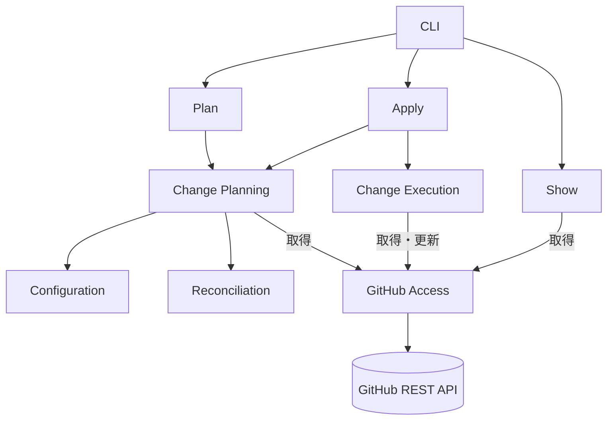

# アーキテクチャ設計

## 1. 目的と設計方針

本ドキュメントは、[要求定義](../spec/requirements.md) を実現する reco の論理構成、責務と依存関係、情報の流れ、変更計画と実行制御、安全な GitHub 設定更新の方式を定めます。CLI の操作形式（[CLI 仕様](../spec/cli.md)）、YAML の入力契約（[YAML 設定仕様](../spec/configuration.md)）、GitHub REST API の個別パラメータは重複して定義せず、構造と実現方式の判断に必要な範囲だけ扱います。概念の意味は [ドメインモデル](domain.md) に従います。

設計では、次の選択を重視します。

- **明示された範囲の管理**：設定宣言で管理する値と、API 操作に必要な未管理値を区別する。
- **判断の分離**：観測、照合、適用可能性、更新結果の確認を別の判断として扱う。
- **承認と実行の一貫性**：変更計画を承認と更新の基礎とし、全対象の事前検証と各更新直前の前提確認を設ける。
- **結果の確実性**：API 応答と期待状態の確認を混同せず、異常時は後続の更新を停止する。
- **最小限の構成**：単一プロセスで逐次実行し、専用の永続状態管理や自動ロールバックを設けない。

## 2. システム構成と責務

### 2.1 論理構成

reco の処理は、CLI から起動される `plan`・`apply`・`show` の各操作を起点に構成します。`plan` と `apply` は同じ変更計画の生成処理を利用しますが、承認と更新は `apply` だけが担います。`show` は設定宣言や変更計画を使わず、GitHub の設定を観測します。

図の矢印は主な呼び出し方向を示します。`Plan`・`Apply`・`Show` はコマンド解析ではなく、各操作の調整と、その結果の表示の整形を担います。`Change Planning` は共有の計画生成、`Change Execution` は承認済み計画の実行を担います。

| 領域 | 主な責務 | 境界 |
|---|---|---|
| CLI | コマンド・オプションと実行環境の解釈、認証情報の選択、出力先の受け渡し、対話承認の入出力、終了コード | 設定の照合、変更計画や更新順序の判断は行わない |
| Plan | `Change Planning` を起動し、得られた変更計画・適用可否を利用者へ提示する操作を調整する | 承認と更新を行わない |
| Apply | `Change Planning` を起動し、全対象の事前検証結果を確認して承認を要求し、承認後に `Change Execution` を開始して結果を集約する | 変更計画を独自に再生成せず、GitHub API の更新を直接呼び出さない |
| Show | 指定リポジトリの設定を観測し、取得できた値を表示する操作を調整する | 設定宣言、照合、変更計画、更新を利用しない |
| Change Planning | Configuration による設定宣言の検証、対象選択、リポジトリ ID の取得、必要な観測、照合と適用可能性の判断、変更計画の生成 | 対話承認や書き込みを行わない |
| Change Execution | 承認済み計画に従う各更新直前の前提確認、逐次更新、更新後の再観測と期待状態・変更対象外の設定の確認、停止と結果の判定 | 承認内容や管理範囲を黙って変更しない |
| Configuration | YAML 全体の解析・入力検証、設定宣言への変換 | GitHub 上の実在性・権限確認を行わない |
| Reconciliation | 管理範囲内の期待状態と観測結果の意味的な比較 | API 通信、適用可能性・更新順序の判断を行わない |
| GitHub Access | GitHub API 通信、リポジトリと設定の観測、API 操作への変換、応答・取得制約・失敗の解釈 | CLI の操作規則、管理範囲や変更可否の判断を行わない |

`GitHub Access` の取得機能は `Plan`・`Apply`・`Show` から間接的または直接的に利用します。一方、更新機能へ進む経路は `Apply` から `Change Execution` を経るものに限定します。`Configuration` と `Reconciliation` は HTTP や GitHub API の応答形式に依存せず、`GitHub Access` は YAML の階層を照合規則として利用しません。

### 2.2 対象の同一性・認証・信頼境界

Change Planning は Configuration に設定宣言全体を検証させてから、宣言内から利用者が指定した対象を選び、選択対象についてだけ GitHub Access から実体と設定を取得します。選択されていない宣言のリポジトリ ID や実在性は確認しません。

リポジトリ名は対象を指定するための情報であり、GitHub が返すリポジトリ ID と同一ではありません。Change Planning は選択された対象の ID を観測時に取得し、Change Execution は各更新直前の再確認に対象の ID も含め、承認した対象と異なるリポジトリへ名前解決された場合は更新しません。これにより、承認後の名前変更・移転・名前の再利用による誤対象更新を検出する機会を設けます。ただし、確認と書き込みの間の競合まで排除するものではありません。なお、異なる名前が同じ実体を指すかどうかは計画時に判定しません。名前変更前の名前で参照すると、GitHub API はリダイレクト応答を返します。reco はこれを観測操作の失敗として扱います（5.2節）。

この確認は、リポジトリ ID について二つの前提を置きます。一つは、名前変更や移転で ID が変わらないことです。名前変更の前後で変わらないことは確認済みです（[GitHub リポジトリ API 仕様](../research/repositories.md) 2章）。もう一つは、ある実体の ID が別の実体に割り当てられないことです。GitHub は名前の再利用への対策として ID を含む OIDC の subject クレームを導入していますが、REST API の `id` について再割り当てがないとは明記していません。reco はこの二つを前提として置きます。一つ目が崩れると、正当な対象を同一でないと判定して停止します。この誤りは安全側です。二つ目が崩れると、名前の再利用による誤対象を検出できません。

関連リソースも名前で指定します。関連リソースが属する先のリポジトリは、上記のリポジトリ ID で確かめます。関連リソースそのものが承認したときと同じ実体かどうかを確かめられる範囲は、GitHub がその種類に ID を付けるかどうかで変わります（[ドメインモデル](domain.md) の関連リソースの同一性）。ID を観測でき、作り直しによって ID が変わることを確かめられた種類では、Change Execution が更新直前の再確認に関連リソースの ID を含めます。確かめられていない種類では、名前と観測した値だけで確かめます。Environment は、一覧と個別取得の応答が ID を含み、同じ名前で作り直すと ID が変わることを確かめた種類です（[GitHub デプロイ環境 API 仕様](../research/deployment-environments.md)）。

CLI が選択した認証情報だけを GitHub Access へ渡します。認証に失敗しても別の認証情報へ切り替えず、認証トークン・認証ヘッダーを出力しません。GitHub の応答や通信エラーを診断に利用する場合も、秘密情報を含む生データを無条件に表示しない境界を設けます。`401`、`403`、`404` などの応答は区別しますが、権限不足と不存在を根拠なく断定しません。

対象が個人アカウント所有であることは利用者が守る前提とし、認証主体と所有者の一致検査は設けません。実際のアクセス可否はトークンの権限と GitHub の制約に従います。

| Relationship | Target | Target Type |
|---|---|---|
| `alignment` | `FR-002` | Functional Requirement |
| `alignment` | `FR-003` | Functional Requirement |
| `alignment` | `FR-010` | Functional Requirement |
| `alignment` | `QR-001` | Quality Requirement |
| `alignment` | `INV-004` | Invariant |
| `grounding` | [GitHub REST API 共通仕様](../research/rest-api.md) | Repository File |
| `grounding` | [GitHub リポジトリ API 仕様](../research/repositories.md) | Repository File |
| `grounding` | [GitHub デプロイ環境 API 仕様](../research/deployment-environments.md) | Repository File |

### 2.3 package の分け方

Go の package は、2.1節の領域を次の考え方で分けます。

- 操作 (Plan、Apply、Show) は、操作ごとに package を分ける。各操作の処理の流れと表示は、[CLI 仕様](../spec/cli.md) の操作ごとの規定に従って別々に変わるため
- 複数の操作が共有する領域は、操作の package の外に置く。操作の package を呼び出すのは CLI だけ (2.1節) のため
- 同じ要求の変更で一緒に変わる領域は、同じ package に置く。たとえば照合の規則は変更計画と一緒に変わるため、Reconciliation は Change Planning と同じ package に置く
- Change Execution は Apply と同じ package に置く。承認済み計画を実行する経路を Apply に限定し、ほかの操作から更新機能へ進む依存を作らないため
- 四つの文脈が共有する語（[ドメインモデル](domain.md) 4.9節）は、どの文脈の package にも依存しない package に置き、文脈ごとの判断を持ち込まない。宣言と観測が同じ定義を使い、片方だけが変わることを防ぐため
- 関連リソースの種類と名前による識別は、設定の識別と同じ package に置く。どの管理の単位を指すかは四つの文脈が共有する語であり、リポジトリ設定と関連リソースで識別の置き場を分けると、管理の単位を並べる順や設定の領域との対応を二か所で持つことになるため。値を持つ種類（Variable）の存在することと存在しないことの表現も、期待値と観測結果を同じ判定で比べるため、設定の値と同じ package に置く。値を持たない種類（Environment）では、存在することの期待値は管理の単位の形が表し、値の表現を置かない。関連リソースの観測結果（存在する、存在しない、観測不能）と GitHub が付ける ID は、観測の文脈の package に置く。管理の単位は、形を表す設定の識別と、関連リソースの名前の組で識別する。リポジトリ設定は名前を持たない。名前を設定の識別の文字列に埋め込まないのは、名前が `.` を含み得るため、`a.deployment_branch_policy` という名前の Environment の存在と、`a` という名前の Environment の `deployment_branch_policy` を区別できなくなるため。名前の同一判定（[ドメインモデル](domain.md) 4.8節の同一性を判定できる名前）も、名前と同じ package に置く
- reco が観測するが宣言を受け付けない設定の値（Environment の保護設定）も、設定の値と同じ package に置く。宣言を受け付けるようになったときに、観測と宣言が同じ定義を使うため
- 複数の操作が同じ形で示す表示のうち、変更計画の概念で決まるもの（変更計画の表示。リポジトリごとの節、変更予定の行、`Side effect:`、集計）は、操作の package の外の一つの package に置く。Plan と Apply が同じ変更予定を別々の形で示すことを防ぐため。この package は変更計画に依存するため、Show からは使わない
- 観測不能をどう示すかは、操作ごとの表示が決め、観測不能という概念と表示の文言を一つに結び付けない。同じ観測不能でも、利用者がその場面で知りたいことが操作ごとに違うため（示し方は [CLI 仕様](../spec/cli.md)）

package 間の依存の制約は、`scripts/golangci-lint/.golangci.yml` の depguard 規則で検査します。

## 3. 情報の流れと変更計画

### 3.1 設定宣言と管理範囲

Configuration は YAML 全体の構文・型・重複・設定間の組み合わせを検証し、明示された期待状態を設定宣言（Configuration Declaration）として渡します。管理範囲（Management Scope）は、期待状態が宣言された設定から導出します。省略と、明示的な `false`・空配列を区別し、関連設定が一体で意味を持つ場合はその完全性を入力時に確認します。関連リソースは、宣言された名前のものだけを管理範囲に入れます。存在しないことの宣言は、その名前を管理範囲に入れたうえで、期待値を存在しないこととします。名前の省略と区別します。

入力契約に適合することは、GitHub に適用可能であることを意味しません。GitHub の権限・現在状態・更新条件の判断は、対象の観測後に行います。

| Relationship | Target | Target Type |
|---|---|---|
| `alignment` | `FR-001` | Functional Requirement |
| `alignment` | `INV-001` | Invariant |

### 3.2 観測・照合・適用可能性

GitHub Access は取得値に加え、どの設定を確認できたか、GitHub の取得条件により確認できない項目は何かを観測結果（Observation Result）として表します。認証・権限・通信などによる観測操作の失敗は、取得条件による観測不能とは区別し、正常な観測結果として扱いません。

API の成功応答を受け取ったことだけでは、必要な設定値を確認できたとは判断しません。必要なフィールドが得られない場合、GitHub の既知の取得条件による観測不能と根拠をもって分類できるときに限り、観測結果にその理由を記録します。読み取り要求の成功応答に期待するこの形を **取得契約** と呼びます。本文を解釈でき、観測に必要なフィールドが、既知の取得条件による欠落を除いてそろっていることです。理由を確認できない欠落や解釈できない本文のように、取得契約に適合しない応答は観測操作の失敗として扱います。欠落した値を既定値で補ったり、理由を推測して比較不能へ置き換えたりしません。

トークン所有者が Write 以上のロールを持たないリポジトリでは、`GET /repos/{owner}/{repo}` の応答から `allow_auto_merge` と `delete_branch_on_merge` がそろって欠けます（[GitHub リポジトリ API 仕様](../research/repositories.md) 1.1）。この欠落は取得条件による観測不能として扱わず、観測操作の失敗のままとします。原因は権限の不足であり、ドメインモデルは権限による失敗を観測結果に含めないためです。観測不能として `plan` を進めても、同じ権限では更新できず、利用者が対処すべき原因が後の失敗まで見えなくなります。

リポジトリ ID を返す `GET /repos/{owner}/{repo}` は General の値も返すため、どの観測も General を含みます。Workflow permissions の応答はリポジトリ ID を含まないため（[GitHub Actions 権限 API 仕様](../research/actions-permissions.md) 5.1）、Workflow permissions は別の読み取り要求で読み、その要求は `GET /repos/{owner}/{repo}` が成功したときだけ送ります。いずれかの要求が失敗すれば観測操作の失敗であり、取得できた値だけの観測結果は作りません。

Actions の実行許可は、二つの読み取り要求で読みます。`GET /repos/{owner}/{repo}/actions/permissions` は `GET /repos/{owner}/{repo}` が成功したときだけ送ります。`GET /repos/{owner}/{repo}/actions/permissions/selected-actions` は、Actions 許可ポリシーを `selected` と観測したときだけ送ります。それ以外のときは GitHub が取得を拒否するためです（[GitHub Actions 権限 API 仕様](../research/actions-permissions.md) 4章）。一回の観測で複数の設定の領域を読むときは、General、Actions の実行許可、Workflow permissions、リポジトリ外のワークフローからのアクセス、Environments の順に読み取り要求を送ります。

リポジトリ外のワークフローからのアクセスは、`GET /repos/{owner}/{repo}/actions/permissions/access` で読みます。この要求は、`GET /repos/{owner}/{repo}` の応答の `private` が真のときだけ送ります。公開リポジトリには設定が適用されず、GitHub が取得を拒否するためです（[GitHub Actions 権限 API 仕様](../research/actions-permissions.md) 6章）。送るかどうかは `private` の観測値で決め、取得の `422` から公開であることを推測しません。権限のない公開リポジトリには `403` が返り、`422` が公開範囲だけを理由に返るとは確かめられていないためです。個人アカウント所有のリポジトリは internal の公開範囲を持たないため、`private` の真偽で足ります（[GitHub リポジトリ API 仕様](../research/repositories.md) 3章）。`private` は、どの設定の領域を読む観測でも取得契約に含め、欠けた応答は取得契約に適合しない応答とします。欠けた `private` を公開とみなすと、取得条件による観測不能を根拠なく作るためです。

関連リソースが存在しないことは、その種類の一覧の成功応答に名前がないことで確かめます。名前を指定した取得に対する `404` は、権限の不足でも返り得るため、存在しないことの確認に使いません。一覧は全ページを読みます。途中のページの読み取りが失敗した場合は観測操作の失敗であり、読めたページだけの観測結果は作りません。読めた範囲に名前がないことから、存在しないとは判断しません。一覧の成功応答が、その種類の関連リソースをすべて含むことも、種類ごとに実際の動作で確かめます。一覧に名前があるかどうかは、GitHub がその種類で名前を同じとみなす規則（大文字と小文字を区別するかなど）で判定します。この規則を実際の動作で確かめていない種類では、一覧に名前がないことから存在しないとは判断しません。規則を誤ると、存在する関連リソースを存在しないと判断し、作成の要求で上書きし得るためです。

Environment では、一覧について次を実際の動作で確かめています（[GitHub デプロイ環境 API 仕様](../research/deployment-environments.md)）。一覧の成功応答は、確かめた件数の範囲で、作成と削除の直後も含めて、存在する Environment をすべて含みました。GitHub は Environment の名前を、ASCII の英字の大文字と小文字を区別せずに同じ名前とみなし、応答の名前には作成したときの綴りを返します。GitHub は、アクセントの有無、ASCII 以外の文字の大文字と小文字、全角と半角、末尾の空白、制御文字の違いも同じ名前とみなしました。一方、印字可能な ASCII 文字の記号や空白を加えた名前は、確かめた範囲で別の名前でした。ページを分けたときの応答（`total_count` と、`Link` ヘッダーが示す URL の形）も確かめています。

GitHub の同一判定のすべてを reco は再現できないため、宣言の名前は同一性を判定できる名前（印字可能な ASCII 文字だけからなり、前後に空白を持たない名前）に限ります（[YAML 設定仕様](../spec/configuration.md) 7.1節）。宣言の名前と一覧の名前の突き合わせと、それによる存在の観測結果は、[ドメインモデル](domain.md) 4.8節の同一性を判定できる名前と存在の観測に従います。この判定は、一覧から名前で Environment を引く一つの関数に閉じ、呼び出し側が一覧を綴りで探しません。一覧に、大文字小文字を区別せずに同じ名前が二つ以上あれば、取得契約に適合しない応答とします。GitHub は二つを同じ Environment とみなすはずであり、どちらを照合し更新するかが決まらないためです。個別パターンの重複と同じ扱いで、`show` も観測操作の失敗で止まります。

一覧は、`per_page` に上限の `100` を、`page` に `1` から順の番号を付けて読みます。応答の `total_count` を全件数とし、読んだ要素の数が `total_count` に達したら読み終えたとします。達するまでは次のページを読み、次の場合は観測操作の失敗とします。

- 要素が一つもないページを、全件に達する前に受けた
- 読んだ要素の数が `total_count` を超えた
- `total_count` が、同じ一覧の1ページ目と異なった
- 100ページを読んでも全件に達しない
- `total_count` か要素の配列が欠けた

件数が食い違う一覧は、読んでいるあいだに関連リソースが増減した可能性があり、ページの境目で要素を読み落とし得るためです。件数が変わらない入れ替わり（1件が消え、1件が増えた）は検出できません。次のページへの要求は、reco が組み立てた `/repos/{owner}/{repo}/...` の URL にだけ送り、応答の `Link` ヘッダーは読みません。`Link` の URL は `/repositories/{repository_id}/...` の形で reco が組み立てる URL と異なり（[GitHub デプロイ環境 API 仕様](../research/deployment-environments.md) 3.1）、たどると送信先を応答の内容に委ねることになるためです（5.2節）。ページ数の上限は、異常な応答で要求を送り続けないためのものです。

Environments は、`GET /repos/{owner}/{repo}/environments` の全ページで読みます。一覧の要素は個別取得の本文と全フィールドが一致するため（GitHub デプロイ環境 API 仕様 3.1）、Environment ごとの個別取得は送りません。デプロイ元制限の方式は `deployment_branch_policy` から決めます。`null` は `all`、`protected_branches` だけが真なら `protected_branches`、`custom_branch_policies` だけが真なら `selected` です。両方が同じ値の組は GitHub が更新で受け付けないため（同 1章）、取得で受けたら取得契約に適合しない応答とします。

個別パターンは、`GET /repos/{owner}/{repo}/environments/{environment_name}/deployment-branch-policies` の全ページで読みます。この要求は、方式を `selected` と観測した Environment にだけ、一覧の並びで送ります。`selected` でないときは GitHub が `404` を返すためです（[GitHub デプロイ元パターン API 仕様](../research/deployment-branch-policies.md) 1章）。`selected` と観測したあとの失敗は、`404` を含めて観測操作の失敗とします。Environment の名前は、パスの1要素としてエスケープして送ります。`.` と `..` はエスケープしても別の経路を指すため、その名前の Environment の個別パターンは読まず、観測操作の失敗とします。

`plan` と `apply` も、`show` と同じく、宣言に名前のない Environment を含めて、方式を `selected` と観測したすべての Environment の個別パターンを読みます。そのどれかの読み取りに失敗すれば、宣言した Environment の計画も観測操作の失敗で止まります。宣言した Environment に限ると、観測結果に「方式は `selected` だが個別パターンを読んでいない」状態が要り、その状態を空集合と取り違えると、存在する個別パターンを加わる側に数えた計画を作り得るためです。

Environments に、取得条件による観測不能はありません。非公開リポジトリでも一覧と個別パターンを取得できたためです（GitHub デプロイ環境 API 仕様 1.1）。Environment の取得契約は、`id`、`name`、`deployment_branch_policy`、`protection_rules`、`can_admins_bypass` がそろうことです。`can_admins_bypass` は公式のスキーマにありませんが、常に返ることを確かめています（同 3.2）。保護ルールは `type` で読み分け、`wait_timer` と `required_reviewers` の値を読みます。それ以外の `type` の要素は読みません。個別パターンの取得契約は、`id`、`name`、`type` がそろい、`type` が `branch` か `tag` であることです。

関連リソースの一覧は、その種類が属する設定の領域を読み取る観測でだけ読みます。`show` は reco が観測するすべての種類の一覧を読み、`plan` と `apply` は宣言された設定の領域の一覧だけを読みます。別の関連リソースに属する関連リソースは、属する先が存在すると確かめたときだけ読み、存在しないときは、属する先が存在しないことを理由とする観測不能とします。

取得条件による観測不能として扱うのは次の三つです。

| 取得条件 | 観測不能になる設定 | 根拠 |
|---|---|---|
| Actions が無効（`enabled: false`） | Actions 許可ポリシー、`sha_pinning_required`、選択方式の Actions 許可条件 | 応答に `allowed_actions` が含まれず、`sha_pinning_required` は保存された値によらず `false` で返る（GitHub Actions 権限 API 仕様 3.1） |
| Actions 許可ポリシーが `selected` でない | 選択方式の Actions 許可条件 | 取得が `409` を返し、値は返らない（GitHub Actions 権限 API 仕様 4章） |
| リポジトリが公開（`private: false`） | `access_level` | 公式資料が非公開リポジトリにだけ適用されると記載し、公開リポジトリへの取得は `422` を返して値を返さない（GitHub Actions 権限 API 仕様 6章） |

Actions の有効状態は取得条件を持たず、`GET /repos/{owner}/{repo}/actions/permissions` の応答が取得契約に適合すれば必ず観測値になります。Actions の有効状態だけを管理設定とするリポジトリでも、計画時の観測は Actions の実行許可を読み取ります。

Actions が有効のときに `allowed_actions` または `sha_pinning_required` が欠けた応答と、3項目のいずれかが欠けた Selected actions の応答は、取得契約に適合しない応答です。`sha_pinning_required` と Selected actions の3項目は公式ドキュメント上は任意のフィールドですが、欠落の理由を確認できないため、既定値で補いません。`selected` と観測したあとの Selected actions の取得が `409` を返した場合も、観測不能にせず観測操作の失敗とします（[ドメインモデル](domain.md) の現在状態・観測結果・観測失敗）。

`access_level` の取得条件は公開範囲だけです。Actions が無効のリポジトリでも取得は値を返すため（GitHub Actions 権限 API 仕様 6章）、Actions の有効状態は取得条件になりません。定義にない `access_level` の値と、`access_level` の欠けた応答は、取得契約に適合しない応答です。非公開と観測したあとの取得が `422` を返した場合も、観測不能にせず観測操作の失敗とします。

Reconciliation は管理範囲内の期待状態と観測結果を比較し、一致（Match）、不一致（Mismatch）、比較不能（Not Comparable）を返します。比較可能な集合値は設定の意味に沿って比較し、例えば許可パターンは要素の順序だけで差分を作りません。Change Execution が変更前提、更新後の期待状態、変更対象外の設定を比べるときも、同じ判定を使います（[ドメインモデル](domain.md) の設定の値）。未観測値を既定値で補わず、観測操作の失敗を比較不能として処理しません。比較不能にするのは、管理設定の観測結果が取得条件による観測不能のときだけで、その理由をそのまま管理設定の計画に持たせます。関連リソースが存在するかどうかも同じ判定で比べ、存在しないと確かめた関連リソースを、存在することを期待値とする宣言と比べた結果は不一致です。

Change Planning は照合とは別に適用可能性（Applicability）を判断します。不一致でも適用不能な場合があり、比較不能でも必要な条件を確認できれば適用可能な場合があります。照合結果だけから適用可否を導出せず、変更予定ごとの計画時の観測結果と期待値、同じ対象リポジトリのほかの管理設定の期待値から、API の前提条件と未管理設定への影響を考慮して判断します。適用不能になる条件は 5.4節が定めます。5.4節に挙げた遷移の変更予定は、その条件に当たらない限り、比較不能を含めて適用可能です。

| Relationship | Target | Target Type |
|---|---|---|
| `alignment` | `FR-004` | Functional Requirement |
| `alignment` | `FR-005` | Functional Requirement |
| `alignment` | `FR-006` | Functional Requirement |
| `alignment` | `QR-002` | Quality Requirement |
| `grounding` | [GitHub リポジトリ API 仕様](../research/repositories.md) | Repository File |
| `grounding` | [GitHub Actions 権限 API 仕様](../research/actions-permissions.md) | Repository File |
| `grounding` | [GitHub デプロイ環境 API 仕様](../research/deployment-environments.md) | Repository File |
| `grounding` | [GitHub デプロイ元パターン API 仕様](../research/deployment-branch-policies.md) | Repository File |

### 3.3 変更計画と実行単位

Change Planning は設定宣言、観測結果、照合結果、適用可能性を組み合わせ、変更計画（Change Plan）を生成します。計画は確認済み差分と比較不能な設定予定を区別し、適用可否と理由、承認する変更内容、実行に必要な前提条件・操作順序を保持します。更新によって影響を受け得る未管理設定がある場合は、その保全に必要な既存値や確認条件も実行時に利用できるようにします。変更に伴う副作用は、副作用を生む変更予定に、失われる設定と、その設定の計画時の観測結果（観測値か、理由を伴う観測不能）として持たせます。再開する設定（[ドメインモデル](domain.md) の照合結果と適用可能性）は、Actions を有効にする変更予定に、設定の並びとして持たせます。論理的な設定変更には、それを構成する更新操作ごとに、変更前提で比べる関係する現在値の設定と、その承認時に予定した値（設定の値か、理由を伴う観測不能）の並びを持たせます。並びは Change Planning が導き、Change Execution は並びを更新直前の観測と比べるだけで、何を比べるかを決めません。何が関係する現在値に当たるか（[ドメインモデル](domain.md) の承認と変更前提）は、変更計画の内容（どの遷移か、どの副作用を示したか）で決まるためです。適用不能な項目も表示のために残しますが、実行可能な操作にはしません。関連リソースの作成と削除は、変更予定にその種別を持たせ、設定の値の変更と区別して表示できるようにします。値を持たない Environment では、関連リソースそのものの管理設定の不一致が、そのまま作成に当たります。削除の変更予定には、失われる値として、計画時の観測値を持たせます。作成の更新操作には「存在しないこと」を、削除の更新操作には「存在し、値が計画時の観測値と同じこと」を、承認時に予定した値として持たせます。存在する関連リソースの中の設定を変える更新操作には、その関連リソースが「存在し、ID が計画時と同じこと」（ID を観測できる種類に限る）を、中の設定の計画時の観測値より先に並べます。一致を確認した設定には更新を予定しません。

| 単位 | 設計上の意味 |
|---|---|
| 管理設定 | 利用者が期待値を明示した管理の単位。管理対象かどうかの基準 |
| 論理的な設定変更 | 利用者が意図する変更内容と、完了を判断する期待状態とが対応する変更の単位 |
| 更新操作 | 論理的な設定変更を実現する GitHub への個々の更新要求。個別の前提条件と応答を持つ |
| 対象リポジトリ | 一回の実行で選択されたリポジトリ。複数の変更を含み得る |

管理設定、論理的な設定変更、更新操作は一対一とは限りません。たとえば選択方式の Actions 許可条件は3項目を一体として扱い、Actions 許可ポリシーの変更を必要とする場合は、関連する更新操作を順序と前提条件を持つ一つの論理的な設定変更として計画します。どの変更予定をまとめるかと更新操作の順序は、5.4節の遷移表に従って Change Planning が決めます。一方、独立して管理できる設定を、API エンドポイントや YAML の階層だけを理由に一つの管理の単位へまとめません。複数の管理設定を一つの更新操作へまとめる場合も、承認した値と完了確認の範囲が不明確にならないことを条件とします。一覧の全体を値とする設定で、GitHub が要素ごとの追加と削除の要求だけを受け付ける場合は、その設定の変更予定を、要素ごとの更新操作を並べた一つの論理的な設定変更として計画します。属する先の関連リソースの作成は、それに属する関連リソースや中の設定の変更より先に実行します。

変更計画は当該実行のために作る一時的な情報です。過去の `plan` 結果や保存済みの計画を、`apply` の実行指示として使用しません。

| Relationship | Target | Target Type |
|---|---|---|
| `alignment` | `FR-006` | Functional Requirement |
| `alignment` | `FR-007` | Functional Requirement |
| `alignment` | `FR-011` | Functional Requirement |

## 4. 計画生成と実行制御

### 4.1 全対象の事前検証

`plan` と `apply` は Change Planning を共有します。Change Planning は設定宣言全体の検証、対象選択、リポジトリ ID の取得、必要な観測、照合、適用可能性の判断、変更計画の生成を行います。Apply は選択されたすべての対象について入力不正・観測操作の失敗・適用不能な変更が残っていないことを確認するまで、承認や更新へ進みません。

Change Planning は、選択された対象を設定宣言の `repositories` の並びで一つずつ観測し、並列には観測しません。GitHub はセカンダリのレート制限を避けるため、要求を並行させず逐次に送るよう推奨しており（[GitHub REST API 共通仕様](../research/rest-api.md) 5章）、観測の順を宣言の並びに揃えると、変更計画の並びと打ち切りの位置を利用者が宣言から読み取れるためです。

問題の種類によって、検証を打ち切る時点が異なります。入力不正は、GitHub へ問い合わせる前に設定宣言全体を検証して報告します。観測操作に失敗した場合は、その時点で検証を打ち切り、残りの対象を観測せず、観測できた対象だけの変更計画も作りません。適用不能な変更は、選択された全対象の判断を終えてから、対象と理由をまとめて報告します。

この事前検証は、GitHub の状態や権限が承認後も変わらないこと、あるいは更新が成功することを保証しません。変更直前に改めて前提を確認する理由は、この時間差にあります。

| Relationship | Target | Target Type |
|---|---|---|
| `alignment` | `FR-001` | Functional Requirement |
| `alignment` | `FR-002` | Functional Requirement |
| `alignment` | `FR-008` | Functional Requirement |
| `alignment` | `INV-002` | Invariant |
| `grounding` | [GitHub REST API 共通仕様](../research/rest-api.md) | Repository File |

### 4.2 読み取り専用操作

Plan は Change Planning で得られた変更計画と適用可否を表示し、GitHub の設定を更新しません。Show は設定宣言や照合・変更計画を使わず、GitHub Access で指定リポジトリを観測して結果を表示します。いずれも、確認できた情報と取得条件による観測不能を区別し、観測操作の失敗を正常な結果として表示しません。区別の表し方は操作ごとの表示が決めます（2.3節）。

| Relationship | Target | Target Type |
|---|---|---|
| `alignment` | `FR-004` | Functional Requirement |
| `alignment` | `FR-007` | Functional Requirement |

### 4.3 `apply` の更新境界

Apply と Change Execution は次の境界を順に通過します。

1. 全対象の事前検証を完了する。問題が残る場合は承認・更新へ進まない。
2. 変更が不要と確認できた場合は、承認も書き込みも行わない。
3. Apply は確認済み差分と比較不能な設定予定を区別して提示し、CLI を通じて明示的な対話承認を得る。承認できなければ Change Execution を開始しない。承認の入力を読めても、承認待ちのあいだに中断を受けていれば Change Execution を開始しない。承認は、選択した全対象の変更計画に対して一度だけ求める。
4. Change Execution は承認した論理的な設定変更を構成する各更新操作の直前に、対象 ID、必要な現在値、適用条件を再確認する。先行操作により予定された状態変化を考慮し、前提に関係する予定外の変化や確認不能な条件があれば、計画を黙って変更せず停止する。
5. 更新操作を逐次実行する。先行する更新操作の成功を確認できた場合だけ、同じ論理的な設定変更の次の更新操作に進む。必要な更新操作の後、その論理的な設定変更全体の期待状態を再観測し、影響を受け得る変更対象外の設定が更新直前の値から変わっていないことも確認する。
6. 論理的な設定変更全体の完了が確認できた場合だけ、次の論理的な設定変更を開始する。更新操作の失敗・成否不明・前提不成立・再観測失敗・変更対象外の設定の予期しない変化を検出した場合は、後続の更新を開始しない。開始しなかった論理的な設定変更には、変更前提の確認のための読み取り要求も送らない。次の論理的な設定変更が別の対象リポジトリのものである場合も同じである。Change Execution は対象リポジトリを設定宣言の `repositories` の並びで一つずつ処理し、変更不要の対象リポジトリには要求を送らない。

Apply は承認された変更計画を Change Execution に渡し、Change Execution だけが GitHub Access の更新機能を呼び出す構成とします。CLI、Plan、Show、Change Planning は更新機能を呼び出しません。複数リポジトリでも更新を並列化せず、既に実施した操作の自動的な取り消しは行いません。

| Relationship | Target | Target Type |
|---|---|---|
| `alignment` | `FR-008` | Functional Requirement |
| `alignment` | `FR-009` | Functional Requirement |
| `alignment` | `FR-010` | Functional Requirement |
| `alignment` | `FR-011` | Functional Requirement |
| `alignment` | `FR-012` | Functional Requirement |
| `alignment` | `INV-002` | Invariant |
| `alignment` | `INV-003` | Invariant |
| `alignment` | `INV-004` | Invariant |
| `alignment` | `INV-005` | Invariant |

## 5. GitHub API との境界

### 5.1 外部契約の吸収

GitHub Access は GitHub REST API の応答やエラーを、reco が扱う観測結果、更新操作の結果、失敗情報に変換します。利用する REST API のバージョン（`2026-03-10`）を明示し、取得条件・権限・必須フィールドなどの制約も提供します。未管理設定の値は推測して補完しません。

### 5.2 HTTP 通信とリダイレクトの信頼境界

GitHub Access は、認証付きリクエストの送信先を GitHub.com の REST API オリジン `https://api.github.com` に限定します。GitHub API が HTTP リダイレクト応答を返した場合は、HTTP メソッドを問わず追従せず、エラーとして呼び出し元へ伝えます。リダイレクト先の `Location` を利用した通信や自動再送は行いません。

読み取り要求へのリダイレクトは観測操作の失敗であり、取得条件による観測不能とは扱いません。更新成功後の状態確認に使う GET で発生した場合も、更新操作の成功と期待状態の確認失敗を区別します。更新要求へのリダイレクトは、応答を受け取っただけでは GitHub 上の副作用がなかったと確定できないため、更新操作の成否不明として扱います。Change Execution は後続の更新を停止し、いずれの場合も CLI はエラー終了します。

リダイレクト先への認証情報の漏えいや意図しない更新を防ぐため、追従可否の例外判定は設けません。エラーの診断には、認証情報や秘密情報を含む URL、ヘッダー、本文の無条件な出力を使用しません。リポジトリの同一性は、リダイレクト先の URL ではなく GitHub から確認したリポジトリ ID によって扱います。

| Relationship | Target | Target Type |
|---|---|---|
| `alignment` | `FR-003` | Functional Requirement |
| `alignment` | `FR-004` | Functional Requirement |
| `alignment` | `FR-010` | Functional Requirement |
| `alignment` | `FR-013` | Functional Requirement |
| `alignment` | `QR-001` | Quality Requirement |
| `alignment` | `QR-002` | Quality Requirement |
| `alignment` | `INV-004` | Invariant |
| `alignment` | `INV-005` | Invariant |
| `grounding` | [GitHub REST API 共通仕様](../research/rest-api.md) | Repository File |
| `grounding` | [GitHub リポジトリ API 仕様](../research/repositories.md) | Repository File |

### 5.3 未管理設定を保全する更新方式

API へ送信するフィールドは、設定宣言の管理範囲とは異なります。API の必須フィールドや未管理値を保全するために必要なフィールドを送信する場合でも、それらを新しい管理設定にはしません。

関連リソースを作成、変更、削除する更新要求は、宣言された名前の関連リソースだけを宛先にします。宣言されていない名前の関連リソースを宛先とする更新要求は、どの操作でも送りません。作成は、存在する関連リソースを上書きし得る要求になる場合も、更新直前の観測でその名前が存在しないと確かめたときだけ送ります。削除は、存在しないことを宣言された名前だけを宛先とし、更新直前の観測で、存在し、値が承認の前に示した値と同じと確かめたときだけ送ります。一覧の全体を置き換える更新エンドポイントや、複数の関連リソースをまとめて消す更新エンドポイントは使いません。同じ種類の別の名前の関連リソースは、更新後に更新直前の値と比べません。別の名前の関連リソースを変えないことは、種類ごとに実際の動作で確かめ、その確認結果を保全の根拠とします。

| 更新の対象 | 更新方式で守ること |
|---|---|
| General | 宣言された変更対象だけを送り、省略したフィールドの保持に依拠して部分更新する |
| Actions の有効状態 | `enabled` だけを送り、省略した `allowed_actions` と `sha_pinning_required` の保持に依拠して更新する |
| Actions 許可ポリシー | 必須の `enabled` には `true` を送り、`sha_pinning_required` など送らない値を変えないことを確認できる方式で更新する |
| 選択方式の Actions 許可条件 | 3項目を一体として扱い、Actions 許可ポリシーとの依存関係を考慮する |
| `sha_pinning_required` | 必須の `enabled` には、更新直前に有効と確かめたうえで `true` を送り、省略した `allowed_actions` の保持に依拠して更新する |
| Workflow permissions | 管理する値だけを送り、省略したもう一方のフィールドの保持に依拠して部分更新する |
| リポジトリ外のワークフローからのアクセス | `access_level` だけを送る。この更新エンドポイントで reco が観測する設定はほかになく、保全を確かめる設定がない |
| Environment | `deployment_branch_policy` だけを送り、省略した保護設定の保持に依拠して更新する。方式を宣言していない作成は本文を送らない |

API パラメータが任意であることは、省略した値の保持を保証しません。既存値を併送する場合も、その値を観測でき、更新直前の条件が成立する必要があります。省略・併送のどちらでも未管理値の保全を確認できないときは、更新を適用不能とします。保全の判断には、GitHub が公開する契約と確認できた実際の動作を区別して用い、実証されていない保持動作を前提にしません。

更新後は、同じ更新エンドポイントで reco が観測する設定のうち、その論理的な設定変更が変えないものについて、更新直前に確認した値との一致も確認します。管理設定か未管理設定かは問いません（[ドメインモデル](domain.md) の変更対象外の設定）。期待状態だけが一致していても、変更対象外の設定の予期しない変化を検出した場合は変更全体を完了扱いせず、後続の更新を停止します。取得条件によって更新後に再確認できない設定は、値を推測して保全済みとせず、事前に確認した外部契約や実動作の根拠が保全を支持する範囲でのみ適用可能と判断します。再取得した値の変化は外部主体の同時変更による可能性もあるため、原因を断定しません。更新操作の影響が、その論理的な設定変更が変えない、別の更新エンドポイントの設定に及ぶ場合は、変更に伴う副作用として 5.4節で扱い、この比較の対象にしません。

General では、`PATCH /repos/{owner}/{repo}` で省略したフィールドが保持されることを実際の動作で確認しています（[GitHub リポジトリ API 仕様](../research/repositories.md) 4章）。これが、宣言された変更対象だけを送る方式の根拠です。更新後に再取得して更新直前の値と比べるのは、reco が観測する General のうち、その論理的な設定変更が変えない設定です（`delete_branch_on_merge` を変える論理的な設定変更では `allow_auto_merge`）。名前、説明など、reco が読まないフィールドと、取得条件の判定にだけ読む公開範囲は再確認せず、保持の確認結果を根拠に保全されるとみなします。

Actions の有効状態では、`PUT /repos/{owner}/{repo}/actions/permissions` に `enabled` だけを送ります。省略した `allowed_actions` と `sha_pinning_required` が保持され、選択方式の Actions 許可条件も変わらないことを、無効にする更新と有効に戻す更新のどちらでも、公開・非公開のリポジトリで実際の動作により確認しています（[GitHub Actions 権限 API 仕様](../research/actions-permissions.md) 3.2・4章）。これが、`enabled` だけを送る方式の根拠です。無効にする更新では、更新後に Actions 許可ポリシーと `sha_pinning_required` が取得条件により観測不能になり（GitHub Actions 権限 API 仕様 3.1）、更新直前の値と比べられません。有効にする更新では、更新直前に同じ理由で観測不能で、比べる基準がありません。どちらの場合も、この確認結果を根拠に保全されるとみなします。無効にする更新が反映されず有効のままだった場合は、どちらも観測できるため、更新直前の値と比べます。

Actions 許可ポリシーでは、`PUT /repos/{owner}/{repo}/actions/permissions` で省略した `sha_pinning_required` が保持されることを実際の動作で確認しています（[GitHub Actions 権限 API 仕様](../research/actions-permissions.md) 3.2）。必須の `enabled` には `true` を送ります。`allowed_actions` の宣言は Actions が有効であることを期待状態に含むためです（[YAML 設定仕様](../spec/configuration.md) 4章）。`sha_pinning_required` は送りません。この更新要求は Actions の有効状態も書くため、Actions 許可ポリシーを変える論理的な設定変更は有効状態も変える設定に含め（[ドメインモデル](domain.md) の変更対象外の設定）、更新直前の値と比べません。更新後は `sha_pinning_required` を再取得し、更新直前の値と比べます。Actions が無効のときは `sha_pinning_required` の応答が保存された値を示さないため（GitHub Actions 権限 API 仕様 3.1）、更新直前の値と比べられません。この場合は、無効の状態から有効化と同時にポリシーを変えても `sha_pinning_required` が保持されるという確認結果（GitHub Actions 権限 API 仕様 3.2）を根拠に、保全されるとみなします。更新後に Actions が無効で `sha_pinning_required` を再取得できない場合は、この根拠に当たりません。期待値の Actions 許可ポリシーも同じ取得条件で観測不能になるため、期待状態の確認失敗として完了にしません。

選択方式の Actions 許可条件では、`PUT /repos/{owner}/{repo}/actions/permissions/selected-actions` に3項目をすべて送ります。3項目は一つの設定グループで、どれも期待値を持つためです。省略したフィールドが保持されることは実際の動作で確認していますが（[GitHub Actions 権限 API 仕様](../research/actions-permissions.md) 4章）、この方式は保持に依拠しません。空の許可パターンは、`null` の扱いが公開ドキュメントにないため、空の配列として送ります。この更新エンドポイントで reco が観測する設定は選択方式の Actions 許可条件だけのため、更新後に更新直前の値と比べる設定はありません。この更新が `allowed_actions` と `sha_pinning_required` を変えないことは、実際の動作で確認しています（[GitHub Actions 権限 API 仕様](../research/actions-permissions.md) 4.2）。

`sha_pinning_required` では、`PUT /repos/{owner}/{repo}/actions/permissions` に `enabled: true` と `sha_pinning_required` だけを送ります。省略した `allowed_actions` が保持され、選択方式の Actions 許可条件も変わらないことを、`allowed_actions` を `selected` にし、3項目を既定と異なる値にした状態で、公開・非公開のリポジトリで実際の動作により確認しています（[GitHub Actions 権限 API 仕様](../research/actions-permissions.md) 3.2）。これが、`allowed_actions` を送らない方式の根拠です。`allowed_actions` を併送しないのは、`selected` を送ると GitHub が `github_owned_allowed` を `true` に変えるためです。必須の `enabled` に送る `true` は既存値の併送に当たるため、更新直前の観測で Actions が有効であることを変更前提として確かめます（5.4節）。無効のリポジトリへこの更新要求を送ると、利用者が宣言していない有効化を reco が行うことになるためです。`sha_pinning_required` の期待値は Actions が有効であることを含まないため、Actions の有効状態はこの論理的な設定変更が変える設定に含めず、更新後に Actions 許可ポリシーとともに再取得して、更新直前の値と比べます。選択方式の Actions 許可条件は別の更新エンドポイントの設定のため更新後に比べず、上記の確認結果を根拠に保全されるとみなします。Actions 許可ポリシーと `sha_pinning_required` の両方に変更予定があるときも、一つの更新要求にまとめません。片方の期待状態だけが一致しなかったときに、どちらの変更が完了したかを分けて報告できなくなるためです。

Workflow permissions では、`PUT /repos/{owner}/{repo}/actions/permissions/workflow` で省略したフィールドが保持されることを、公開・非公開のリポジトリで実際の動作により確認しています（[GitHub Actions 権限 API 仕様](../research/actions-permissions.md) 5.2）。これが、管理する値だけを送る方式の根拠です。観測したもう一方の値を併送しないのは、観測から更新までのあいだに外部主体がその値を変えた場合に、古い値で上書きしてしまうためです。更新後に再取得して更新直前の値と比べるのは、`default_workflow_permissions` と `can_approve_pull_request_reviews` のうち、その論理的な設定変更が変えないほうです。2フィールドは Actions が無効のときも取得・更新でき（GitHub Actions 権限 API 仕様 5.1・5.2）、Actions の有効状態はこの方式の条件になりません。

リポジトリ外のワークフローからのアクセスでは、`PUT /repos/{owner}/{repo}/actions/permissions/access` に `access_level` だけを送り、`204` を正常応答とします。`access_level` は必須で、この更新エンドポイントで reco が観測する設定は `access_level` だけのため、更新後に更新直前の値と比べる設定はありません。送った値が直後の取得に反映されることと、Actions が無効のときも取得・更新できることは、実際の動作で確認しています（[GitHub Actions 権限 API 仕様](../research/actions-permissions.md) 6章）。

Environment では、`PUT /repos/{owner}/{repo}/environments/{environment_name}` に `deployment_branch_policy` だけを送ります。`all` は `null`、`protected_branches` は `protected_branches: true` と `custom_branch_policies: false` で表します。方式を宣言していない作成は本文を送りません。正常応答は作成も更新も `200` で、本文は個別取得と同じ形です。本文が Environment の取得契約を満たさない `200` と、ほかの `2xx`（`201` など）は、更新の契約の外として成否不明にします（6.1節）。方式を送る根拠は、次の実際の動作の確認です（[GitHub デプロイ環境 API 仕様](../research/deployment-environments.md) 4.1）。

- `deployment_branch_policy` だけの `PUT` で、`wait_timer`、`reviewers`、`prevent_self_review`、`can_admins_bypass` と、それらの保護ルールの `id` が変わらなかった
- 存在する名前への本文のない `PUT` は、何も変えなかった
- 方式の両方 `true` と両方 `false` は `422` で、値は変わらなかった

更新後に再取得して更新直前の値と比べるのは、その名前の Environment の保護設定（`wait_timer`、`required_reviewers`、`can_admins_bypass`）です。作成では更新直前に Environment が存在せず、比べる値がありません。reco が種類を知らない保護ルールは観測結果に含めず、比べません。別の名前の Environment は比べません。別の名前の Environment を作成、更新、削除した前後で、ほかの Environment が `updated_at` を含む全フィールドと個別パターンまで一致したこと（GitHub デプロイ環境 API 仕様 4.1）を根拠に、保全されるとみなします。

更新要求の宛先は、存在する Environment では、変更前提で ID を確かめた更新直前の観測の綴りにし、作成では設定宣言の綴りにします。GitHub は ASCII の英字の大文字小文字だけが違う名前を同じ Environment とみなすため（GitHub デプロイ環境 API 仕様 2章）、作成の変更前提の「存在しないこと」も、大文字小文字を区別せずに一覧と比べます。比べ方を誤ると、存在する Environment に作成の要求を送り、宣言した方式で上書きします。名前は、パスの一つの要素としてエスケープしてから宛先に入れます。エスケープしない `/` は別の経路への要求になるためです（GitHub デプロイ環境 API 仕様 2章）。

更新直前の観測と更新要求のあいだに、外部主体が同じ名前の Environment を作った場合は防げません。本文のない作成の要求は、存在する名前の Environment を何も変えません。方式を本文に含む作成の要求は、その Environment の方式を変え、それが `selected` だった場合は個別パターンを失わせます。

この方式が保護するのは reco 自身の更新操作による未管理設定の変更であり、外部主体による競合や GitHub 側の独立した変化ではありません。

| Relationship | Target | Target Type |
|---|---|---|
| `alignment` | `FR-006` | Functional Requirement |
| `alignment` | `FR-011` | Functional Requirement |
| `alignment` | `INV-001` | Invariant |
| `grounding` | [GitHub リポジトリ API 仕様](../research/repositories.md) | Repository File |
| `grounding` | [GitHub Actions 権限 API 仕様](../research/actions-permissions.md) | Repository File |
| `grounding` | [GitHub デプロイ環境 API 仕様](../research/deployment-environments.md) | Repository File |

### 5.4 非原子的な更新と中間状態

選択方式の Actions 許可条件の取得・更新には、Actions 許可ポリシー（`allowed_actions`）が `selected` であるという前提があります。`all` / `local_only` のときと Actions が無効のとき、GitHub は選択方式の Actions 許可条件の取得も更新も `409` で拒否します（[GitHub Actions 権限 API 仕様](../research/actions-permissions.md) 4章）。そのため `all` / `local_only` から `selected` へ変更する際は、Actions 許可ポリシーを先に更新するしかなく、二つの更新操作の間に中間状態が生じます。

Change Planning は、予定する中間状態、各更新操作の前提、未管理設定への影響を踏まえて実行可能性と順序を判断します。Change Execution は操作直前に、先行操作による予定どおりの変化と、外部からの予定外の変化を区別します。比較不能な選択方式の Actions 許可条件は推測しません。

宣言した遷移が、GitHub の仕様上避けられない影響（管理範囲外の値の消失や、一時的な中間状態）を伴う場合も、reco はそれを理由に利用者が宣言した遷移を止めません。適用不能とするのは、利用者が宣言していない設定を reco が変えなければ実行できない遷移と、更新のあとに期待状態を確かめる手段がなく、完了を確認できないことが計画の時点で決まっている変更です。前者は利用者の意図なしにセキュリティを下げ得るためで、後者は reco が完了を報告できない更新を送ることになるためです。

Actions 許可ポリシーの遷移は次の表に従います。遷移元は観測した現在値、遷移先は宣言した値です。Actions が無効のときは遷移元のポリシーが応答に含まれないため（GitHub Actions 権限 API 仕様 3.1）、遷移元を「無効」として扱い、照合結果は比較不能とします。

| 遷移元 | 遷移先 | 更新操作の順序 | 中間状態で取得できる値と取得できない値 | 適用不能になる条件 |
|---|---|---|---|---|
| `all` / `local_only` | もう一方 | (1) Actions 許可ポリシー | 中間状態はない | なし |
| `all` / `local_only` | `selected` | (1) Actions 許可ポリシー、(2) 選択方式の Actions 許可条件 | (1) の前は選択方式の Actions 許可条件を取得できない。(1) の後は取得でき、GitHub が戻した値（`github_owned_allowed: true`、`verified_allowed: false`、`patterns_allowed: []`）を返す | なし |
| `selected` | `selected`（3項目だけが異なる） | (1) 選択方式の Actions 許可条件 | 中間状態はない | なし |
| `selected` | `all` / `local_only` | (1) Actions 許可ポリシー | 中間状態はない。(1) の後は選択方式の Actions 許可条件を取得できない | なし。既存の選択方式の Actions 許可条件が失われることを変更計画に示す |
| 無効 | `all` / `local_only` | (1) Actions の有効化と Actions 許可ポリシー（一つの更新操作） | 中間状態はない。(1) の前は Actions 許可ポリシーと選択方式の Actions 許可条件を取得できない | なし。無効にする前のポリシーが `selected` なら選択方式の Actions 許可条件が失われ得ることを変更計画に示す。`sha_pinning_required` を宣言していなければ、無効にする前の値で再開することも示す |
| 無効 | `selected` | (1) Actions の有効化と Actions 許可ポリシー（一つの更新操作）、(2) 選択方式の Actions 許可条件 | (1) の前は Actions 許可ポリシーと選択方式の Actions 許可条件を取得できない。(1) の後は選択方式の Actions 許可条件を取得できる | なし。`sha_pinning_required` を宣言していなければ、無効にする前の値で再開することを変更計画に示す |

`all` / `local_only` / 無効から `selected` への遷移では、Actions 許可ポリシーと選択方式の Actions 許可条件の変更予定を、(1) と (2) をこの順に行う一つの論理的な設定変更にまとめます。完了を判断する期待状態は、Actions 許可ポリシーが `selected` で、選択方式の Actions 許可条件が宣言した値であることです。(2) の直前の変更前提に、Actions 許可ポリシーが `selected` であること（(1) による予定どおりの変化）を含めます。(1) の直後の取得が (1) の前のポリシーを返した場合の扱いは 6.2節で定めます。中間状態の3項目は (2) ですべて上書きするため、変更前提に含めません。(2) の直前の観測は設定の領域の単位で読むため、選択方式の Actions 許可条件も読み取ります。この読み取りが失敗した場合は、3項目を変更前提に使わなくても観測操作の失敗であり、(2) を開始しません。

遷移元が `local_only` のとき、中間状態は `github_owned_allowed: true` によって GitHub 所有の Actions を許可します。宣言した `github_owned_allowed` が `false` なら、遷移元も宣言した状態も許可しない Actions を (1) から (2) までの間だけ許可することになります。(2) を開始できなかった場合と (2) が失敗した場合は、この中間状態が残ります。reco は (1) を取り消さず、どの更新操作まで終えたかを変更結果に示します。(1) の更新要求と (2) の直前の観測のあいだには更新要求の間隔（6.2節）が入るため、中間状態は少なくとも1秒残ります。

遷移元が無効の遷移では、(1) の直前の変更前提に、Actions が無効で Actions 許可ポリシーを取得できないままであることを含めます。承認時に予定した値が観測不能であるためです（[ドメインモデル](domain.md) の承認と変更前提）。

Actions 許可ポリシーを宣言せずに Actions の有効状態を宣言した場合（[YAML 設定仕様](../spec/configuration.md) 4.1）、有効状態の変更予定は、次の表のどちらの向きも適用可能で、一つの更新操作からなる一つの論理的な設定変更になります。

| 遷移元 | 宣言 | 更新操作 | 更新後に取得できない値 |
|---|---|---|---|
| 無効 | `enabled: true` | (1) Actions の有効状態（`enabled: true` だけを送る） | なし。無効にする前の Actions 許可ポリシー、選択方式の Actions 許可条件、`sha_pinning_required` で有効になり、そのことを変更計画に示す（[CLI 仕様](../spec/cli.md) 4章） |
| 有効 | `enabled: false` | (1) Actions の有効状態（`enabled: false` だけを送る） | Actions 許可ポリシー、`sha_pinning_required`、選択方式の Actions 許可条件 |

変更前提で比べる関係する現在値は、Actions の有効状態だけです。無効にしても、GitHub は Actions 許可ポリシー、`sha_pinning_required`、選択方式の Actions 許可条件の値を保持するため（GitHub Actions 権限 API 仕様 3.2・4章）、変更計画に示す消失はなく、これらの値を変更前提に含めません。Actions 許可ポリシーとともに有効を宣言した場合は、有効状態が管理設定にならないため（[ドメインモデル](domain.md) の管理の単位と管理設定）、Actions 許可ポリシーの遷移表の遷移元が「無効」の行だけが当たります。無効と Actions 許可ポリシーは同時に宣言できないため（YAML 設定仕様 4.1）、有効状態の変更予定と Actions 許可ポリシーの変更予定が、同じ対象リポジトリの変更計画に並ぶことはありません。

`sha_pinning_required` の変更予定の適用可能性は、Actions の状態と、同じ対象リポジトリの宣言で決まります。

| 観測 | 同じ対象リポジトリの宣言 | 照合結果 | 適用可能性 |
|---|---|---|---|
| 有効で、宣言と同じ値 | 問わない | 一致 | なし |
| 有効で、宣言と異なる値 | 問わない | 不一致 | 適用可能 |
| 無効 | `enabled: true` か Actions 許可ポリシー | 比較不能 | 適用可能。Actions を有効にする変更のあとに更新する |
| 無効 | どちらもない | 比較不能 | 適用不能 |

Actions が無効のあいだ、`sha_pinning_required` の取得は保存された値を示さず（GitHub Actions 権限 API 仕様 3.1）、無効のまま送った値は成功の応答が返っても保存されません（GitHub Actions 権限 API 仕様 3.2）。更新して期待状態を確かめるには Actions が有効である必要があり、有効にする宣言がなければ、利用者が宣言していない Actions の有効状態を reco が変えなければ実行できない遷移に当たります。

`sha_pinning_required` の変更予定は、一つの更新操作からなる一つの論理的な設定変更です。管理の単位の並び（[YAML 設定仕様](../spec/configuration.md) 4章）により、同じ対象リポジトリの Actions の有効状態、Actions 許可ポリシー、選択方式の Actions 許可条件の論理的な設定変更がすべて完了したあとに実行します。変更前提で比べる関係する現在値は、計画時の観測で決まります。

| 計画時の観測 | 関係する現在値と、承認時に予定した値 |
|---|---|
| 有効で、宣言と異なる値 | `sha_pinning_required` が計画時の観測値であること、Actions の有効状態が有効であること |
| 無効（先行する変更が有効にする） | Actions の有効状態が有効であること |

計画時に無効だったリポジトリでは、先行する論理的な設定変更が Actions を有効にすることが予定どおりの変化で、そのあとに観測できる `sha_pinning_required` の値は変更前提に含めません（[ドメインモデル](domain.md) の承認と変更前提）。更新直前に Actions が無効であれば、変更前提の不成立として更新要求を送りません。このとき観測し直しはしません（6.2節の観測し直しは、同じ論理的な設定変更の先行する更新操作に限ります）。Actions を有効にした先行する論理的な設定変更は、更新後の観測で有効を確かめて完了しています。そのあとに無効を観測した原因が外部主体の変更か取得の遅れかは断定できず、Actions を有効にする要求を誤って送るより、止めるほうを選ぶためです。先行する Actions 許可ポリシーの変更が変えた `allowed_actions` の値は、変更前提に含めません。

無効のリポジトリでは、Actions を有効にする論理的な設定変更の完了から `sha_pinning_required` の更新までのあいだ、Actions は無効にする前の `sha_pinning_required` で動きます。更新要求の間隔（6.2節）が入るため、この状態は少なくとも1秒残ります。`sha_pinning_required` の論理的な設定変更が完了しなければ、この状態が残ります。この状態は変更計画に示しません。宣言した値に変わるまでの短いあいだの状態で、完了しなかったことは変更結果が示すためです。

`access_level` の変更予定の適用可能性は、公開範囲だけで決まります。Actions の有効状態と、同じ対象リポジトリのほかの宣言は関係しません。

| 観測 | 照合結果 | 適用可能性 |
|---|---|---|
| 非公開で、宣言と同じ値 | 一致 | なし |
| 非公開で、宣言と異なる値（宣言できない `organization` を含む） | 不一致 | 適用可能 |
| 公開 | 比較不能 | 適用不能 |

公開リポジトリには `access_level` が適用されず、取得は値を返しません（GitHub Actions 権限 API 仕様 6章）。更新しても期待状態を確かめる手段がなく、公開範囲は reco が変える設定ではないため、ほかの宣言でも解消しません。`access_level` の変更予定は、一つの更新操作からなる一つの論理的な設定変更です。変更前提で比べる関係する現在値は、`access_level` が計画時の観測値であることだけです。更新直前にリポジトリが公開になっていれば `access_level` が観測不能になり、関係する現在値の変化として更新要求を送りません。更新後に公開になっていれば、期待値と比べる `access_level` が観測不能になるため、期待状態の確認失敗として完了にしません。

Environment とその `deployment_branch_policy` の変更予定は、次の表に従います。`PUT /repos/{owner}/{repo}/environments/{environment_name}` は作成と更新を兼ね、作成のときも本文の値を設定するためです（[GitHub デプロイ環境 API 仕様](../research/deployment-environments.md)）。

| Environment の観測 | `deployment_branch_policy` の観測と宣言 | 変更予定 | 更新操作 | 適用可能性 |
|---|---|---|---|---|
| 存在する | 宣言しない、または宣言と同じ値（`selected` なら個別パターンの集合を含む） | なし | なし | なし |
| 存在する | 宣言と異なる値で、宣言が `selected` でない | 方式の変更（不一致） | (1) Environment の `PUT` | 適用可能。現在値が `selected` なら、なくなる個別パターンを現在値として示す |
| 存在する | 宣言と異なる値で、宣言が `selected`（方式の違いか、個別パターンの集合の違い） | 方式または個別パターンの変更（不一致） | なし（Apply が論理的な設定変更を導く段階でエラーにする） | 適用可能 |
| 存在しない | 宣言しない | 作成（不一致） | (1) Environment の `PUT` | 適用可能 |
| 存在しない | 宣言する（属する先が存在しないため比較不能） | 作成（不一致）とデプロイ元制限の変更（比較不能） | (1) 方式を本文に含む Environment の `PUT` | 適用可能 |
| 名前の同一性を判定できない | 問わない（同じ理由で比較不能） | 作成（比較不能）と、宣言していればデプロイ元制限の変更（比較不能） | なし | 適用不能。作成の要求が、GitHub が同じとみなす既存の Environment を変え得る |

存在しない Environment の作成と、その `deployment_branch_policy` の変更予定は、一つの更新操作からなる一つの論理的な設定変更にまとめます。完了を判断する期待状態は、Environment が存在し、方式が宣言した値であることです。作成と方式を二つの更新操作に分けると、作成のあとの中間状態で、宣言していない方式（作成の既定値）の Environment が残り得るためです。変更予定は管理設定ごとに二つのまま示し、集計でも二つに数えます（[CLI 仕様](../spec/cli.md) 4章）。`deployment_branch_policy` を本文に含む作成の `PUT` が方式を設定することは、実際の動作で確かめています（GitHub デプロイ環境 API 仕様 4.1）。

期待値の方式が `selected` の変更予定（存在しない Environment の作成と重なるものを含む）は、個別パターンを加える更新操作と取り除く更新操作を持たないため、Apply は論理的な設定変更を導く段階で、承認を求める前にエラーにします（[CLI 仕様](../spec/cli.md) 5章）。適用不能にはしません。適用可能性は安全に変更できるかの判断であり、reco が更新操作を持たないことはその理由に当たらないためです。

作成の変更前提で比べる関係する現在値は、その名前の Environment が存在しないことだけです。更新直前に同じ名前の Environment が存在するか、同じかどうかを判定できない名前の Environment があれば、方式が宣言と同じでも関係する現在値の変化として更新要求を送りません。承認したのは作成であり、存在する Environment の設定を上書きする変更ではないためです。方式の変更の変更前提で比べる関係する現在値は、Environment が存在し ID が計画時と同じこと、方式が計画時の観測値と同じこと（`selected` なら個別パターンの集合を含む）です。この順に並べ、Environment そのものの変化を先に示します。期待状態は、作成では Environment が存在し、方式を宣言していれば方式が宣言した値であることです。方式の変更では、方式が宣言した値であることです。ID は期待状態で比べません。作成のあとに存在しないと確かめた場合は不一致、方式の変更のあとに存在しない場合は方式が観測不能、同じかどうかを判定できない名前が現れた場合は観測不能として、どれも完了にしません。

`selected` のまま3項目だけを変える場合は、Actions 許可ポリシーの更新を送りません。現在の値と同じ `selected` を送っても、GitHub は `github_owned_allowed` を `true` に変えるためです（GitHub Actions 権限 API 仕様 3.2）。

`selected` から `all` / `local_only` への切替によって、GitHub は選択方式の Actions 許可条件を残さず、`selected` に戻したときには上記の値に戻っています（GitHub Actions 権限 API 仕様 4章）。遷移先が `all` / `local_only` のとき選択方式の Actions 許可条件は宣言できないため（[YAML 設定仕様](../spec/configuration.md) 4.1）、その既存値は管理範囲外の設定であり、reco はこの消失を防げません。Change Planning は、この遷移を適用可能としたうえで、既存の選択方式の Actions 許可条件が失われることを観測した値とともに変更計画へ含めます（[CLI 仕様](../spec/cli.md) 4章）。消失を承認前に明示するのは、INV-001 が禁じる管理範囲外の設定の暗黙の削除に当たらないようにするためです。そのため、(1) の直前の変更前提に、変更計画に示した選択方式の Actions 許可条件の値を含めます。更新後は選択方式の Actions 許可条件を取得できないため、その値を保全済みとはみなさず、消失したものとして扱います。

GitHub の複数の更新操作を原子的に実行する仕組みはありません。途中で更新が失敗・中断された場合は、先行操作の影響が残り得ます。最終状態の一致を確認できることと、中間状態の安全性を確認できることは別の条件です。

| Relationship | Target | Target Type |
|---|---|---|
| `alignment` | `FR-006` | Functional Requirement |
| `alignment` | `FR-010` | Functional Requirement |
| `alignment` | `FR-012` | Functional Requirement |
| `alignment` | `INV-001` | Invariant |
| `alignment` | `INV-004` | Invariant |
| `grounding` | [GitHub Actions 権限 API 仕様](../research/actions-permissions.md) | Repository File |
| `grounding` | [GitHub デプロイ環境 API 仕様](../research/deployment-environments.md) | Repository File |

## 6. 更新結果と障害時の制御

### 6.1 更新操作の結果と期待状態の確認

Change Execution は、各更新操作の応答と更新後の期待状態の観測結果を分けて保持します。変更対象外の設定についても、更新前後に確認できた値と、確認できない部分を区別します。複数の更新操作からなる論理的な設定変更では、途中の更新操作の成功だけで全体を完了としません。

| 変更結果 | 判定 |
|---|---|
| 完了 | 必要な更新操作の成功と論理的な設定変更全体の期待状態の一致を確認し、変更対象外の設定の予期しない変化を検出していない |
| 失敗 | 更新を開始したが、完了を確認できない。副作用がなかったことは意味しない |
| 未実行 | 更新操作を一度も開始していない。開始直前の前提不成立で開始できなかった場合と、先行する異常によって実行を止めた場合を含む |

失敗は、次のどれに当たるかを区別して保持します。

- **更新操作の失敗**：GitHub が更新要求を明示的に拒否した
- **更新操作の成否不明**：送信した更新要求の成否を確認できない。どの応答が当たるかは下の表で定める
- **期待状態の確認失敗**：更新操作の成功応答後、再観測に失敗した。再観測したリポジトリの ID が承認したリポジトリと異なる場合と、観測し直す前の待機中に中断を受けた場合も含む。期待値と比べる設定が取得条件により観測不能だった場合の扱いは、[ドメインモデル](domain.md) の期待状態の確認結果に従う
- **期待状態との不一致**：更新操作の成功応答後、観測し直しを打ち切った最後の再観測の値が期待状態と異なる（6.2節）
- **変更対象外の設定の予期しない変化**：5.3節で比べる設定の値が、更新直前と異なる。どの更新操作の直前の値と比べるかは、[ドメインモデル](domain.md) の観測の時点の定めに従う

更新操作の成功・失敗・成否不明は、GitHub Access が更新要求への応答から次のとおり判定し、Change Execution はこの判定を読み替えません。

| 更新要求への応答 | 更新操作の結果 |
|---|---|
| 更新エンドポイントの正常応答を受け取り、応答が更新の契約に適合した | 成功 |
| `4xx`（認証失敗、権限不足、レート制限、対象が見つからない、処理できない要求、競合、その他の `4xx`） | 失敗 |
| `5xx` | 成否不明 |
| `3xx`（リダイレクト応答） | 成否不明 |
| 応答を受け取れなかった（接続の失敗、時間切れ、中断） | 成否不明 |
| 正常応答の本文を最後まで受け取れなかった、または応答が更新の契約に適合しない | 成否不明 |
| 更新エンドポイントの正常応答以外の `2xx`、最終応答としての `1xx` | 成否不明 |

`4xx` だけを失敗とするのは、GitHub が要求を拒否したと応答したステータスだからです。`5xx` は拒否を表さず、更新が処理されたかを応答から判断できないため、reco は成否不明とします。

更新エンドポイントの正常応答とは、[GitHub API 仕様](../research/README.md) がその更新エンドポイントの正常応答として記載したステータスです。成功とする `2xx` を正常応答に限るのは、GitHub がドキュメントで正常応答として示したステータスでなければ、更新要求を処理した応答だと根拠づけられないためです。正常応答のステータスは更新エンドポイントによって異なるため、本節では特定のステータスを定めません。

成功の判定に使う **更新の契約** は、正常応答が本文を持つかどうかで次のように定まります。

- **本文がリソースの表現を返す正常応答**：本文を解釈でき、その設定の取得契約と同じフィールドがそろっている。取得契約と異なり、欠落を取得条件による観測不能とはみなさない
- **本文のない正常応答**：本文で確かめる値はない

更新の成功応答で確かめるのは値ではなく、GitHub が更新要求を処理した応答であることです。本文のない正常応答では、更新後の値とリポジトリ ID を、更新後の期待状態の確認で再取得して確かめます。

更新操作の成功は、期待状態に達したことを意味しません。GitHub は、送った値を反映しないまま `200` を返す場合があります（[GitHub リポジトリ API 仕様](../research/repositories.md) 4章）。この場合、更新操作は成功、期待状態の確認結果は不一致となり、変更結果は失敗です。

更新操作の成功後の不一致について、GitHub の応答は原因を示しません。reco は原因を断定しませんが、設定ごとに既知の原因の候補があれば、可能性として変更結果に添えます。対象のリポジトリがその原因の条件に当たるかは確かめていないため、候補は条件付きの文で示します。候補は公式ドキュメントに記載がなくても、推測として挙げてかまいません。原因を断定しない表示であれば、候補が外れても誤った判断を招かず、候補がないよりも利用者が原因を調べる手がかりになるためです。成否不明の更新では、不一致の原因が更新操作にあるかも分からないため、候補を添えません。

先行する更新操作の成功後に、後続の更新操作の前提が成立せず開始できなかった場合も、論理的な設定変更全体を失敗とし、完了済みの更新操作と未開始の更新操作を区別します。

結果はリポジトリごとに集約し、完了と完了以外が混在するリポジトリを全体として完了としません。集約では、変更不要（論理的な設定変更がない）、完了（すべて完了）、完了以外を含む、先行する対象リポジトリの異常による停止（どの論理的な設定変更も変更前提を確かめていない）を区別します。変更不要の対象リポジトリは、先行する対象リポジトリが完了以外に終わっても変更不要のままです。リポジトリと論理的な設定変更のどちらの単位で示すかと、CLI に表示する結果区分の文字列は [CLI 仕様](../spec/cli.md) で定めます。

| Relationship | Target | Target Type |
|---|---|---|
| `alignment` | `FR-012` | Functional Requirement |
| `alignment` | `FR-013` | Functional Requirement |
| `alignment` | `QR-002` | Quality Requirement |
| `grounding` | [GitHub REST API 共通仕様](../research/rest-api.md) | Repository File |
| `grounding` | [GitHub リポジトリ API 仕様](../research/repositories.md) | Repository File |
| `grounding` | [GitHub Actions 権限 API 仕様](../research/actions-permissions.md) | Repository File |

### 6.2 停止・再観測・リトライ

更新操作が成否不明になった後の読み取りで期待状態が見えても、更新操作の成否まで確定したものとして扱いません。成否不明のあとは、診断のために一度だけ再観測しますが、成否不明の更新を再送したり、後続の更新を開始したりしません。どの応答が成否不明に当たるかは 6.1節で定めます。

更新操作の失敗、更新直前の前提不成立、更新成功後の期待状態の確認失敗・不一致、変更対象外の設定の予期しない変化も、後続の更新を停止する条件です。更新操作の失敗でも、更新要求は再送しません。

GitHub は、更新要求に正常応答を返したあと、すぐには取得の結果に更新を反映しないことがあります（[GitHub Actions 権限 API 仕様](../research/actions-permissions.md) 5.2）。どの設定と条件で反映が遅れるかは公式ドキュメントに記載がないため、Change Execution はすべての更新操作について、反映が遅れ得るものとして扱います。更新操作が成功または成否不明に終わったら、待たずに更新後の観測を行います。更新操作が成功し、観測値が期待状態と一致しないとき、または期待値と比べる設定が取得条件により観測不能のときに限り、1秒、2秒、4秒、8秒、16秒と間隔を倍にして待ちながら観測し直します。反映がすぐに済む場合に待ち時間を足さず、遅れた場合も読み取り要求を続けて送らないためです。期待状態との一致を確認できた時点でやめ、6回目の観測でも一致を確認できなければ、その観測が与える確認結果（不一致または確認失敗。[ドメインモデル](domain.md) の期待状態の確認結果）とします。観測不能のときも観測し直すのは、Actions が無効の状態から有効にする更新では、更新前の値を返す取得が、外部主体が Actions を無効にした場合と同じ応答になるためです。どの観測が期待状態の確認結果と変更対象外の設定の予期しない変化を与えるかは、[ドメインモデル](domain.md) の観測の時点の定めに従います。

観測操作の失敗とリポジトリ ID の不一致では、その時点で期待状態の確認失敗とします。前者は読み取りの失敗で、後述の読み取りの再試行の規則が扱います。後者は反映の遅れでは説明できないためです。待っているあいだに中断を受けたら、観測せずに期待状態の確認失敗とします。いずれの場合も、更新要求は再送しません。観測し直すのは期待状態の確認のための読み取りであり、更新操作の結果を変えません。

一つの論理的な設定変更が複数の更新操作からなるとき、先行する更新操作の反映の遅れは、後続の更新操作の直前の観測にも現れ得ます。先行する更新操作が成功し、後続の更新操作の直前の観測が先行する更新操作の変更前提をそのまま満たすとき（先行する更新操作が変える設定が、その更新直前の値のまま、または同じ理由で観測不能のままのとき）に限り、更新後の観測と同じ間隔で待ちながら観測し直します。後続の更新操作の変更前提が成立した時点でやめ、6回目の観測でも先行する更新操作の直前の状態のままなら、関係する現在値の変化として変更前提の不成立とし、後続の更新操作を開始しません。観測し直すのは、反映の遅れだけを理由に、反映済みの先行する更新操作と中間状態（5.4節）を残して止まる頻度を下げるためです。

この観測し直しは、後続の更新操作を開始しない条件を減らしません。後続の更新操作を開始するのは、観測し直さない場合と同じ変更前提が、最後の観測で成立したときだけです。先行する更新操作が失敗または成否不明に終わった場合は、この観測そのものを行わず、成否不明のあとの診断の再観測で予定どおりの値が見えても後続の更新操作を開始しません。観測操作の失敗、リポジトリ ID の不一致、先行する更新操作の直前の値でも承認時に予定した値でもない値の観測では、観測し直さずに、その時点で変更前提の不成立とします。最後の場合は反映の遅れでは説明できないためです。待っているあいだに中断を受けたら、観測せずに変更前提の確認不能とします。観測し直すのは変更前提の確認のための読み取りであり、先行する更新操作の更新要求は再送せず、その結果も変えません。

先行する更新操作が成功したあとで、後続の更新操作を開始できなかった場合と、後続の更新操作が失敗した場合も、更新後の観測を一度だけ行います。先行する更新操作が GitHub の状態を変えているため、期待状態の確認結果と、先行する更新操作の更新エンドポイントの変更対象外の設定の予期しない変化を示すためです（FR-012）。完了を確認できないことはすでに決まっているため、観測し直しません。後続の更新操作は開始しません。最初の更新操作が失敗した場合は、更新後の観測を行いません。

GitHub は、セカンダリのレート制限を避けるため、更新系の要求のあいだを少なくとも1秒空けるよう推奨しています（[GitHub REST API 共通仕様](../research/rest-api.md) 5章）。Change Execution は、一回の実行で更新操作を一つでも開始したあとは、次の更新操作の更新直前の観測より前に1秒待ちます。この待機を **更新要求の間隔** と呼びます。待つのは、先行する論理的な設定変更の更新後の観測と次の論理的な設定変更の最初の更新操作の更新直前の観測のあいだと、複数の更新操作からなる論理的な設定変更の、先行する更新操作の更新要求と後続の更新操作の更新直前の観測のあいだです。先行する論理的な設定変更と次の論理的な設定変更が別の対象リポジトリに属する場合も同じで、あいだに変更不要の対象リポジトリをはさんでも、待つのは一度です。最初の更新操作の前と、最後の更新操作のあとは待ちません。更新要求のあいだの時間は、この1秒に更新直前の観測の読み取りの時間が加わるため、1秒以上になります。経過時間を測って不足分だけ待つことはしません。

更新直前の観測より前に待つのは、観測のあとに待つと、変更前提を確かめてから更新要求を送るまでの時間が延び、そのあいだの外部主体の変更を見逃すためです。後続の更新操作では、待ったあとの最初の観測から、上記の観測し直しの規則をそのまま適用します。更新要求の間隔は、観測し直しの回数と待つ時間に数えません。

更新要求の間隔は、更新操作を開始しない条件を減らしません。待つのは次の更新操作の更新直前の観測へ進む場合だけで、待ったあとに確かめる変更前提は変わりません。先行する論理的な設定変更が完了以外に終わった場合と、先行する更新操作が成功しなかった場合は、待たずに後続を停止します。待っているあいだに中断を受けたら、観測せずに変更前提の確認不能とし、その更新操作を開始しません。更新要求は再送しません。

読み取り操作のリトライは、対象オリジンの制約と回数・待機時間の上限を守り、再試行可能な一時的失敗に限定します。認証失敗や対象の不明確さをリトライで補いません。レート制限時は GitHub の指示する待機条件を守ります。読み取りの再試行は、更新要求の再送を認める根拠になりません。

レート制限の超過は `403` または `429` で報告され、ステータスコードだけでは権限不足と区別できません。GitHub Access は `retry-after` と `x-ratelimit-remaining` の応答ヘッダーからレート制限かどうかを判定し、レート制限による `403` を権限不足と断定しません。

| Relationship | Target | Target Type |
|---|---|---|
| `alignment` | `FR-010` | Functional Requirement |
| `alignment` | `FR-012` | Functional Requirement |
| `alignment` | `FR-013` | Functional Requirement |
| `alignment` | `INV-004` | Invariant |
| `alignment` | `INV-005` | Invariant |
| `grounding` | [GitHub REST API 共通仕様](../research/rest-api.md) | Repository File |
| `grounding` | [GitHub Actions 権限 API 仕様](../research/actions-permissions.md) | Repository File |

## 7. References

- [要求定義](../spec/requirements.md)
- [CLI 仕様](../spec/cli.md)
- [YAML 設定仕様](../spec/configuration.md)
- [ドメインモデル](domain.md)
- [GitHub REST API 共通仕様](../research/rest-api.md)
- [GitHub リポジトリ API 仕様](../research/repositories.md)
- [GitHub Actions 権限 API 仕様](../research/actions-permissions.md)
- [GitHub デプロイ環境 API 仕様](../research/deployment-environments.md)
- [GitHub デプロイ元パターン API 仕様](../research/deployment-branch-policies.md)
