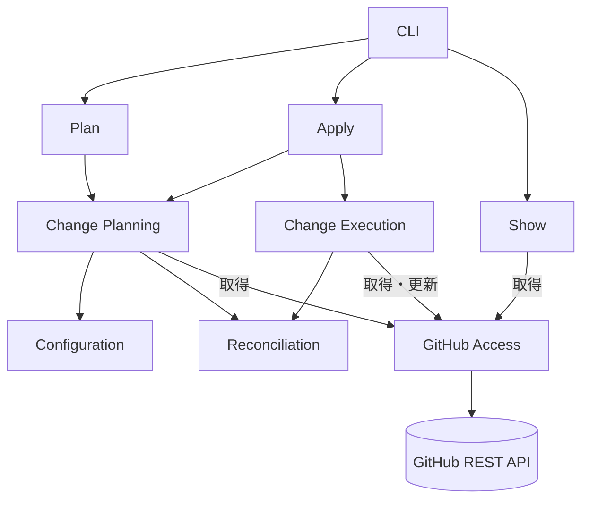

# アーキテクチャ設計

## 1. 目的と設計方針

本ドキュメントは、[要求定義](../spec/requirements.md) を実現する reco の論理構成、責務と依存関係、情報の流れ、変更計画と実行制御、安全な GitHub 設定更新の方式を定めます。CLI の操作形式（[CLI 仕様](../spec/cli.md)）、YAML の入力契約（[YAML 設定仕様](../spec/configuration.md)）、GitHub REST API の個別パラメータは重複して定義せず、構造と実現方式の判断に必要な範囲だけ扱います。概念の意味は [ドメインモデル](domain.md) に従います。

設計では、次の選択を重視します。

- **明示された範囲の管理**：設定宣言で管理する値と、API 操作に必要な未管理値を区別する。
- **判断の分離**：観測、照合、適用可能性、更新結果の確認を別の判断として扱う。
- **承認と実行の一貫性**：変更計画を承認と更新の基礎とし、全対象の事前検証と各更新直前の前提確認を設ける。
- **結果の確実性**：API 応答と期待状態の確認を混同せず、異常時は後続の更新を停止する。
- **最小限の構成**：単一プロセスで逐次実行し、専用の永続状態管理や自動ロールバックを設けない。

## 2. システム構成と責務

### 2.1 論理構成

reco の処理は、CLI から起動される `plan`・`apply`・`show` の各操作を起点に構成します。`plan` と `apply` は同じ変更計画の生成処理を利用しますが、承認と更新は `apply` だけが担います。`show` は設定宣言や変更計画を使わず、GitHub の設定を観測します。

図の矢印は主な呼び出し方向を示します。`Plan`・`Apply`・`Show` はコマンド解析や出力整形ではなく、各操作の調整を担います。`Change Planning` は共有の計画生成、`Change Execution` は承認済み計画の実行を担います。

| 領域 | 主な責務 | 境界 |
|---|---|---|
| CLI | コマンド・オプションと実行環境の解釈、認証情報の選択、表示、対話承認の入出力、終了コード | 設定の照合、変更計画や更新順序の判断は行わない |
| Plan | `Change Planning` を起動し、得られた変更計画・適用可否を利用者へ提示する操作を調整する | 承認と更新を行わない |
| Apply | `Change Planning` を起動し、全対象の事前検証結果を確認して承認を要求し、承認後に `Change Execution` を開始して結果を集約する | 変更計画を独自に再生成せず、GitHub API の更新を直接呼び出さない |
| Show | 指定リポジトリの設定を観測し、取得できた値と観測不能な項目を表示する操作を調整する | 設定宣言、照合、変更計画、更新を利用しない |
| Change Planning | Configuration による設定宣言の検証、対象選択、リポジトリ ID の取得、必要な観測、照合と適用可能性の判断、変更計画の生成 | 対話承認や書き込みを行わない |
| Change Execution | 承認済み計画に従う各更新直前の前提確認、逐次更新、更新後の再観測と期待状態・未管理値の確認、停止と結果の判定 | 承認内容や管理範囲を黙って変更しない |
| Configuration | YAML 全体の解析・入力検証、設定宣言への変換 | GitHub 上の実在性・権限確認を行わない |
| Reconciliation | 管理範囲内の期待状態と観測結果の意味的な比較 | API 通信、適用可能性・更新順序の判断を行わない |
| GitHub Access | GitHub API 通信、リポジトリと設定の観測、API 操作への変換、応答・取得制約・失敗の解釈 | CLI の操作規則、管理範囲や変更可否の判断を行わない |

`GitHub Access` の取得機能は `Plan`・`Apply`・`Show` から間接的または直接的に利用します。一方、更新機能へ進む経路は `Apply` から `Change Execution` を経るものに限定します。`Configuration` と `Reconciliation` は HTTP や GitHub API の応答形式に依存せず、`GitHub Access` は YAML の階層を照合規則として利用しません。

### 2.2 対象の同一性・認証・信頼境界

Change Planning は Configuration に設定宣言全体を検証させてから、宣言内から利用者が指定した対象を選び、選択対象についてだけ GitHub Access から実体と設定を取得します。選択されていない宣言のリポジトリ ID や実在性は確認しません。

リポジトリ名は対象を指定するための情報であり、GitHub が返すリポジトリ ID と同一ではありません。Change Planning は選択された対象の ID を観測時に取得し、Change Execution は各更新直前の再確認に対象の ID も含め、承認した対象と異なるリポジトリへ名前解決された場合は更新しません。これにより、承認後の名前変更・移転・名前の再利用による誤対象更新を検出する機会を設けます。ただし、確認と書き込みの間の競合まで排除するものではありません。なお、異なる名前が同じ実体を指すかどうかは計画時に判定しません。リネーム前の名前のように別名で参照した場合、GitHub API のリダイレクト応答は観測操作の失敗として扱います（5.2節）。

CLI が選択した認証情報だけを GitHub Access へ渡します。認証に失敗しても別の認証情報へ切り替えず、認証トークン・認証ヘッダーを出力しません。GitHub の応答や通信エラーを診断に利用する場合も、秘密情報を含む生データを無条件に表示しない境界を設けます。`401`、`403`、`404` などの応答は区別しますが、権限不足と不存在を根拠なく断定しません。

対象が個人アカウント所有であることは利用者が守る前提とし、認証主体と所有者の一致検査は設けません。実際のアクセス可否はトークンの権限と GitHub の制約に従います。

| Relationship | Target | Target Type |
|---|---|---|
| `alignment` | `FR-002` | Functional Requirement |
| `alignment` | `FR-003` | Functional Requirement |
| `alignment` | `FR-010` | Functional Requirement |
| `alignment` | `QR-001` | Quality Requirement |
| `alignment` | `INV-004` | Invariant |
| `grounding` | [GitHub API 仕様](../research/github-api.md) | Internal Document |

### 2.3 Go package との対応

2.1節の領域と、領域をまたいで使う部品は、Go の package に次のように対応します。

| 領域・部品 | package |
|---|---|
| CLI | `cmd` |
| Configuration | `internal/configuration` |
| GitHub Access | `internal/github` |
| 診断ログの出力 (全領域が共通に使う logger) | `internal/logger` |

## 3. 情報の流れと変更計画

### 3.1 設定宣言と管理範囲

Configuration は YAML 全体の構文・型・重複・設定間の組み合わせを検証し、明示された期待状態を設定宣言（Configuration Declaration）として渡します。管理範囲（Management Scope）は、期待状態が宣言された設定から導出します。省略と、明示的な `false`・空配列を区別し、関連設定が一体で意味を持つ場合はその完全性を入力時に確認します。

入力契約に適合することは、GitHub に適用可能であることを意味しません。GitHub の権限・現在状態・更新条件の判断は、対象の観測後に行います。

| Relationship | Target | Target Type |
|---|---|---|
| `alignment` | `FR-001` | Functional Requirement |
| `alignment` | `INV-001` | Invariant |

### 3.2 観測・照合・適用可能性

GitHub Access は取得値に加え、どの設定を確認できたか、GitHub の取得条件により確認できない項目は何かを観測結果（Observation Result）として表します。認証・権限・通信などによる観測操作の失敗は、取得条件による観測不能とは区別し、正常な観測結果として扱いません。

API の成功応答を受け取ったことだけでは、必要な設定値を確認できたとは判断しません。必要なフィールドが得られない場合、GitHub の既知の取得条件による観測不能と根拠をもって分類できるときに限り、観測結果にその理由を記録します。理由を確認できない欠落や、期待する取得契約に適合しない応答は観測操作の失敗として扱います。欠落した値を既定値で補ったり、理由を推測して比較不能へ置き換えたりしません。

Reconciliation は管理範囲内の期待状態と観測結果を比較し、一致（Match）、不一致（Mismatch）、比較不能（Not Comparable）を返します。比較可能な集合値は設定の意味に沿って比較し、例えば許可パターンは要素の順序だけで差分を作りません。未観測値を既定値で補わず、観測操作の失敗を比較不能として処理しません。

Change Planning は照合とは別に適用可能性（Applicability）を判断します。不一致でも適用不能な場合があり、比較不能でも必要な条件を確認できれば適用可能な場合があります。照合結果だけから適用可否を導出せず、API の前提条件と未管理設定への影響を考慮します。

| Relationship | Target | Target Type |
|---|---|---|
| `alignment` | `FR-004` | Functional Requirement |
| `alignment` | `FR-005` | Functional Requirement |
| `alignment` | `FR-006` | Functional Requirement |
| `alignment` | `QR-002` | Quality Requirement |

### 3.3 変更計画と実行単位

Change Planning は設定宣言、観測結果、照合結果、適用可能性を組み合わせ、変更計画（Change Plan）を生成します。計画は確認済み差分と比較不能な設定予定を区別し、適用可否と理由、承認する変更内容、実行に必要な前提条件・操作順序を保持します。更新によって影響を受け得る未管理設定がある場合は、その保全に必要な既存値や確認条件も実行時に利用できるようにします。適用不能な項目も表示のために残しますが、実行可能な操作にはしません。一致を確認した設定には更新を予定しません。

| 単位 | 設計上の意味 |
|---|---|
| 管理設定 | 利用者が期待状態を明示した設定。管理対象かどうかの基準 |
| 論理的な設定変更 | 利用者が意図する変更内容と、完了を判断する期待状態とが対応する変更の単位 |
| 更新操作 | 論理的な設定変更を実現する GitHub への個々の更新要求。個別の前提条件と応答を持つ |
| 対象リポジトリ | 一回の実行で選択されたリポジトリ。複数の変更を含み得る |

管理設定、論理的な設定変更、更新操作は一対一とは限りません。たとえば選択方式の Actions 許可条件は3項目を一体として扱い、Actions 許可ポリシーの変更を必要とする場合は、関連する更新操作を順序と前提条件を持つ一つの論理的な設定変更として計画します。一方、独立して管理できる設定を、API エンドポイントや YAML の階層だけを理由に不可分な管理単位へまとめません。複数の管理設定を一つの更新操作へまとめる場合も、承認した値と完了確認の範囲が不明確にならないことを条件とします。

変更計画は当該実行のために作る一時的な情報です。過去の `plan` 結果や保存済みの計画を、`apply` の実行指示として使用しません。

| Relationship | Target | Target Type |
|---|---|---|
| `alignment` | `FR-006` | Functional Requirement |
| `alignment` | `FR-007` | Functional Requirement |
| `alignment` | `FR-011` | Functional Requirement |

## 4. 計画生成と実行制御

### 4.1 全対象の事前検証

`plan` と `apply` は Change Planning を共有します。Change Planning は設定宣言全体の検証、対象選択、リポジトリ ID の取得、必要な観測、照合、適用可能性の判断、変更計画の生成を行います。Apply は選択されたすべての対象について入力不正・観測操作の失敗・適用不能な変更が残っていないことを確認するまで、承認や更新へ進みません。

問題の種類によって、検証を打ち切る時点が異なります。入力不正は、GitHub へ問い合わせる前に設定宣言全体を検証して報告します。観測操作に失敗した場合は、その時点で検証を打ち切ります。適用不能な変更は、選択された全対象の判断を終えてから、対象と理由をまとめて報告します。

この事前検証は、GitHub の状態や権限が承認後も変わらないこと、あるいは更新が成功することを保証しません。変更直前に改めて前提を確認する理由は、この時間差にあります。

| Relationship | Target | Target Type |
|---|---|---|
| `alignment` | `FR-001` | Functional Requirement |
| `alignment` | `FR-002` | Functional Requirement |
| `alignment` | `FR-008` | Functional Requirement |
| `alignment` | `INV-002` | Invariant |

### 4.2 読み取り専用操作

Plan は Change Planning で得られた変更計画と適用可否を CLI に渡して表示し、GitHub の設定を更新しません。Show は設定宣言や照合・変更計画を使わず、GitHub Access で指定リポジトリを観測して結果を CLI に渡します。いずれも、確認できた情報と取得条件による観測不能を区別し、観測操作の失敗を正常な結果として表示しません。

| Relationship | Target | Target Type |
|---|---|---|
| `alignment` | `FR-004` | Functional Requirement |
| `alignment` | `FR-007` | Functional Requirement |

### 4.3 `apply` の更新境界

Apply と Change Execution は次の境界を順に通過します。

1. 全対象の事前検証を完了する。問題が残る場合は承認・更新へ進まない。
2. 変更が不要と確認できた場合は、承認も書き込みも行わない。
3. Apply は確認済み差分と比較不能な設定予定を区別して提示するよう CLI に依頼し、CLI を通じて明示的な対話承認を得る。承認できなければ Change Execution を開始しない。
4. Change Execution は承認した論理的な設定変更を構成する各更新操作の直前に、対象 ID、必要な現在値、適用条件を再確認する。先行操作により予定された状態変化を考慮し、前提に関係する予定外の変化や確認不能な条件があれば、計画を黙って変更せず停止する。
5. 更新操作を逐次実行する。先行する更新操作の成功を確認できた場合だけ、同じ論理的な設定変更の次の更新操作に進む。必要な更新操作の後、その論理的な設定変更全体の期待状態を再観測し、影響を受け得る未管理設定についても保全条件を確認する。
6. 論理的な設定変更全体の完了が確認できた場合だけ、次の論理的な設定変更を開始する。更新操作の失敗・成否不明・前提不成立・再観測失敗・未管理設定の予期しない変化を検出した場合は、後続の更新を開始しない。

Apply は承認された変更計画を Change Execution に渡し、Change Execution だけが GitHub Access の更新機能を呼び出す構成とします。CLI、Plan、Show、Change Planning は更新機能を呼び出しません。複数リポジトリでも更新を並列化せず、既に実施した操作の自動的な取り消しは行いません。

| Relationship | Target | Target Type |
|---|---|---|
| `alignment` | `FR-008` | Functional Requirement |
| `alignment` | `FR-009` | Functional Requirement |
| `alignment` | `FR-010` | Functional Requirement |
| `alignment` | `FR-011` | Functional Requirement |
| `alignment` | `FR-012` | Functional Requirement |
| `alignment` | `INV-002` | Invariant |
| `alignment` | `INV-003` | Invariant |
| `alignment` | `INV-004` | Invariant |
| `alignment` | `INV-005` | Invariant |

## 5. GitHub API との境界

### 5.1 外部契約の吸収

GitHub Access は GitHub REST API の応答やエラーを、reco が扱う観測結果と失敗情報に変換します。利用する REST API のバージョン（`2026-03-10`）を明示し、取得条件・権限・必須フィールドなどの制約も提供します。未管理設定の値は推測して補完しません。

### 5.2 HTTP 通信とリダイレクトの信頼境界

GitHub Access は、認証付きリクエストの送信先を GitHub.com の REST API オリジン `https://api.github.com` に限定します。GitHub API が HTTP リダイレクト応答を返した場合は、HTTP メソッドを問わず追従せず、エラーとして呼び出し元へ伝えます。リダイレクト先の `Location` を利用した通信や自動再送は行いません。

読み取り要求へのリダイレクトは観測操作の失敗であり、取得条件による観測不能とは扱いません。更新成功後の状態確認に使う GET で発生した場合も、更新操作の成功と期待状態の確認失敗を区別します。更新要求へのリダイレクトは、応答を受け取っただけでは GitHub 上の副作用がなかったと確定できないため、更新操作の成否不明として扱います。Change Execution は後続の更新を停止し、いずれの場合も CLI はエラー終了します。

リダイレクト先への認証情報の漏えいや意図しない更新を防ぐため、追従可否の例外判定は設けません。エラーの診断には、認証情報や秘密情報を含む URL、ヘッダー、本文の無条件な出力を使用しません。リポジトリの同一性は、リダイレクト先の URL ではなく GitHub から確認したリポジトリ ID によって扱います。

| Relationship | Target | Target Type |
|---|---|---|
| `alignment` | `FR-003` | Functional Requirement |
| `alignment` | `FR-004` | Functional Requirement |
| `alignment` | `FR-010` | Functional Requirement |
| `alignment` | `FR-013` | Functional Requirement |
| `alignment` | `QR-001` | Quality Requirement |
| `alignment` | `QR-002` | Quality Requirement |
| `alignment` | `INV-004` | Invariant |
| `alignment` | `INV-005` | Invariant |
| `grounding` | [GitHub API 仕様](../research/github-api.md) | Internal Document |

### 5.3 未管理設定を保全する更新方式

API へ送信するフィールドは、設定宣言の管理範囲とは異なります。API の必須フィールドや未管理値を保全するために必要なフィールドを送信する場合でも、それらを新しい管理設定にはしません。

| 設定領域 | 更新方式で守ること |
|---|---|
| General | 宣言された変更対象だけを部分更新する |
| Actions 許可ポリシー | 必須の `enabled` の現在値を保持し、`sha_pinning_required` など未管理値を変えないことを確認できる方式で更新する |
| 選択方式の Actions 許可条件 | 3項目を一体として扱い、Actions 許可ポリシーとの依存関係を考慮する |
| Workflow permissions | 片方だけを管理する場合も、もう片方の値を維持できる方式で更新する |

API パラメータが任意であることは、省略した値の保持を保証しません。既存値を併送する場合も、その値を観測でき、更新直前の条件が成立する必要があります。省略・併送のどちらでも未管理値の保全を確認できないときは、更新を適用不能とします。保全の判断には、GitHub が公開する契約と確認できた実際の動作を区別して用い、実証されていない保持動作を前提にしません。

更新後は、影響を受け得る未管理設定のうち再取得できる値について、更新直前に確認した既存値との一致も確認します。管理範囲の期待状態だけが一致していても、未管理設定の予期しない変化を検出した場合は変更全体を完了扱いせず、後続の更新を停止します。取得条件によって更新後に再確認できない設定は、値を推測して保全済みとせず、事前に確認した外部契約や実動作の根拠が保全を支持する範囲でのみ適用可能と判断します。再取得した値の変化は外部主体の同時変更による可能性もあるため、原因を断定しません。

この方式が保護するのは reco 自身の更新操作による未管理設定の変更であり、外部主体による競合や GitHub 側の独立した変化ではありません。

| Relationship | Target | Target Type |
|---|---|---|
| `alignment` | `FR-006` | Functional Requirement |
| `alignment` | `FR-011` | Functional Requirement |
| `alignment` | `INV-001` | Invariant |
| `grounding` | [GitHub API 仕様](../research/github-api.md) | Internal Document |

### 5.4 非原子的な更新と中間状態

選択方式の Actions 許可条件の取得・更新には、Actions 許可ポリシー（`allowed_actions`）が `selected` であるという前提があります。`all` / `local_only` から `selected` へ変更する際は、変更前に選択方式の Actions 許可条件を取得できない場合があり、Actions 許可ポリシーの更新と選択方式の Actions 許可条件の更新の間に一時状態が生じます。

Change Planning は、予定する中間状態、各更新操作の前提、未管理設定への影響を踏まえて実行可能性と順序を判断します。Change Execution は操作直前に、先行操作による予定どおりの変化と、外部からの予定外の変化を区別します。`selected` から別のポリシーへ切り替える場合も、管理範囲外となる選択方式の Actions 許可条件の保全を検討し、切替後に取得できないことを値の保持の証拠とはしません。比較不能な選択方式の Actions 許可条件を推測せず、安全な中間状態と未管理値の保全を確認できない遷移は実行しません。

GitHub の複数の更新操作を原子的に実行する仕組みはありません。途中で更新が失敗・中断された場合は、先行操作の影響が残り得ます。最終状態の一致を確認できることと、中間状態の安全性を確認できることは別の条件です。

| Relationship | Target | Target Type |
|---|---|---|
| `alignment` | `FR-006` | Functional Requirement |
| `alignment` | `FR-010` | Functional Requirement |
| `alignment` | `FR-012` | Functional Requirement |
| `alignment` | `INV-001` | Invariant |
| `alignment` | `INV-004` | Invariant |
| `grounding` | [GitHub API 仕様](../research/github-api.md) | Internal Document |

## 6. 更新結果と障害時の制御

### 6.1 更新操作の結果と期待状態の確認

Change Execution は、各更新操作の応答と更新後の期待状態の観測結果を分けて保持します。未管理設定の保全についても、更新前後に確認できた値と、確認できない部分を区別します。複数の更新操作からなる論理的な設定変更では、途中の更新操作の成功だけで全体を完了としません。

| 変更結果 | 判定 |
|---|---|
| 完了 | 必要な更新操作の成功と論理的な設定変更全体の期待状態の一致を確認し、未管理設定の予期しない変化を検出していない |
| 失敗 | 更新を開始したが、完了を確認できない。副作用がなかったことは意味しない |
| 未実行 | 更新操作を一度も開始していない。開始直前の前提不成立で開始できなかった場合を含む |

失敗は、次のどれに当たるかを区別して保持します。

- **更新操作の失敗**：GitHub が更新要求を明示的に拒否した
- **更新操作の成否不明**：応答の喪失や HTTP リダイレクト応答により、送信した更新要求の成否を確認できない
- **期待状態の確認失敗**：更新操作の成功応答後、再観測に失敗した
- **期待状態との不一致**：更新操作の成功応答後、再観測した値が期待状態と異なる
- **未管理設定の予期しない変化**：期待状態は一致したが、影響を受け得る未管理設定の値が更新直前と異なる

先行する更新操作の成功後に、後続の更新操作の前提が成立せず開始できなかった場合も、論理的な設定変更全体を失敗とし、完了済みの更新操作と未開始の更新操作を区別します。

管理範囲内のすべての設定が期待状態と一致したリポジトリには論理的な設定変更が存在しないため、変更結果ではなく変更不要として扱います。結果はリポジトリごとに集約し、完了と未完了が混在するときは論理的な設定変更の単位でも区別します。CLI に表示する結果区分の文字列は [CLI 仕様](../spec/cli.md) で定めます。

| Relationship | Target | Target Type |
|---|---|---|
| `alignment` | `FR-012` | Functional Requirement |
| `alignment` | `FR-013` | Functional Requirement |
| `alignment` | `QR-002` | Quality Requirement |

### 6.2 停止・再観測・リトライ

更新要求の応答が失われ、実施されたか判断できないときは更新操作の成否不明とします。その後の読み取りで期待状態が見えても、更新操作の成否まで確定したものとして扱いません。診断用の再観測は行えても、成否不明の更新を再送したり、後続の更新を開始したりしません。

更新の明示的な失敗、更新直前の前提不成立、更新成功後の期待状態の確認失敗・不一致、未管理設定の予期しない変化も、後続の更新を停止する条件です。更新要求に失敗応答が返った場合も、再送しません。

読み取り操作のリトライは、対象オリジンの制約と回数・待機時間の上限を守り、再試行可能な一時的失敗に限定します。認証失敗や対象の不明確さをリトライで補いません。レート制限時は GitHub の指示する待機条件を守り、書き込み操作間には推奨される間隔を設けます。読み取りの再試行は、更新要求の再送を認める根拠になりません。

レート制限の超過は `403` または `429` で報告され、ステータスコードだけでは権限不足と区別できません。GitHub Access は `retry-after` と `x-ratelimit-remaining` の応答ヘッダーからレート制限かどうかを判定し、レート制限による `403` を権限不足と断定しません。レート制限で拒否された更新要求は、更新操作の失敗として扱い、再送しません。

| Relationship | Target | Target Type |
|---|---|---|
| `alignment` | `FR-010` | Functional Requirement |
| `alignment` | `FR-013` | Functional Requirement |
| `alignment` | `INV-004` | Invariant |
| `alignment` | `INV-005` | Invariant |
| `grounding` | [GitHub API 仕様](../research/github-api.md) | Internal Document |

## 7. References

- [要求定義](../spec/requirements.md)
- [CLI 仕様](../spec/cli.md)
- [YAML 設定仕様](../spec/configuration.md)
- [ドメインモデル](domain.md)
- [GitHub API 仕様](../research/github-api.md)
