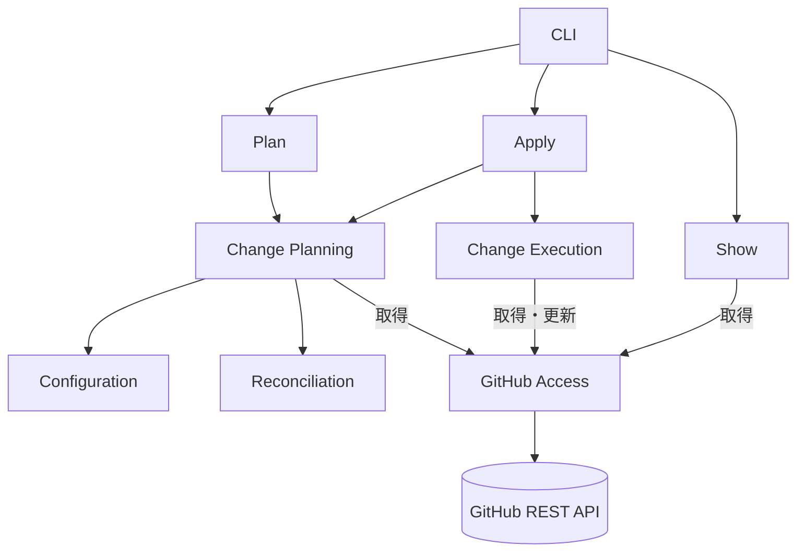

# アーキテクチャ設計

## 1. 目的と設計方針

本ドキュメントは、[要求定義](../spec/requirements.md) を実現する reco の論理構成、領域ごとの責務と依存の向き、計画から実行までの情報の流れ、GitHub API との信頼境界を定めます。概念の意味は [ドメインモデル](domain.md) が、操作と表示は [CLI 仕様](../spec/cli.md) が、宣言の形は [YAML 設定仕様](../spec/configuration.md) が定めます。すべての設定に共通する仕組みのうち、GitHub への要求と応答の解釈の細則は [GitHub API 通信の設計](github-access.md) が、承認後の観測し直しと更新要求の間隔は [変更の実行の設計](execution.md) が、特定の設定に固有の設計は [設定ごとの設計](settings/README.md) が定めます。

設計では、次の選択を重視します。

- **明示された範囲の管理**：設定宣言で管理する値と、API 操作に必要な未管理値を区別する。
- **判断の分離**：観測、照合、適用可能性、更新結果の確認を別の判断として扱う。
- **承認と実行の一貫性**：変更計画を承認と更新の基礎とし、全対象の事前検証と各更新直前の前提確認を設ける。
- **結果の確実性**：API 応答と期待状態の確認を混同せず、異常時は後続の更新を停止する。
- **最小限の構成**：単一プロセスで逐次実行し、専用の永続状態管理や自動ロールバックを設けない。

## 2. システム構成と責務

### 2.1 論理構成

reco の処理は、CLI から起動される `plan`・`apply`・`show` の各操作を起点に構成します。`plan` と `apply` は同じ変更計画の生成処理を利用しますが、承認と更新は `apply` だけが担います。`show` は設定宣言や変更計画を使わず、GitHub の設定を観測します。

図の矢印は主な呼び出し方向を示します。`Plan`・`Apply`・`Show` はコマンド解析ではなく、各操作の調整と、その結果の表示の整形を担います。`Change Planning` は共有の計画生成、`Change Execution` は承認済み計画の実行を担います。

| 領域 | 主な責務 | 境界 |
|---|---|---|
| CLI | コマンド・オプションと実行環境の解釈、認証情報の選択、出力先の受け渡し、対話承認の入出力、終了コード | 設定の照合、変更計画や更新順序の判断は行わない |
| Plan | `Change Planning` を起動し、得られた変更計画・適用可否を利用者へ提示する操作を調整する | 承認と更新を行わない |
| Apply | `Change Planning` を起動し、全対象の事前検証結果を確認して承認を要求し、承認後に `Change Execution` を開始して結果を集約する | 変更計画を独自に再生成せず、GitHub API の更新を直接呼び出さない |
| Show | 指定リポジトリの設定を観測し、取得できた値を表示する操作を調整する | 設定宣言、照合、変更計画、更新を利用しない |
| Change Planning | Configuration による設定宣言の検証、対象選択、リポジトリ ID の取得、必要な観測、照合と適用可能性の判断、変更計画の生成 | 対話承認や書き込みを行わない |
| Change Execution | 承認済み計画に従う各更新直前の前提確認、逐次更新、更新後の再観測と期待状態・変更対象外の設定の確認、停止と結果の判定 | 承認内容や管理範囲を黙って変更しない |
| Configuration | YAML 全体の解析・入力検証、設定宣言への変換 | GitHub 上の実在性・権限確認を行わない |
| Reconciliation | 管理範囲内の期待状態と観測結果の意味的な比較 | API 通信、適用可能性・更新順序の判断を行わない |
| GitHub Access | GitHub API 通信、リポジトリと設定の観測、API 操作への変換、応答・取得制約・失敗の解釈 | CLI の操作規則、管理範囲や変更可否の判断を行わない |

`GitHub Access` の取得機能は `Plan`・`Apply`・`Show` から間接的または直接的に利用します。一方、更新機能へ進む経路は `Apply` から `Change Execution` を経るものに限定します。`Configuration` と `Reconciliation` は HTTP や GitHub API の応答形式に依存せず、`GitHub Access` は YAML の階層を照合規則として利用しません。

### 2.2 対象の同一性・認証・信頼境界

Change Planning は Configuration に設定宣言全体を検証させてから、利用者が指定した対象を選び、選択した対象だけを GitHub Access で観測します。選択されていない宣言のリポジトリには、ID や実在性を確かめる要求も送りません。

対象はリポジトリ名で指定しますが、承認した対象と同じかどうかは、GitHub が返すリポジトリ ID で確かめます。Change Planning が観測時に ID を取得し、Change Execution が各更新直前の再確認に ID を含め、承認した対象と異なるリポジトリへ名前解決された場合は更新しません。承認後の名前変更・移転・名前の再利用による誤対象の更新を検出するためです。確認と書き込みのあいだの競合までは排除しません。名前変更前の名前で参照すると GitHub はリダイレクトを返し（[GitHub リポジトリ API 仕様](../research/repositories.md) 2章）、reco は追従しません（5.2節）。

この確認は、ID が名前変更や移転で変わらないことと、別の実体に割り当てられないことを前提とします（[ドメインモデル](domain.md) の宣言・選択・実体の識別）。前者は確かめていますが、後者は GitHub が REST API の `id` について明記していません。前者が崩れると正当な対象を停止させ、これは安全側の誤りです。後者が崩れると、名前の再利用による誤対象を検出できません。関連リソースの同一性をどこまで確かめるかは、[ドメインモデル](domain.md) の関連リソースの同一性が定めます。

CLI が選択した認証情報だけを GitHub Access へ渡します。認証に失敗しても別の認証情報へ切り替えず、認証トークン・認証ヘッダーを出力しません。GitHub の応答や通信エラーを診断に利用する場合も、秘密情報を含む生データを無条件に表示しない境界を設けます。`401`、`403`、`404` などの応答は区別しますが、権限不足と不存在を根拠なく断定しません。

対象が個人アカウント所有であることは利用者が守る前提とし、認証主体と所有者の一致検査は設けません。実際のアクセス可否はトークンの権限と GitHub の制約に従います。

| Relationship | Target | Target Type |
|---|---|---|
| `alignment` | `FR-002` | Functional Requirement |
| `alignment` | `FR-003` | Functional Requirement |
| `alignment` | `FR-010` | Functional Requirement |
| `alignment` | `QR-001` | Quality Requirement |
| `alignment` | `INV-004` | Invariant |
| `grounding` | [GitHub REST API 共通仕様](../research/rest-api.md) | Repository File |
| `grounding` | [GitHub リポジトリ API 仕様](../research/repositories.md) | Repository File |

### 2.3 package の分け方

Go の package は、2.1節の領域を次の考え方で分けます。

- 操作 (Plan、Apply、Show) は、操作ごとに package を分ける。各操作の処理の流れと表示は、[CLI 仕様](../spec/cli.md) の操作ごとの規定に従って別々に変わるため
- 複数の操作が共有する領域は、操作の package の外に置く。操作の package を呼び出すのは CLI だけ (2.1節) のため
- 同じ要求の変更で一緒に変わる領域は、同じ package に置く。たとえば照合の規則は変更計画と一緒に変わるため、Reconciliation は Change Planning と同じ package に置く
- Change Execution は Apply と同じ package に置く。承認済み計画を実行する経路を Apply に限定し、ほかの操作から更新機能へ進む依存を作らないため
- すべての文脈が共有する語（[ドメインモデル](domain.md) 4.9節。設定と関連リソースの識別、設定の値）は、どの文脈の package にも依存しない package に置き、文脈ごとの判断を持ち込まない。宣言と観測が同じ定義を使い、片方だけが変わることを防ぐため。関連リソースの存在も設定の値と同じ型で表し、reco が観測するが宣言を受け付けない設定の値もここに置く。管理の単位は、設定の識別と関連リソースの名前の組で識別し、名前を識別の文字列に埋め込まない。名前は `.` を含み得るため、埋め込むと別の管理の単位を区別できなくなる。関連リソースの名前は、宣言で受け付ける名前の形に限った型で表す。観測の文脈は GitHub が返した名前を文字列のまま持ち、宣言の名前と同じかをこの型の判定で決める
- 管理範囲の列挙は、宣言の文脈の package に置く。照合と、計画時に読み取る設定の領域の選択が、同じ列挙から管理設定を決めるため
- 変更計画の表示（リポジトリごとの節、変更予定の行、`Side effect:`、集計）は、操作の package の外の一つの package に置く。Plan と Apply が同じ変更予定を別々の形で示すことを防ぐため。この package は変更計画に依存するため、Show からは使わない
- Show は、表示を設定宣言と同じ構造の YAML で書くが（[CLI 仕様](../spec/cli.md) 6章）、Configuration に依存しない。Show が観測だけで成り立つようにするため。二つの構造の一致は、CLI のテストで Show の表示を設定宣言として読み戻して確かめる
- 観測不能をどう示すかは、操作ごとの表示が決める。同じ観測不能でも、利用者がその場面で知りたいことが操作ごとに違うため

[ドメインモデル](domain.md) 4.9節の文脈と、2.1節の領域と、package は次のように対応します。文脈は語の意味が通用する範囲で、領域と package はそれを実現する構成のため、一対一とは限りません。

| 文脈（ドメインモデル 4.9節） | 領域（2.1節） | package |
|---|---|---|
| 宣言 | Configuration | `internal/configuration` |
| 観測と GitHub への要求 | GitHub Access | `internal/github` |
| 計画 | Change Planning（Reconciliation を含む） | `internal/changeplan` |
| 承認と実行 | Apply のうち承認の要求、Change Execution | `internal/apply`（承認の対話の入出力は `cmd`） |
| すべての文脈が共有する語 | なし | `internal/setting`、`internal/repository` |
| どの文脈にも属さない操作の調整と表示 | CLI、Plan、Apply、Show | `cmd`、`internal/plan`、`internal/apply`、`internal/show`、`internal/changeplandisplay` |

package 間の依存の制約は、`scripts/golangci-lint/.golangci.yml` の depguard 規則で検査します。GitHub Access は観測と更新要求を一つの package に持つため、package の依存だけでは更新要求を送る経路を Apply に限れません。GitHub へ更新要求を送るメソッドを、それを定める GitHub Access のほかには `internal/apply` だけが直接呼ぶことは、同じ設定の forbidigo 規則で検査します。interface やメソッド値を経た呼び出しは、この規則では検出できません。

## 3. 情報の流れと変更計画

### 3.1 設定宣言と管理範囲

Configuration は YAML 全体を検証し、明示された期待状態を設定宣言として渡します。管理範囲は、期待値が明示された管理の単位から導きます（[ドメインモデル](domain.md) の管理の単位と管理設定）。Configuration は GitHub を観測しないため、入力契約に適合することは適用可能であることを意味しません。GitHub の権限・現在状態・更新条件の判断は、観測のあとに Change Planning が行います。

| Relationship | Target | Target Type |
|---|---|---|
| `alignment` | `FR-001` | Functional Requirement |
| `alignment` | `INV-001` | Invariant |

### 3.2 観測・照合・適用可能性

GitHub Access は、取得した値に加えて、取得条件により確認できない設定とその理由を観測結果として返します。認証・権限・通信などによる観測操作の失敗は、取得条件による観測不能と区別し、正常な観測結果として扱いません。API の成功応答を受け取ったことだけでは値を確認できたと判断せず、応答が取得契約に適合しなければ観測操作の失敗とします。欠落した値を既定値で補ったり、理由を推測して観測不能へ置き換えたりしません。一回の観測の要求が一つでも失敗すれば、取得できた値だけの観測結果は作りません。取得契約に適合し、reco の解釈しない部分を含む値は、観測操作の失敗にせず、その設定だけを理由を伴う観測不能として返します（[ドメインモデル](domain.md) の現在状態・観測結果・観測失敗）。GitHub が種類を増やし得る要素を一つ足しただけで、その要素と関係のない設定まで確認できなくなることを避けるためです。解釈しない部分を除いた残りを観測値にはしません。

関連リソースが存在しないことは、その種類の一覧を全ページ読み、成功応答に名前がないことで確かめます。名前を指定した取得への `404` は権限の不足でも返り得るため、存在しないことの確認に使いません。存在しないと誤って判断すると、作成の要求で存在する関連リソースを上書きし得るためです。取得契約、要求の順序、一覧の読み方の細則は [GitHub API 通信の設計](github-access.md) が、設定ごとの読み取り要求と取得条件は設定ごとの設計の各文書の「観測」が定めます。

Reconciliation は管理範囲内の期待状態と観測結果を比べ、一致・不一致・比較不能を返します（[ドメインモデル](domain.md) の照合結果と適用可能性）。Change Execution が変更前提、更新後の期待状態、変更対象外の設定を比べるときも、同じ判定を使います。

Change Planning は照合とは別に適用可能性を判断し、照合結果だけから適用可否を導きません。判断の材料は [ドメインモデル](domain.md) の照合結果と適用可能性が、適用不能とする方針は 5.4節が、設定ごとの適用不能の条件は設定ごとの設計の各文書の「適用可能性と副作用」が定めます。そこに挙げた条件に当たらない変更予定は、比較不能を含めて適用可能です。

| Relationship | Target | Target Type |
|---|---|---|
| `alignment` | `FR-004` | Functional Requirement |
| `alignment` | `FR-005` | Functional Requirement |
| `alignment` | `FR-006` | Functional Requirement |
| `alignment` | `QR-002` | Quality Requirement |

### 3.3 変更計画と実行単位

Change Planning は設定宣言、観測結果、照合結果、適用可能性を組み合わせ、変更計画を生成します。承認する変更内容（論理的な設定変更、その更新操作、変更前提、操作順序）は、変更計画から一意に導けるようにし、Change Planning の同じ導出を Plan と Apply が使います（4.2節）。利用者が承認するのは提示した変更計画であり、そこから導けない内容を実行に持ち込まないためです。変更に伴う副作用、副作用を示さなかった設定、再開する設定は、変更予定ごとに管理設定の計画に持たせます。変更予定の注記は、その変更予定の観測値と期待値だけで決まるため、管理設定の計画から導きます。適用不能な変更予定も表示のために残しますが、実行可能な操作にはしません。

更新操作ごとに変更前提で比べる設定と承認時に予定した値（[ドメインモデル](domain.md) の承認と変更前提）も、Change Planning が導いて更新操作に持たせます。Change Execution は、その並びを更新直前の観測と比べるだけで、何を比べるかを決めません。何が関係する現在値に当たるかは、どの遷移か、どの副作用を示したかという変更計画の内容で決まるためです。

管理設定、論理的な設定変更、更新操作は一対一とは限りません（[ドメインモデル](domain.md) の変更計画・論理的な設定変更・変更結果）。どの変更予定をまとめるかと更新操作の順序は、設定ごとの設計の遷移表に従って Change Planning が決めます。独立して管理できる設定を、API エンドポイントや YAML の階層だけを理由に一つの管理の単位へまとめません。複数の管理設定を一つの更新操作へまとめるのは、承認した値と完了確認の範囲が不明確にならない場合に限ります。`plan` と承認が値を管理設定ごとに示し、期待状態の確認がまとめたすべての期待値を比べ、一致しなかった管理設定を変更結果で示せば、この条件を満たします。

変更計画は当該実行のために作る一時的な情報です。過去の `plan` 結果や保存済みの計画を、`apply` の実行指示として使用しません。

| Relationship | Target | Target Type |
|---|---|---|
| `alignment` | `FR-006` | Functional Requirement |
| `alignment` | `FR-007` | Functional Requirement |
| `alignment` | `FR-011` | Functional Requirement |

## 4. 計画生成と実行制御

### 4.1 全対象の事前検証

`plan` と `apply` は Change Planning を共有します。Apply は選択されたすべての対象について入力不正・観測操作の失敗・適用不能な変更が残っていないことを確認するまで、承認や更新へ進みません。

Change Planning は、選択された対象を設定宣言の `repositories` の並びで一つずつ観測し、並列には観測しません。GitHub はセカンダリのレート制限を避けるため、要求を並行させず逐次に送るよう推奨しており（[GitHub REST API 共通仕様](../research/rest-api.md) 5章）、観測の順を宣言の並びに揃えると、変更計画の並びと打ち切りの位置を利用者が宣言から読み取れるためです。

問題の種類によって、検証を打ち切る時点が異なります。入力不正は、GitHub へ問い合わせる前に設定宣言全体を検証して報告します。観測操作に失敗した場合は、その時点で検証を打ち切り、残りの対象を観測せず、観測できた対象だけの変更計画も作りません。適用不能な変更は、選択された全対象の判断を終えてから、対象と理由をまとめて報告します。

この事前検証は、GitHub の状態や権限が承認後も変わらないこと、あるいは更新が成功することを保証しません。変更直前に改めて前提を確認する理由は、この時間差にあります。

| Relationship | Target | Target Type |
|---|---|---|
| `alignment` | `FR-001` | Functional Requirement |
| `alignment` | `FR-002` | Functional Requirement |
| `alignment` | `FR-008` | Functional Requirement |
| `alignment` | `INV-002` | Invariant |
| `grounding` | [GitHub REST API 共通仕様](../research/rest-api.md) | Repository File |

### 4.2 読み取り専用操作

Plan は Change Planning で得られた変更計画と適用可否を表示し、GitHub の設定を更新しません。Plan は、適用不能な変更予定がなければ、Apply が承認の前に行うのと同じく変更計画から論理的な設定変更を導きます。導けないのは Change Planning の不変条件が破れたときに限るため、正常な変更計画では表示も終了コードも変わりませんが、`plan` が通った変更計画は、`apply` でも承認の要求まで進みます。Show は設定宣言や照合・変更計画を使わず、GitHub Access で指定リポジトリを観測して結果を表示します。いずれも、確認できた情報と取得条件による観測不能を区別し、観測操作の失敗を正常な結果として表示しません。

| Relationship | Target | Target Type |
|---|---|---|
| `alignment` | `FR-004` | Functional Requirement |
| `alignment` | `FR-007` | Functional Requirement |

### 4.3 `apply` の更新境界

Apply と Change Execution は次の境界を順に通過します。

1. 全対象の事前検証を完了する。問題が残る場合は承認・更新へ進まない。
2. 変更が不要と確認できた場合は、承認も書き込みも行わない。
3. Apply は確認済みの差分と比較不能な設定予定を区別して提示し、CLI を通じて明示的な対話承認を得る。承認できなければ Change Execution を開始しない。承認の入力を読めても、承認待ちのあいだに中断を受けていれば Change Execution を開始しない。承認は、選択した全対象の変更計画に対して一度だけ求める。
4. Change Execution は承認した論理的な設定変更を構成する各更新操作の直前に、対象 ID と関係する現在値を再確認する。先行操作により予定された状態変化を考慮し、前提に関係する予定外の変化や確認不能な条件があれば、計画を黙って変更せず停止する。
5. 更新操作を逐次実行する。先行する更新操作の成功を確認できた場合だけ、同じ論理的な設定変更の次の更新操作に進む。必要な更新操作の後、その論理的な設定変更全体の期待状態を再観測し、変更対象外の設定が更新直前の値から変わっていないことも確認する。
6. 論理的な設定変更全体の完了が確認できた場合だけ、次の論理的な設定変更を開始する。完了以外に終わった場合は、後続の更新を開始せず、開始しなかった論理的な設定変更には変更前提の確認のための読み取り要求も送らない。次の論理的な設定変更が別の対象リポジトリのものである場合も同じである。対象リポジトリは設定宣言の `repositories` の並びで一つずつ処理し、変更不要の対象リポジトリには要求を送らない。

Apply は承認された変更計画を Change Execution に渡し、Change Execution だけが GitHub Access の更新機能を呼び出す構成とします。CLI、Plan、Show、Change Planning は更新機能を呼び出しません。複数リポジトリでも更新を並列化せず、既に実施した操作の自動的な取り消しは行いません。

| Relationship | Target | Target Type |
|---|---|---|
| `alignment` | `FR-008` | Functional Requirement |
| `alignment` | `FR-009` | Functional Requirement |
| `alignment` | `FR-010` | Functional Requirement |
| `alignment` | `FR-011` | Functional Requirement |
| `alignment` | `FR-012` | Functional Requirement |
| `alignment` | `INV-002` | Invariant |
| `alignment` | `INV-003` | Invariant |
| `alignment` | `INV-004` | Invariant |
| `alignment` | `INV-005` | Invariant |

## 5. GitHub API との境界

### 5.1 外部契約の吸収

GitHub Access は GitHub REST API の応答やエラーを、reco が扱う観測結果、更新操作の結果、失敗情報に変換し、ほかの領域を GitHub の応答形式から切り離します。利用する REST API のバージョン（`2026-03-10`）を明示し、未管理設定の値は推測して補完しません。変換の規則は [GitHub API 通信の設計](github-access.md) が定めます。

### 5.2 HTTP 通信とリダイレクトの信頼境界

GitHub Access は、認証付きリクエストの送信先を GitHub.com の REST API オリジン `https://api.github.com` に限定します。GitHub API が HTTP リダイレクト応答を返した場合は、HTTP メソッドを問わず追従せず、エラーとして呼び出し元へ伝えます。リダイレクト先の `Location` を利用した通信や自動再送は行いません。

読み取り要求へのリダイレクトは観測操作の失敗であり、取得条件による観測不能とは扱いません。更新成功後の状態確認に使う GET で発生した場合も、更新操作の成功と期待状態の確認失敗を区別します。更新要求へのリダイレクトは、応答を受け取っただけでは GitHub 上の副作用がなかったと確定できないため、更新操作の成否不明として扱います。Change Execution は後続の更新を停止し、いずれの場合も CLI はエラー終了します。更新エンドポイントが仕様として `3xx` を返す場合（Environment の個別パターンを加える要求の `303` など）も同じで、成功や変更なしとは読み替えません。

リダイレクト先への認証情報の漏えいや意図しない更新を防ぐため、追従可否の例外判定は設けません。エラーの診断には、認証情報や秘密情報を含む URL、ヘッダー、本文の無条件な出力を使用しません。リポジトリの同一性は、リダイレクト先の URL ではなく GitHub から確認したリポジトリ ID によって扱います。

| Relationship | Target | Target Type |
|---|---|---|
| `alignment` | `FR-003` | Functional Requirement |
| `alignment` | `FR-004` | Functional Requirement |
| `alignment` | `FR-010` | Functional Requirement |
| `alignment` | `FR-013` | Functional Requirement |
| `alignment` | `QR-001` | Quality Requirement |
| `alignment` | `QR-002` | Quality Requirement |
| `alignment` | `INV-004` | Invariant |
| `alignment` | `INV-005` | Invariant |
| `grounding` | [GitHub REST API 共通仕様](../research/rest-api.md) | Repository File |

### 5.3 未管理設定を保全する更新方式

API へ送信するフィールドは、設定宣言の管理範囲とは異なります。API の必須フィールドや未管理値を保全するために必要なフィールドを送信する場合でも、それらを新しい管理設定にはしません。

関連リソースを作成、変更、削除する更新要求は、宣言された名前の関連リソースだけを宛先にします。宣言されていない名前の関連リソースを宛先とする更新要求は、どの操作でも送りません。別の関連リソースに属する関連リソースでは、宣言された属する先の、宣言された名前だけを宛先にし、更新直前の観測で属する先が存在すると確かめたときだけ送ります。属する先が違えば、同じ名前でも別の関連リソースであり、別の属する先や、属する先の種類の違う同じ名前の関連リソース（Environment Variable に対する Repository Variable）へは送りません。作成は、存在する関連リソースを上書きし得る要求になる場合も、GitHub が拒否する要求になる場合も、更新直前の観測でその名前が存在しないと確かめたときだけ送ります。値の変更は、更新直前の観測で、その名前の関連リソースが存在し、値の全体が承認の前に示した値と同じで、GitHub が ID を付ける種類では ID も承認時と同じと確かめたときだけ送ります。宛先を ID でしか示せない種類では、更新直前の観測と更新要求のあいだの名前の変更を防げず、その扱いは設定ごとの設計の「防げない競合」が定めます。削除は、存在しないことを宣言された名前だけを宛先とし、更新直前の観測で、存在し、値が承認の前に示した値と同じと確かめたときだけ送ります。一覧の全体を置き換える更新エンドポイントや、複数の関連リソースをまとめて消す更新エンドポイントは使いません。同じ種類の別の名前の関連リソースは、更新後に更新直前の値と比べません。別の名前の関連リソースを変えないことは、種類ごとに実際の動作で確かめ、その確認結果を保全の根拠とします。

送った値で既存の値の全体を置き換える更新要求（送った配列にない要素を残さないものなど）では、置き換える範囲の全体を管理設定の期待値から作り、観測した値を併送しません。置き換える範囲の全体を一つの管理の単位にするため、その範囲に併送する未管理設定がないからです。この更新要求は、置き換える範囲の現在値を reco がすべて解釈できたときだけ送り、解釈しない部分があれば変更予定を適用不能にします（[ドメインモデル](domain.md) の照合結果と適用可能性）。置き換える範囲の中に、宣言で期待値にできない値（GitHub が既定値を持つ任意の項目など）があるときは、送らなかったときに GitHub が設定する値と現在値が同じだと観測で確かめた場合に限り、解釈できたものとします。送らずに済む根拠は、その値が変わらないことを実際の動作で確かめたことに置きます。

API パラメータが任意であることは、省略した値の保持を保証しません。既存値を併送する場合も、その値を観測でき、更新直前の条件が成立する必要があります。省略・併送のどちらでも未管理値の保全を確認できないときは、更新を適用不能とします。保全の判断には、GitHub が公開する契約と確認できた実際の動作を区別して用い、実証されていない保持動作を前提にしません。

更新後は、変更対象外の設定（[ドメインモデル](domain.md) の変更計画・論理的な設定変更・変更結果）について、更新直前に確認した値との一致を確認します。管理設定か未管理設定かは問いません。期待状態だけが一致していても、変更対象外の設定の予期しない変化を検出した場合は変更全体を完了扱いせず、後続の更新を停止します。変更に伴う副作用として示した設定を比べず、副作用を示さなかった設定を比べることも、ドメインモデルの同じ節が定めます。取得条件によって更新後に再確認できない設定は、値を推測して保全済みとせず、事前に確認した外部契約や実動作の根拠が保全を支持する範囲でのみ適用可能と判断します。再取得した値の変化は外部主体の同時変更による可能性もあるため、原因を断定しません。

更新の対象ごとに送るフィールド、正常応答、未管理設定を保全する根拠、更新後に比べる変更対象外の設定は、[設定ごとの設計](settings/README.md) の各文書の「更新方式」が定めます。

この方式が防ぐのは reco 自身の更新操作による未管理設定の変更であり、外部主体による競合や GitHub 側の独立した変化ではありません。

| Relationship | Target | Target Type |
|---|---|---|
| `alignment` | `FR-006` | Functional Requirement |
| `alignment` | `FR-011` | Functional Requirement |
| `alignment` | `INV-001` | Invariant |

### 5.4 非原子的な更新と中間状態

GitHub が、ある設定の取得と更新に別の設定の状態を前提として求める場合や、一つの変更予定を複数の更新要求でしか実現できない場合は、一つの論理的な設定変更の更新操作のあいだに中間状態が生じます。Actions 許可ポリシーを `all` / `local_only` から `selected` へ変えて選択方式の Actions 許可条件を設定する変更と、Environment の個別パターンを一つずつ加えて取り除く変更がこれに当たります。

一つの更新要求で実現できる変更予定は、項目ごとの更新操作に分けず、一つの更新操作で実現します。分けると、更新操作のあいだに、変更前の状態にも宣言した状態にもない項目の組み合わせが生じ得るためです。非公開リポジトリの Fork Pull Request ワークフローの実行条件の4項目がこれに当たります（[Actions の設計](settings/actions.md) の更新方式）。

Change Planning は、予定する中間状態、各更新操作の前提、未管理設定への影響を踏まえて実行可能性と順序を判断します。Change Execution は操作直前に、先行操作による予定どおりの変化と、外部からの予定外の変化を区別します。比較不能な設定の値は推測しません。

宣言した遷移が、GitHub の仕様上避けられない影響（管理範囲外の値の消失や、一時的な中間状態）を伴う場合も、reco はそれを理由に利用者が宣言した遷移を止めません。適用不能とするのは、利用者が宣言していない設定を reco が変えなければ実行できない遷移と、更新のあとに期待状態を確かめる手段がなく、完了を確認できないことが計画の時点で決まっている変更です。前者は利用者の意図なしにセキュリティを下げ得るためで、後者は reco が完了を報告できない更新を送ることになるためです。

設定ごとの遷移、適用可能性、変更に伴う副作用、更新操作の順序、変更前提で比べる関係する現在値は、[設定ごとの設計](settings/README.md) の各文書の「適用可能性と副作用」と「論理的な設定変更と更新操作」が定めます。

GitHub の複数の更新操作を原子的に実行する仕組みはありません。途中で更新が失敗・中断された場合は、先行操作の影響が残り得ます。最終状態の一致を確認できることと、中間状態の安全性を確認できることは別の条件です。

| Relationship | Target | Target Type |
|---|---|---|
| `alignment` | `FR-006` | Functional Requirement |
| `alignment` | `FR-010` | Functional Requirement |
| `alignment` | `FR-012` | Functional Requirement |
| `alignment` | `INV-001` | Invariant |
| `alignment` | `INV-004` | Invariant |

## 6. 更新結果と障害時の制御

### 6.1 更新操作の結果と期待状態の確認

Change Execution は、各更新操作の応答と、更新後の期待状態の観測結果を分けて保持します。更新操作の結果（成功・失敗・成否不明）は GitHub Access が更新要求への応答から判定し、Change Execution はこの判定を読み替えません。GitHub が要求を拒否したと応答した `4xx` だけを失敗とし、拒否を表さない応答や受け取れなかった応答は、更新が処理されたかを判断できないため成否不明とします。応答の形ごとの判定は [GitHub API 通信の設計](github-access.md) が定めます。

更新操作の成功は、期待状態に達したことを意味しません。GitHub は、送った値を反映しないまま `200` を返す場合があります（[GitHub リポジトリ API 仕様](../research/repositories.md) 4章）。変更結果（完了・失敗・未実行）は、変更前提の確認、更新操作の結果、期待状態の確認結果、変更対象外の設定の予期しない変化の有無から導きます（[ドメインモデル](domain.md) の変更計画・論理的な設定変更・変更結果）。失敗は、次のどれに当たるかを区別して保持します。

- **更新操作の失敗**：GitHub が更新要求を明示的に拒否した
- **更新操作の成否不明**：送信した更新要求の成否を確認できない
- **期待状態の確認失敗**：更新操作の成功応答後、再観測に失敗した。再観測したリポジトリの ID が承認したリポジトリと異なる場合と、観測し直す前の待機中に中断を受けた場合も含む
- **期待状態との不一致**：更新操作の成功応答後、観測し直しを打ち切った最後の再観測の値が期待状態と異なる
- **変更対象外の設定の予期しない変化**：5.3節で比べる設定の値が、更新直前と異なる

更新操作の成功後の不一致について、GitHub の応答は原因を示しません。reco は原因を断定しませんが、設定ごとに既知の原因の候補があれば、可能性として変更結果に添えます。対象のリポジトリがその原因の条件に当たるかは確かめていないため、候補は条件付きの文で示します。候補は公式ドキュメントに記載がなくても、推測として挙げてかまいません。原因を断定しない表示であれば、候補が外れても誤った判断を招かず、候補がないよりも利用者が原因を調べる手がかりになるためです。成否不明の更新では、不一致の原因が更新操作にあるかも分からないため、候補を添えません。

結果はリポジトリごとに集約し、完了と完了以外が混在するリポジトリを全体として完了としません。リポジトリと論理的な設定変更のどちらの単位で示すかと、CLI に表示する結果区分の文字列は [CLI 仕様](../spec/cli.md) で定めます。

| Relationship | Target | Target Type |
|---|---|---|
| `alignment` | `FR-012` | Functional Requirement |
| `alignment` | `FR-013` | Functional Requirement |
| `alignment` | `QR-002` | Quality Requirement |
| `grounding` | [GitHub リポジトリ API 仕様](../research/repositories.md) | Repository File |

### 6.2 停止・再観測・リトライ

次のどれかを検出したら、Change Execution は後続の更新を開始しません。

- 更新操作の失敗、成否不明
- 更新直前の前提不成立
- 更新成功後の期待状態の確認失敗、不一致
- 変更対象外の設定の予期しない変化

どの場合も、更新要求は再送しません。成否不明のあとに読み取りで期待状態が見えても、更新操作の成否まで確定したものとして扱いません。先行する更新操作が GitHub の状態を変えたあとに止まった場合は、期待状態の確認結果と変更対象外の設定の変化を示すため、更新後の観測を一度だけ行います。

GitHub は、更新要求に正常応答を返したあと、すぐには取得の結果に更新を反映しないことがあります（[GitHub Actions 権限 API 仕様](../research/actions-permissions.md) 5.2）。どの設定で遅れるかは公式ドキュメントに記載がないため、Change Execution は、すべての更新操作の更新後の観測と、同じ論理的な設定変更の後続の更新操作の直前の観測で、上限のある回数だけ間隔を空けて観測し直します。観測し直すのは読み取りだけで、停止する条件を減らさず、更新操作の結果も変えません。また、GitHub がセカンダリのレート制限を避けるために推奨する間隔（[GitHub REST API 共通仕様](../research/rest-api.md) 5章）に従い、更新操作のあいだを空けます。観測し直す条件、待つ時間と回数、更新要求の間隔は [変更の実行の設計](execution.md) が定めます。

読み取りの再試行は、再試行可能な一時的失敗に限り、更新要求の再送を認める根拠になりません。再試行とレート制限の扱いは [GitHub API 通信の設計](github-access.md) が定めます。

| Relationship | Target | Target Type |
|---|---|---|
| `alignment` | `FR-010` | Functional Requirement |
| `alignment` | `FR-012` | Functional Requirement |
| `alignment` | `FR-013` | Functional Requirement |
| `alignment` | `INV-004` | Invariant |
| `alignment` | `INV-005` | Invariant |
| `grounding` | [GitHub REST API 共通仕様](../research/rest-api.md) | Repository File |
| `grounding` | [GitHub Actions 権限 API 仕様](../research/actions-permissions.md) | Repository File |

## 7. References

- [要求定義](../spec/requirements.md)
- [CLI 仕様](../spec/cli.md)
- [YAML 設定仕様](../spec/configuration.md)
- [ドメインモデル](domain.md)
- [GitHub API 通信の設計](github-access.md)
- [変更の実行の設計](execution.md)
- [設定ごとの設計](settings/README.md)
- [GitHub REST API 共通仕様](../research/rest-api.md)
- [GitHub リポジトリ API 仕様](../research/repositories.md)
- [GitHub Actions 権限 API 仕様](../research/actions-permissions.md)
