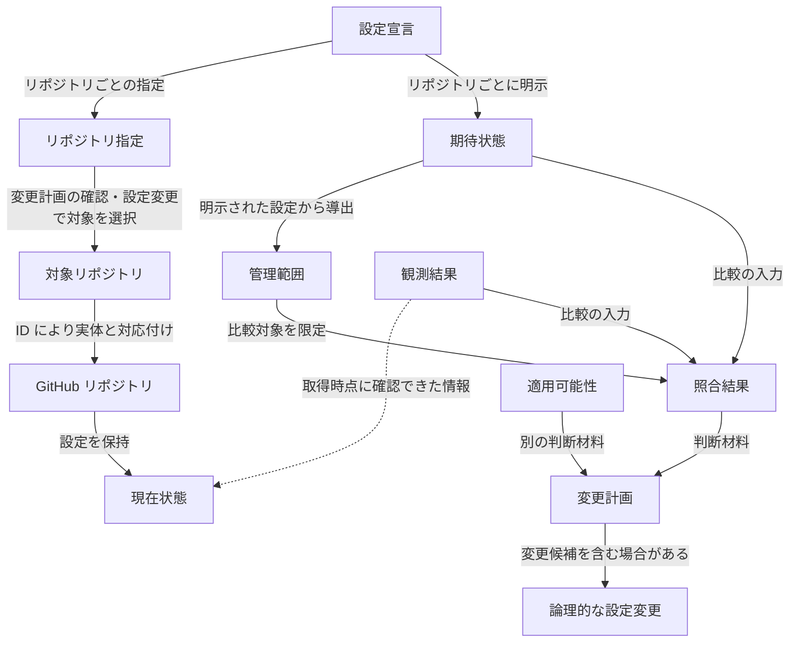

# ドメインモデル

## 1. 目的と適用範囲

本ドキュメントは、reco が GitHub リポジトリの設定を管理する際の中心概念と、その意味上の関係・区別を整理します。利用者が指定する対象と期待状態、GitHub 上の状態と観測結果、照合と変更の判断を、実現方式に依存せず理解するためのモデルです。

システムに求める振る舞い、保証、不変条件は [要求定義](../spec/requirements.md) を正本とします。YAML・CLI の入力契約、GitHub REST API の外部契約、処理順序や更新方式は本ドキュメントで再定義しません。

## 2. ドメインの全体像

reco の管理では、「利用者が管理を意図した範囲」「GitHub 上に実際に存在する状態」「確認できた状態」「変更できるかという判断」を区別します。次の図は概念間の関係を簡略化したものです。処理順序、コンポーネントの依存関係、API 呼び出し順序を表すものではありません。

設定宣言と期待状態・管理範囲の関係は **リポジトリごと** に成立します。宣言に複数のリポジトリがあっても、期待状態や管理範囲をすべてのリポジトリで共有するわけではありません。利用者が reco に要求する操作のうち、変更計画の確認（`plan`）と設定変更（`apply`）は宣言から対象を選びますが、状態確認（`show`）は設定宣言を使わずに対象リポジトリを指定して観測します。このため、対象リポジトリが必ず設定宣言に結びつくわけではありません。

観測結果から現在状態への破線は、取得時点に確認できた情報との関係を示し、状態全体の複製を意味しません。複数の取得操作にまたがる観測結果について、すべての値が同じ時点の原子的なスナップショットであることも保証しません。図では適用可能性の判断材料を省略しています。適用可能性は必要な観測情報、GitHub の制約、未管理設定への影響などに依存し、照合結果から自動的に導かれるものではありません。

## 3. 中心概念

### 3.1 GitHub が提供する対象と設定

| 日本語 | 英語 | 意味 |
|---|---|---|
| リポジトリ | Repository | GitHub 上に存在し、設定を保持するリポジトリ |
| リポジトリ所有者 | Repository Owner | GitHub 上でリポジトリを所有するアカウント |
| リポジトリ ID | Repository ID | GitHub がリポジトリの実体に付与する識別子。所有者名とリポジトリ名による指定とは異なる |
| リポジトリ設定 | Repository Setting | GitHub がリポジトリについて提供する設定。Auto-merge の許可や Actions の実行許可範囲など |
| リポジトリ一般設定 | General | リポジトリ設定のうち、Pull Request の Auto-merge の許可やマージ後のブランチ自動削除など、リポジトリ全般の振る舞いに関する設定の領域 |
| Actions 許可ポリシー | Allowed Actions Policy | 許可する Actions と再利用可能なワークフローの範囲を定める上位設定 |
| 選択方式の Actions 許可条件 | Selected Actions Criteria | 上位の許可ポリシーが `selected` のときに適用される詳細な許可条件 |

英語名は概念を説明するための呼称であり、すべてが GitHub 公式の用語・API フィールド名と一致するわけではありません。たとえば Selected Actions Criteria は、この文書で詳細な許可条件をまとめて指す呼称です。GitHub が提供する設定の意味と、reco が一体として管理する設定の単位は区別します。

Repository Owner は所有関係を表す概念であり、reco が認証主体と所有者の一致を検査することを意味しません。

### 3.2 reco が定義する概念

| 日本語 | 英語 | 意味 |
|---|---|---|
| 設定宣言 | Configuration Declaration | 利用者が明示した、リポジトリごとの宣言の集まり |
| リポジトリごとの宣言 | Repository Declaration | 設定宣言の要素。一つのリポジトリ指定と、そのリポジトリについて期待状態を明示した管理設定の組 |
| リポジトリ指定 | Repository Reference | 所有者名とリポジトリ名の組など、リポジトリを名前で指し示す情報。GitHub 上の実体を識別する Repository ID とは異なる |
| 対象リポジトリ | Target Repository | 一回の操作で選択されたリポジトリ。設定宣言に記載されているだけの指定とは区別する |
| 期待状態 | Desired State | リポジトリについて、管理対象として宣言した設定に利用者が求める状態 |
| 管理範囲 | Management Scope | リポジトリごとに、期待状態が明示された設定の集合。観測した設定や変更が必要な設定の集合とは異なる |
| 設定グループ | Setting Group | 意味を確定するために、複数の値を一体として期待状態を宣言する管理の単位。Selected actions の3項目など |
| 現在状態 | Current State | GitHub 上に実際に存在する設定状態。reco が確認できた範囲と同一ではない |
| 観測結果 | Observation Result | 観測の際に確認できた設定値と範囲、GitHub の取得条件による観測不能を表す情報 |
| 照合結果 | Reconciliation Result | 管理範囲内の期待状態と観測結果を比較した、一致・不一致・比較不能の判断 |
| 適用可能性 | Applicability | 不一致または比較不能と判定された設定について、安全な変更に必要な条件を確認できるかという判断 |
| 変更計画 | Change Plan | 対象、確認済みの差分と比較不能な設定予定、適用可否とその理由をまとめた情報 |
| 論理的な設定変更 | Logical Change | 利用者が意図する変更内容と、完了を判断する期待状態とが対応する変更の単位 |
| 更新操作 | Update Operation | GitHub に対する個々の更新要求。一つの論理的な設定変更は複数の更新操作で実現される場合がある |

現在状態の情報源は GitHub ですが、現在状態と観測できた部分を区別する意味づけは reco のモデルに属します。これらの概念は、それぞれ独立した実装上の型を設けることを要求しません。

## 4. 重要な関係と区別

### 4.1 宣言・選択・実体の識別

対象リポジトリは操作時の選択によって決まり、設定宣言に記載されたリポジトリが常に一回の操作の対象となるわけではありません。また、リポジトリ指定は名前による参照であり、GitHub 上の実体の ID ではありません。

宣言上の重複は、所有者名とリポジトリ名を大文字小文字を区別せずに比較して判定します。異なる名前が GitHub 上で同じ実体を指すかどうかは、この重複判定では扱いません。リネーム前の名前のように別の名前で同じ実体を参照すると、GitHub API はリダイレクト応答を返す場合があります。reco はこれに追従せず、読み取り要求なら観測操作の失敗、更新要求なら更新操作の成否不明として扱います。実体の同一性は、承認後の各更新操作の直前に、承認したリポジトリと同じ ID かを確認する場面で扱います。

このように、「宣言されていること」「選択されていること」「同じ実体を指すこと」は別々に判断します。

| Relationship | Target | Target Type |
|---|---|---|
| `alignment` | `FR-001` | Functional Requirement |
| `alignment` | `FR-002` | Functional Requirement |
| `alignment` | `FR-010` | Functional Requirement |
| `alignment` | `INV-004` | Invariant |

### 4.2 設定の管理単位

GitHub が意味を定める設定、reco が期待状態を指定する際に管理する単位、更新操作の単位は、一致するとは限りません。

| 単位 | 意味 | 例 |
|---|---|---|
| GitHub の設定 | GitHub が提供する個々の設定と意味上の関係 | 上位の Actions 許可ポリシーと詳細な選択条件 |
| reco の管理単位 | 独立して管理する設定、または一体として期待状態を定める設定グループ | Auto-merge は独立。Selected actions の3項目は一体 |
| 更新操作 | GitHub に対する個々の更新要求 | 上位ポリシーと詳細条件は別の操作になり得る |

Selected actions の `github_owned_allowed`・`verified_allowed`・`patterns_allowed` を一体として宣言するのは reco の入力契約です。このまとまりを、GitHub が原子的に更新できる単位とはみなしません。

管理範囲は明示された期待状態から導出されます。設定の省略と `false`・空集合の明示は異なり、期待状態との一致が確認できた設定も管理範囲に残ります。未管理設定を観測したり、別の設定の更新に必要な既存値として送信したりしても、その設定が新たな管理対象になるわけではありません。

| Relationship | Target | Target Type |
|---|---|---|
| `alignment` | `FR-001` | Functional Requirement |
| `alignment` | `FR-011` | Functional Requirement |
| `alignment` | `INV-001` | Invariant |

### 4.3 現在状態・観測結果・観測失敗

Current State は GitHub 上の実際の状態であり、Observation Result は観測の際に確認できた部分を表します。管理範囲外の設定も、変更による影響を判断するために観測される場合があります。管理範囲と観測された範囲は、同じ集合ではありません。

GitHub の取得条件により値を確認できないことと、認証・権限・通信などによって観測操作そのものが失敗することは異なります。前者は観測不能な項目として区別できますが、後者を正常な観測結果に含めません。いずれも、未確認値を `false` や空集合、既定値に補完する根拠にはなりません。

たとえば、Selected Actions Criteria の取得は上位ポリシーの条件に制約されます。取得できないことから、詳細の値が存在しない、または空であるとは判断できません。

| Relationship | Target | Target Type |
|---|---|---|
| `alignment` | `FR-004` | Functional Requirement |
| `alignment` | `QR-002` | Quality Requirement |

### 4.4 照合結果と適用可能性

| 照合結果 | 意味 |
|---|---|
| Match（一致） | 比較できた現在値が期待状態と一致する |
| Mismatch（不一致） | 比較できた現在値と期待状態が異なる |
| Not Comparable（比較不能） | GitHub の取得条件によって必要な値を確認できず、一致・不一致を判断できない |

照合は管理範囲内の設定について行います。管理対象外は照合結果の種類ではなく、観測操作の失敗も Not Comparable に含めません。

適用可能性は、Mismatch または Not Comparable と判定された設定について、安全な変更に必要な条件を確認できるかを表します。Mismatch でも適用不能な場合があり、Not Comparable でも必要な条件が成立すれば適用可能な場合があります。適用可能と判断したことは、将来の更新成功を保証しません。

| Relationship | Target | Target Type |
|---|---|---|
| `alignment` | `FR-005` | Functional Requirement |
| `alignment` | `FR-006` | Functional Requirement |

### 4.5 変更計画・論理的な設定変更・変更結果

Change Plan は、実行前に把握した対象・変更予定・適用可能性を表し、実行済みの変更を意味しません。適用不能な項目も説明のために表されますが、実行可能な変更ではありません。

Logical Change は、利用者が意図した変更内容と、その完了を判断する期待状態を結びつける単位です。管理設定と論理的な設定変更、更新操作は一対一とは限りません。たとえば、選択方式の Actions 許可条件と Actions 許可ポリシーを組み合わせて変更する場合、複数の更新操作が一つの論理的な設定変更を構成し得ます。実際の更新順序や承認・停止条件は要求定義と CLI 仕様が規定します。

変更計画、更新操作の成否、変更後の観測結果、論理的な設定変更全体の結果も、互いに別の情報です。更新要求の応答を失った後で期待状態を観測できても、当該更新操作の成否が判明したことにはなりません。更新操作の成功だけで論理的な設定変更全体の完了を判断することもできません。

変更結果は、論理的な設定変更ごとに完了・失敗・未実行のいずれかとして扱います。完了は期待状態との一致を確認でき、未管理設定の予期しない変化を検出しなかったこと、失敗は更新を開始したが完了を確認できなかったこと、未実行は更新を開始しなかったことを表します。更新操作の成否不明は失敗に含めますが、その場合も更新操作の成否と期待状態の確認結果は区別したまま扱います。

| Relationship | Target | Target Type |
|---|---|---|
| `alignment` | `FR-007` | Functional Requirement |
| `alignment` | `FR-011` | Functional Requirement |
| `alignment` | `FR-012` | Functional Requirement |
| `alignment` | `FR-013` | Functional Requirement |

## 5. シナリオと反例

以下は概念の意味を確認する例です。独立した入力条件や実行規則を定義するものではありません。

| 状況 | 解釈 | 誤った解釈 |
|---|---|---|
| 状態確認で、設定宣言を使わずにリポジトリを観測 | 対象リポジトリと観測結果は存在する | 対象は必ず設定宣言から選ばれる |
| `allow_auto_merge: false` を宣言し、観測値も `false` | 管理範囲内で Match。更新は不要 | 更新不要なので管理対象外 |
| 未管理設定（例：`sha_pinning_required`）を観測 | 管理範囲外の値も観測対象になり得る | 観測した値は自動的に管理対象に入る |
| Selected actions の詳細を上位ポリシーの条件により取得できない | 観測不能であり、照合時には Not Comparable になり得る | 値が空、または観測操作が失敗したと決めつける |
| Mismatch だが安全な変更に必要な条件を確認できない | 不一致と適用不能は併存する | 不一致なら更新可能 |
| 更新要求の応答を失った後、期待状態に一致する値を観測 | 更新後の観測と更新操作の成否は別の情報 | 更新操作の成功が確認できた |

## 6. References

- [要求定義](../spec/requirements.md)
- [CLI 仕様](../spec/cli.md)
- [YAML 設定仕様](../spec/configuration.md)
