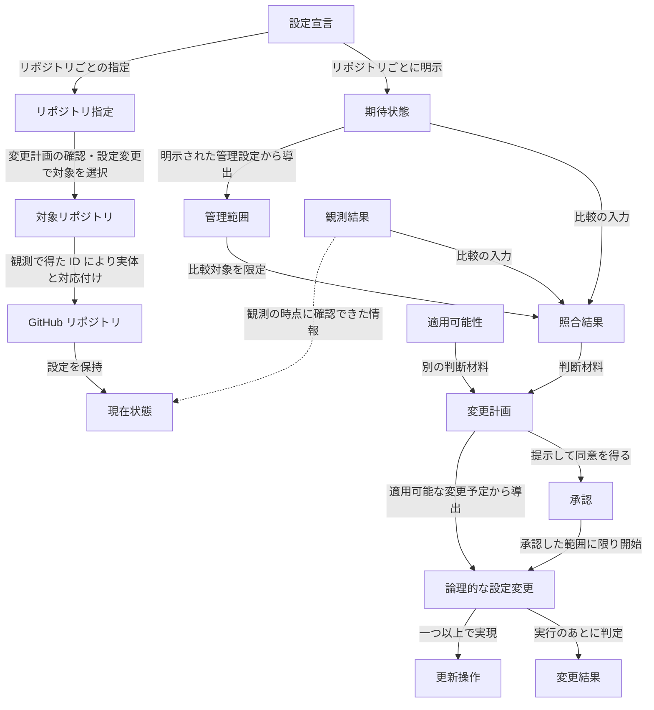

# ドメインモデル

## 1. 目的と適用範囲

本ドキュメントは、reco が GitHub リポジトリの設定を管理する際の中心概念と、その意味上の関係・区別を整理します。利用者が指定する対象と期待状態、GitHub 上の状態と観測結果、照合と変更の判断、承認と実行の結果を、実現方式に依存せず理解するためのモデルです。特定の設定に固有の意味、規則、例は [設定ごとの設計](settings/README.md) が定め、本ドキュメントはどの設定にも通じる概念と区別を扱います。

システムに求める振る舞い、保証、不変条件は [要求定義](../spec/requirements.md) を正本とします。YAML・CLI の入力契約、GitHub REST API の外部契約、処理順序や更新方式は本ドキュメントで再定義しません。

## 2. ドメインの全体像

reco の管理では、「利用者が管理を意図した範囲」「GitHub 上に実際に存在する状態」「確認できた状態」「変更できるかという判断」「承認した変更がどう終わったか」を区別します。次の図は概念間の関係を簡略化したものです。処理順序、コンポーネントの依存関係、API 呼び出し順序を表すものではありません。

設定宣言と期待状態・管理範囲の関係は **リポジトリごと** に成立します。宣言に複数のリポジトリがあっても、期待状態や管理範囲をすべてのリポジトリで共有するわけではありません。利用者の操作のうち、変更計画の確認（`plan`）と設定変更（`apply`）は宣言から対象を選びますが、状態確認（`show`）は設定宣言を使わずに対象リポジトリを指定して観測します。このため、対象リポジトリが必ず設定宣言に結びつくわけではありません。

観測結果から現在状態への破線は、観測の時点に確認できた情報との関係を示し、状態全体の複製を意味しません。複数の取得操作にまたがる観測結果について、すべての値が同じ時点の原子的なスナップショットであることも保証しません。図では適用可能性の判断材料を省略しています。適用可能性は必要な観測情報、GitHub の制約、未管理設定への影響などに依存し、照合結果から自動的に導かれるものではありません。

図の「現在状態」には、リポジトリ設定の値のほかに、Environment や Variable のような関連リソースが存在するかどうかも含まれます。関連リソースに固有の区別は「関連リソースと存在」で定めます。

## 3. 中心概念

### 3.1 GitHub が提供する対象と設定

| 日本語 | 英語 | 意味 |
|---|---|---|
| リポジトリ | Repository | GitHub 上に存在し、設定を保持するリポジトリ |
| リポジトリ ID | Repository ID | GitHub がリポジトリの実体に付与する識別子。所有者名とリポジトリ名による指定とは異なる |
| リポジトリ設定 | Repository Setting | GitHub がリポジトリについて提供する設定。Auto-merge の許可や Actions の実行許可範囲など |
| 設定の値 | Setting Value | 一つの設定が取る値。取り得る値と、二つの値が同じかどうかの判定は、設定ごとに決まっている。設定グループについては、項目ごとの値の組を一つの値として扱う。関連リソースそのものの「存在する」（値を持つ種類では、その値を伴う）と「存在しない」も、設定の値と同じ表現で持ち、同じ判定で比べる（4.8節） |
| 設定の領域 | Setting Area | リポジトリ設定と関連リソースの区分。reco が扱うリポジトリ設定と関連リソースは、いずれか一つの設定の領域に属する。一回の観測で読み取る範囲を選ぶ単位になる |
| 依存する設定 | Dependent Setting | 別の設定（前提の設定）が有効のあいだに限って有効にでき、前提の設定を無効にする更新に伴って GitHub が無効にする設定。Dependabot security updates と、リポジトリの push protection が当たる。上位の設定が取得条件になる関係（Actions の有効状態と Actions 許可ポリシー）とは異なり、依存する設定も前提の設定も、もう一方の状態によらず観測できる。前提の設定が無効のあいだの更新要求に GitHub がどう応答するかは、組ごとに異なる（[Security の設計](settings/security.md)） |
| 前提の設定 | Prerequisite Setting | 依存する設定を有効にするために、有効でなければならない設定。Dependabot security updates に対する Dependabot alerts と、リポジトリの push protection に対する Secret scanning の有効状態が当たる |
| リポジトリの公開範囲 | Visibility | リポジトリが公開か非公開か。reco は設定の領域に含めず、表示も管理もしない。取得条件の判定にだけ読み取る |
| リポジトリへの admin のアクセス | Admin Access | 認証したトークンの所有者が、リポジトリの admin のアクセスを持つか。reco は設定の領域に含めず、表示も管理もしない。読み取り要求の応答の解釈にだけ読み取る |
| 関連リソース | Related Resource | リポジトリに属し、名前で識別され、一つのリポジトリに複数あり得るもの。GitHub 上で作られ、消される。Environment や Variable がこれに当たる。リポジトリごとに一つに決まるリポジトリ設定とは異なり、存在するかどうかが名前ごとに違う |
| 属する先 | Parent | 関連リソースが属するもの。リポジトリか、別の関連リソース（Environment Variable にとっての Environment）である |
| 関連リソースの種類 | Resource Kind | 関連リソースの区分。属する先、名前が同じかどうかの判定、値や設定を持つかどうか、GitHub が ID を付けるかどうかは、種類ごとに決まっている |
| 関連リソースの名前 | Resource Name | 属する先の中で、同じ種類の関連リソースを一つに定める名前。GitHub が関連リソースの実体に付ける ID とは異なる |
| 同一性を判定できる名前 | Comparable Name | GitHub が同じとみなすかどうかを reco が判定できる形の関連リソースの名前。形は種類ごとに決まる（4.8節）。宣言の名前は、入力検証によりこの形に限る。観測の名前がこの形でなく、宣言の名前と ASCII の英字の大文字小文字を除いて一致しないとき、二つが同じかどうかは判定できない |

設定の領域ごとの設定と、その用語は、[設定ごとの設計](settings/README.md) の各文書の「設定と管理の単位」が定めます。

英語名は概念を説明するための呼称であり、すべてが GitHub 公式の用語・API フィールド名と一致するわけではありません。GitHub が提供する設定の意味と、reco が一体として管理する設定の単位は区別します。

### 3.2 操作と対象

| 日本語 | 英語 | 意味 |
|---|---|---|
| 利用者の操作 | Operation | 利用者が reco に要求する一回の実行。状態確認、変更計画の確認、設定変更の三つがある。観測操作や更新操作とは異なる |
| リポジトリ指定 | Repository Reference | 所有者名とリポジトリ名の組で、リポジトリを名前で指し示す情報。GitHub 上の実体を識別する Repository ID とは異なる |
| 対象リポジトリ | Target Repository | 一回の利用者の操作で選択されたリポジトリ。設定宣言に記載されているだけの指定とは区別する。観測のあとは、指定が指した実体の Repository ID を伴う |

### 3.3 宣言

| 日本語 | 英語 | 意味 |
|---|---|---|
| 設定宣言 | Configuration Declaration | 利用者が明示した、リポジトリごとの宣言の集まり |
| リポジトリごとの宣言 | Repository Declaration | 設定宣言の要素。一つのリポジトリ指定と、そのリポジトリの期待状態の組 |
| 管理の単位 | Management Unit | reco が期待値の宣言を受け付ける単位。単独の設定、設定グループ、関連リソースそのもののいずれかである。リポジトリ設定の管理の単位は、どのリポジトリの宣言にも共通の決まった集合で、宣言されたかどうかによらない。関連リソースと、その中の設定の管理の単位は、種類ごとに形が決まり、名前ごとに一つある |
| 設定グループ | Setting Group | 意味を確定するために、複数の値を一体として期待値を宣言する管理の単位。Selected actions の3項目など |
| 管理設定 | Managed Setting | あるリポジトリについて、利用者が期待値を明示した管理の単位。期待状態の宣言、照合、変更予定の単位になる |
| 期待状態 | Desired State | リポジトリについて、管理設定に利用者が求める状態。管理設定ごとの期待値からなる |
| 期待値 | Desired Value | 一つの管理設定に明示された設定の値。`false` や空集合も期待値であり、省略とは異なる。関連リソースそのものを管理の単位とする管理設定では、存在すること（値を持つ種類では、その値を伴う）か、存在しないことのどちらかである |
| 存在しないことの宣言 | Declared Absence | 関連リソースが存在しないことを期待値とする、明示的な宣言。受け付けるかどうかは関連リソースの種類ごとに決まる。宣言の省略とは異なる |
| 管理範囲 | Management Scope | リポジトリごとの、管理設定の集合。観測した設定や変更が必要な設定の集合とは異なる |
| 未管理設定 | Unmanaged Setting | 対象リポジトリの管理範囲に含まれない設定。宣言を省略した管理の単位を指し、管理の単位に含まれず宣言できない設定があれば、それも含む。宣言していない名前の関連リソースと、その中の設定も含む。観測や更新操作への併送の対象になっても、管理対象にはならない |

「管理設定」「未管理設定」のほか、以下の「変更対象外の設定」「副作用を示さなかった設定」などの「設定」は、管理の単位に当たるものを指し、関連リソースそのものも含みます。

### 3.4 観測と GitHub への要求

| 日本語 | 英語 | 意味 |
|---|---|---|
| 現在状態 | Current State | GitHub 上に実際に存在する設定状態。どの名前の関連リソースが存在するかを含む。reco が確認できた範囲と同一ではない |
| 観測 | Observation | 対象リポジトリの設定を、ある時点に GitHub から読み取って確かめること。読み取る設定の領域は観測ごとに決まる。一回の利用者の操作の中でも、時点が異なれば別の観測である |
| 観測結果 | Observation Result | 一回の観測で確認できた情報。指定が指した実体の Repository ID と、読み取った設定の領域の設定ごとの、設定の観測結果からなる。関連リソースを読み取った設定の領域については、その種類の存在する関連リソースの一覧も含む。読み取らなかった設定の領域の情報は含まない |
| 取得条件 | Retrieval Condition | GitHub が設定の値か関連リソースの存在を返すための条件。上位の設定の状態や、リポジトリの公開範囲などがある。成り立たないときの観測不能は、その取得条件を理由として伴う |
| 観測値 | Observed Value | 一つの設定について、観測で確認できた設定の値。現在状態での値（現在値）を、その観測の時点に確認したものである |
| 観測不能 | Unavailable | 観測は成り立ったが、特定の設定の値か関連リソースの存在を確認できないこと。理由は、GitHub の取得条件、属する先の関連リソースが存在しないこと、名前の同一性を判定できないことのいずれかである。理由を伴い、二つの観測不能が同じ理由によるかを判定できる。値が空であることや、観測操作の失敗とは異なる |
| 設定の観測結果 | Setting Observation | 観測結果の要素。一つの設定について、観測値か、理由を伴う観測不能のどちらか一方を持つ |
| 関連リソースの観測結果 | Resource Observation | 一つの名前の関連リソースについて、観測結果から導く、存在する、存在しない、理由を伴う観測不能のいずれか一つ。観測結果の要素ではなく、存在する関連リソースの一覧とその名前を突き合わせて決まる。存在するときは、値を持つ種類ではその観測値を、GitHub が ID を付ける種類ではその ID を伴う |
| 存在しない | Absent | 観測が成り立ち、その名前の関連リソースが GitHub 上にないと確かめられたこと。関連リソースが持つ値（空文字列など）の一つではなく、観測不能とも観測操作の失敗とも異なる |
| 観測操作の失敗 | Observation Failure | 認証・権限・通信などにより観測そのものが成り立たなかったこと。観測結果に含めない |
| GitHub への要求の失敗 | Request Failure | 読み取り要求または更新要求に対して、成功の応答を契約どおりに受け取れなかったこと。原因の種類で区別する |
| 更新エンドポイント | Update Endpoint | GitHub が更新要求を受け付ける単位。更新操作は、いずれか一つの更新エンドポイントへ更新要求を送る。一つの更新エンドポイントが複数の設定の値を受け付ける場合がある |
| 更新操作の結果 | Update Outcome | 一つの更新操作について、GitHub の応答から判断した成功・失敗・成否不明の区別。論理的な設定変更の変更結果とは異なる |

### 3.5 計画

| 日本語 | 英語 | 意味 |
|---|---|---|
| 照合結果 | Reconciliation Result | 一つの管理設定について、期待値と観測結果を比較した、一致・不一致・比較不能の判断。比較不能は、その管理設定の設定の観測結果か関連リソースの観測結果が観測不能のときに限って生じ、観測不能の理由を比較できない理由として伴う |
| 変更予定 | Planned Change | 照合結果が不一致または比較不能の管理設定。不一致によるものを確認済みの差分、比較不能によるものを比較不能な設定予定と呼び分ける。適用可能とは限らない |
| 作成 | Creation | 存在しないと確かめた関連リソースを、存在することを期待値とする宣言に基づいて作る変更予定。確認済みの差分である |
| 削除 | Deletion | 存在する関連リソースを、存在しないことの宣言に基づいて消す変更予定。確認済みの差分である。存在しないことの宣言を受け付ける種類に限って生じる |
| 適用可能性 | Applicability | 変更予定について、安全な変更に必要な条件を確認できるかという判断。適用可能か適用不能のいずれかで、適用不能は理由を伴う。理由は、成り立っていない条件に関わる未管理設定を伴うことがある |
| 変更に伴う副作用 | Side Effect | 宣言された変更を実行すると、GitHub の仕様によって避けられずに生じ、論理的な設定変更が完了したあとも残る、未管理設定の値の消失や変化。一つの論理的な設定変更の更新操作のあいだだけ生じる中間状態は含めない。影響を受ける設定と、起きる変化（失われる、無効になる、有効になる）で表す。reco が観測する設定に及ぶ副作用は、その設定の計画時の設定の観測結果を伴い、観測値があれば変わる前の値を、観測不能であれば失われる可能性だけを示す。reco が観測しない設定（Dependency graph）に及ぶ副作用は、観測結果を伴わず、起きる変化だけを示す。副作用を生む変更予定に添えて提示し、承認の対象に含める |
| 副作用を示さなかった設定 | Setting Without Side Effect | 宣言された変更が、計画時の値のままなら変えないため副作用として示さなかった未管理設定。承認のあとに外部主体が値を変えると、その変更が承認の前に示していない変化を GitHub に起こさせ得るため、計画時の設定の観測結果を伴い、変更前提で計画時の値のままであることを確かめる。前提の設定を無効にする変更予定で、宣言されておらず、計画時に無効だった依存する設定が当たる |
| 再開する設定 | Resumed Setting | 宣言した変更が、宣言していない設定の値を変えずに、GitHub が残していた値の効力を戻すとき、効力を取り戻す未管理設定。値は失われないため、変更に伴う副作用とは区別する。計画時に取得条件により観測不能で、値を示せないことがある。再開させる変更予定に添えて提示し、承認の対象に含める。Actions を無効から有効にする変更予定が当たる（[Actions の設計](settings/actions.md)） |
| 変更不要 | No Change Needed | リポジトリの計画が変更予定を一つも持たないこと。計画時の観測で確かめた事実であり、変更結果ではない |
| 管理設定の計画 | Setting Plan | リポジトリの計画の要素。一つの管理設定について、計画時の設定の観測結果（関連リソースそのものを管理の単位とする管理設定では、関連リソースの観測結果）、期待値、照合結果をまとめたもの。変更予定であれば、適用可能性、変更に伴う副作用、副作用を示さなかった設定、再開する設定も含む |
| リポジトリの計画 | Repository Plan | 変更計画の要素。一つの対象リポジトリについて、Repository ID と、管理範囲内のすべての管理設定の計画をまとめたもの |
| 変更計画 | Change Plan | 一回の利用者の操作で選択されたすべての対象リポジトリについて、リポジトリの計画をまとめた情報。確認済みの差分、比較不能な設定予定、適用可否とその理由を表し、承認の対象になる |
| 論理的な設定変更 | Logical Change | 利用者が意図する変更内容と、完了を判断する期待状態とが対応する変更の単位。適用可能な一つ以上の変更予定から導き、順序の決まった一つ以上の更新操作で実現する |
| 論理的な設定変更が変える設定 | Settings to Change | 論理的な設定変更がまとめた管理設定と、その期待値が含む状態の設定（4.2節）。変更対象外の設定から除く |
| 更新操作 | Update Operation | 論理的な設定変更を構成する、GitHub に対する個々の更新要求の単位。いずれか一つの更新エンドポイントへ更新要求を一度送る。順序と、関係する現在値に当たる設定、承認時に予定した値は、計画で定まる。変更前提が成立せず、開始しない更新操作もある |
| 承認時に予定した値 | Anticipated Value | 更新操作ごとに計画が定める、変更前提の基準。関係する現在値と比べる。設定ごとに、設定の値か、理由を伴う観測不能のどちらか一方を持つ。関連リソースでは、存在する、存在しない、理由を伴う観測不能のいずれか一つを持ち、値を持つ種類で存在するときは、その値を伴う。設定の観測結果や関連リソースの観測結果と同じ形をとるが、観測で確かめた事実ではなく、承認の対象になる見込みである。計画時の観測値とは限らず、先行する更新操作が変える設定では、その更新操作による予定どおりの変化を反映した値である。先行する更新操作が作成する関連リソースでは、存在することであり、承認の時点で定まらない ID は持たない |

### 3.6 承認と実行

| 日本語 | 英語 | 意味 |
|---|---|---|
| 承認 | Approval | 提示した変更計画の対象と変更内容について、利用者が対話で与える明示的な同意。一回の設定変更の実行に限り有効で、承認した対象と変更内容だけに及ぶ |
| 変更前提 | Change Precondition | 承認した論理的な設定変更を構成する一つの更新操作を、開始してよい条件。更新操作ごとに、その直前に確かめる。対象が承認したリポジトリと同じ実体であること、関係する現在値が承認時に予定した値と同じであること、適用条件が成立すること |
| 関係する現在値 | Relevant Current Value | ある更新操作の変更前提で、承認時に予定した値と比べる設定の、更新直前の設定の観測結果。関連リソースでは、更新直前の関連リソースの観測結果である。どの設定が当たるかは更新操作ごとに決まり、その更新操作が変える設定、その更新操作が生む副作用として提示した設定、副作用を示さなかった設定、先行する更新操作が変えた設定、その更新操作が更新要求に含めて送る変えない設定、その更新操作が値を変える前提として有効でなければならない設定を含み得る |
| 変更前提の確認結果 | Precondition Check | 一つの更新操作の変更前提を、更新直前に確かめた結果。成立か、不成立の四つの形（同一性の不一致、関係する現在値の変化、適用条件の不成立、確認不能）のいずれかである。先行する異常によって確かめなかった更新操作には、確認結果がない |
| 期待状態の確認結果 | Desired State Confirmation | 更新操作のあとの観測で、論理的な設定変更の期待状態を確かめた結果。一致、不一致、確認失敗を区別し、更新操作の結果とは別に扱う。期待値と比べる設定が観測不能で、観測できた値に期待値と異なるものがない場合は、確認失敗に当たる。更新後の観測が承認したリポジトリと同じ実体を指さない場合も、値を比べずに確認失敗とする。不一致は、期待値と異なる値を観測した管理設定を伴う |
| 変更対象外の設定 | Outside Setting | ある論理的な設定変更の更新操作によって影響を受け得る設定のうち、その論理的な設定変更が変えず、変更に伴う副作用として提示もしていないもの。管理設定か未管理設定かを問わない |
| 変更対象外の設定の予期しない変化 | Unexpected Outside Change | 変更対象外の設定について、更新直前の観測値と更新後の観測値が異なること。原因は断定しない |
| 変更結果 | Change Result | 論理的な設定変更ごとの完了（Completed）・失敗（Failed）・未実行（Not Attempted）の区別。変更前提の確認、更新操作の結果、期待状態の確認結果、変更対象外の設定の予期しない変化の有無から導く |

現在状態の情報源は GitHub ですが、現在状態と観測できた部分を区別する意味づけは reco のモデルに属します。これらの概念は、それぞれ独立した実装上の型を設けることを要求しません。

## 4. 重要な関係と区別

### 4.1 宣言・選択・実体の識別

対象リポジトリは操作時の選択によって決まり、設定宣言に記載されたリポジトリが常に一回の操作の対象となるわけではありません。また、リポジトリ指定は名前による参照であり、GitHub 上の実体の ID ではありません。

状態確認で利用者が操作時に与える所有者名とリポジトリ名の組も、設定宣言の要素と同じリポジトリ指定です。

宣言上の重複は名前で判定します。異なる名前が GitHub 上で同じ実体を指すかどうかは、この重複判定では扱いません。名前変更前の名前で同じ実体を参照すると、GitHub API はリダイレクト応答を返します。reco はこれに追従せず、読み取り要求なら観測操作の失敗、更新要求なら更新操作の成否不明として扱います。

名前が指す実体は、観測してはじめて分かります。対象リポジトリの Repository ID は観測結果から得られ、名前と実体の対応はその観測の時点のものです。実体の同一性は、承認後の各更新操作の直前に、承認したリポジトリと同じ ID かを確認する場面で扱います。この確認は、Repository ID が名前変更や移転で変わらず、別の実体に割り当てられないことを前提とします。

| Relationship | Target | Target Type |
|---|---|---|
| `alignment` | `FR-001` | Functional Requirement |
| `alignment` | `FR-002` | Functional Requirement |
| `alignment` | `FR-010` | Functional Requirement |
| `alignment` | `INV-004` | Invariant |

### 4.2 管理の単位と管理設定

GitHub が意味を定める設定、reco が期待値の宣言を受け付ける管理の単位、更新操作の単位、GitHub が更新要求を受け付ける更新エンドポイントは、一致するとは限りません。

| 単位 | 意味 | 例 |
|---|---|---|
| GitHub の設定 | GitHub が提供する個々の設定と意味上の関係 | 上位の Actions 許可ポリシーと詳細な選択条件 |
| 管理の単位 | 独立して管理する単独の設定、または一体として期待値を定める設定グループ | Auto-merge は単独。Selected actions の3項目は一つの設定グループ |
| 更新操作 | GitHub に対する個々の更新要求 | 上位ポリシーと詳細条件は別の操作になり得る |
| 更新エンドポイント | GitHub が更新要求を受け付ける単位 | Actions 許可ポリシーと選択方式の Actions 許可条件は、同じ設定の領域に属するが、別々の更新エンドポイントで更新する |

Selected actions の `github_owned_allowed`・`verified_allowed`・`patterns_allowed` を一体として宣言するのは reco の入力契約です。このまとまりを、GitHub が原子的に更新できる単位とはみなしません。照合結果、変更予定、適用可能性は管理設定ごとに一つ定まり、設定グループの内訳ごとには定めません。設定の観測結果、関係する現在値、変更対象外の設定を数えるときも、設定グループは一つの設定です。

reco が扱う設定は、広い順に三つの集合をなします。reco が観測する設定、そのうち宣言を受け付ける管理の単位、そのうちあるリポジトリで期待値が明示された管理設定です。

リポジトリ設定の管理の単位は、どのリポジトリにも共通の決まった集合です。関連リソースと、その中の設定の管理の単位は名前を含むため、決まった集合になりません。その形は「関連リソースと存在」で定めます。

管理範囲は明示された期待値から導出されます。設定の省略と `false`・空集合の明示は異なり、期待値との一致が確認できた管理設定も管理範囲に残ります。管理設定か未管理設定かはリポジトリごとに決まるため、同じ管理の単位が、あるリポジトリでは管理設定、別のリポジトリでは未管理設定になります。未管理設定を観測したり、別の設定の更新に必要な既存値として送信したりしても、その設定が新たな管理対象になるわけではありません。

管理の単位の期待値が、別の管理の単位が表す設定の状態を含むことがあります。このとき、その状態にする変更は、期待値を含む管理設定の変更であり、未管理設定の変更には当たりません。その状態を表す管理の単位を同じリポジトリで宣言しても期待状態は増えず、同じ状態の変化を二つの管理設定の変更予定として数えません。Actions 許可ポリシーの期待値が、Actions が有効であることを含む場合がこれに当たります（[Actions の設計](settings/actions.md) の設定と管理の単位）。

これに対して、依存する設定と前提の設定の期待値は、互いの状態を含みません。Dependabot security updates を有効と宣言しても、Dependabot alerts を有効にすることは期待状態に含まれず、Dependabot alerts は未管理設定のままです。リポジトリの push protection と Secret scanning の有効状態も同じです。そのため、前提の設定が無効で宣言されていないリポジトリで、依存する設定を有効にする変更は、未管理設定を変えなければ実行できません（照合結果と適用可能性）。

設定の領域は、更新操作の影響が及ぶ範囲を表す単位ではありません。同じ設定の領域の設定が、別々の更新エンドポイントで更新される場合があるためです。更新操作の影響が及び得る範囲は、その更新操作が更新要求を送る更新エンドポイントで決まります。観測で読み取る範囲は設定の領域で選ぶため、更新前後の観測で読み取った設定のすべてが、変更対象外の設定になるわけではありません。

二つの設定の値が同じかどうかは、設定の意味で決まります。要素の順序に意味のない設定では、順序だけが異なる二つの値は同じ値です。許可パターンと、デプロイ元制限の個別パターン（4.8）がこれに当たります。この判定は、期待値と観測値を比べる照合に限らず、変更前提の確認、更新後の期待状態の確認、変更対象外の設定の予期しない変化の検出にも使います。GitHub が応答で要素を並べ替えて返しても、設定の状態は変わっていないためです。要素の順序に意味のある設定では、順序の違いも値の違いです。

設定グループの値は、すべての項目が同じ値のときに限り同じ値です。

同じ値と判定された二つの値でも、要素の並びまで同じとは限りません。期待値は宣言された並びを、観測値は GitHub が返した並びを保ちます。並びを揃えるのは同じ値かどうかの判定の中だけで、表示や GitHub へ送る値は保った並びを使います。並びのほかにも、同じ値と判定される二つの値が異なる表現を持つ設定があり（Dependabot security updates の一時停止。[Security の設計](settings/security.md)）、表示は保った表現を使い、比べるときは表現の違いで結果を変えません。

| Relationship | Target | Target Type |
|---|---|---|
| `alignment` | `FR-001` | Functional Requirement |
| `alignment` | `FR-005` | Functional Requirement |
| `alignment` | `FR-011` | Functional Requirement |
| `alignment` | `INV-001` | Invariant |

### 4.3 現在状態・観測結果・観測失敗

Current State は GitHub 上の実際の状態であり、Observation Result は一回の観測で確認できた部分を表します。管理範囲外の設定も、変更による影響を判断するために観測される場合があります。管理範囲と観測された範囲は、同じ集合ではありません。

一回の観測が読み取る設定の領域は、観測結果を使う側が決めます。状態確認は reco が観測できるすべての設定の領域を読み取り、変更計画の確認と設定変更は判断に必要な設定の領域を読み取ります。変更計画の確認で判断に必要な設定の領域は、対象リポジトリの管理範囲に含まれる管理設定が属する設定の領域です。設定変更の更新直前と更新後の観測で判断に必要な設定の領域は、変更前提で比べる関係する現在値、期待状態、比べる変更対象外の設定が属する設定の領域です。Repository ID は、名前が指す実体を確かめるために、どの観測でも読み取ります。読み取らなかった設定の領域の値は観測結果になく、これは観測不能とも観測操作の失敗とも異なります。値を確認しようとしていないためです。観測不能と同じく、`false` や空集合、既定値に補完する根拠にはなりません。

GitHub の取得条件により値を確認できないことと、認証・権限・通信などによって観測操作そのものが失敗することは異なります。前者は観測結果の中の観測不能として区別できますが、後者を正常な観測結果に含めません。いずれも、未確認値を `false` や空集合、既定値に補完する根拠にはなりません。

たとえば、Selected Actions Criteria の取得は上位ポリシーの条件に制約されます。取得できないことから、詳細の値が存在しない、または空であるとは判断できません。

観測不能は設定ごとに決まります。同じ設定の領域を読み取った一回の観測の中で、ある設定は観測値を持ち、別の設定は観測不能になります。Actions が無効のリポジトリでは、Actions の有効状態は「無効」という観測値を持ち、Actions 許可ポリシー、`sha_pinning_required`、選択方式の Actions 許可条件は観測不能です。一つの取得条件が複数の設定を観測不能にするとき、それらの設定は同じ理由を持ちます。設定の領域が異なっても、取得条件を根拠づける資料や応答が設定ごとに違っても同じです。理由が表すのは取得条件そのものだからです。GitHub が応答に値を含めていても、その値が設定の状態を示さないと分かっている場合は、観測値にしません。Actions が無効のときに返る `sha_pinning_required` がこれに当たります。

取得条件は、上位の設定の状態とは限りません。`access_level` は非公開リポジトリにだけ適用され、公開リポジトリでは観測不能です。理由はリポジトリが公開であることで、Actions の有効状態には左右されません。公開と分かったとき、reco は `access_level` の読み取り要求を送りません。要求を送らない点は読み取らなかった設定の領域と同じですが、意味は異なります。読み取らなかった設定の領域は、観測結果を使う側が読み取らないと決めたもので、値を確認しようとしていません。公開リポジトリの `access_level` は、値を確認しようとして公開範囲を読み取り、取得条件により確認できなかったもので、理由を伴う観測不能として観測結果に含まれます。

GitHub が、設定の値を応答の本文ではなく、要求が成り立ったかどうかで返す取得があります。失敗を表す応答は、権限の不足やリポジトリの不存在でも返る GitHub への要求の失敗であり、その応答だけでは値を判断できません。reco がその応答を観測値として読むのは、同じ観測の中で、その応答にほかの解釈が残らないと確かめたときに限ります。確かめられなかったときは、ほかの読み取りと同じく観測操作の失敗であり、観測不能にもしません。値を確認できない理由を、GitHub の取得条件として根拠づけられないためです。この読み方は、GitHub が値をこの形で返すと確かめた取得だけに当て、ほかの読み取り要求の失敗の応答は観測操作の失敗のままです。どの取得に当て、何を確かめるかは [設定ごとの設計](settings/README.md) が定めます（Dependabot alerts。[Security の設計](settings/security.md)）。

取得条件に当たらないと観測した直後に、GitHub がその設定の読み取りを拒否した場合は、観測不能ではなく観測操作の失敗です。Actions 許可ポリシーを `selected` と観測したあとで、選択方式の Actions 許可条件を取得できなかった場合がこれに当たります（ほかの例は [設定ごとの設計](settings/README.md) の各文書の「観測」）。二つの読み取りのあいだに現在状態が変わった可能性があり、どちらの時点の状態も一つの観測結果として確認できていないためです。

観測操作の失敗は、読み取り要求が GitHub への要求の失敗に終わったことを指します。失敗の種類は「GitHub への要求の失敗と更新操作の結果」で定めます。

設定変更では、同じ対象リポジトリを異なる時点に観測します。それぞれの時点の観測結果は別の情報であり、後の時点の観測結果で前の時点の観測結果を置き換えません。

| 観測の時点 | 観測結果の使い道 |
|---|---|
| 計画時の観測 | 照合と適用可能性の判断の入力になる。承認の際に提示する観測値と、承認したリポジトリの ID を与える |
| 更新直前の観測 | その更新操作の変更前提を確かめる。その更新操作が最初に影響を及ぼし得る変更対象外の設定の、更新前の値を与える |
| 更新後の観測 | 期待状態の確認結果と、変更対象外の設定の予期しない変化の有無を与える |

GitHub は、更新要求に正常応答を返したあと、すぐには取得の結果に更新を反映しないことがあります。更新後の観測は、更新が反映されたあとの状態を捉えるため、時間をおいて観測し直す場合があります。観測し直しは、更新後の観測という一つの時点の中で行います。期待状態の確認結果と変更対象外の設定の予期しない変化を与えるのは、観測し直しを打ち切った最後の観測です。それより前の観測は、更新がまだ反映されていないときの値を示している可能性があるため使いません。観測し直す条件、待つ時間と回数はアーキテクチャ設計が定めます。

先行する更新操作の反映の遅れは、同じ論理的な設定変更の後続の更新操作の、更新直前の観測にも現れます。この観測も、先行する更新操作が反映されたあとの状態を捉えるため、時間をおいて観測し直す場合があります。観測し直しは、その更新操作の更新直前の観測という一つの時点の中で行い、変更前提の確認結果を与えるのは、観測し直しを打ち切った最後の観測です。観測し直すのは読み取りだけで、先行する更新操作の結果を変えません。

更新直前の観測は更新操作ごとに、更新後の観測は論理的な設定変更ごとに行います。変更前提は更新操作ごとに確かめ、期待状態は論理的な設定変更の全体について確かめるためです。先行する論理的な設定変更の更新後の観測は、次の論理的な設定変更の更新直前の観測を兼ねません。

変更対象外の設定の更新前の値を与えるのは、その設定が影響を受け得る更新操作のうち、最初のものの直前の観測です。二つの更新操作からなる論理的な設定変更で、一つ目だけが影響を及ぼし得る設定は、一つ目の直前の観測値と更新後の観測値を比べます。二つ目の直前の観測値は、この比較に使いません。二つ目の直前を基準にすると、一つ目が起こした変化を見逃すためです。

状態確認と変更計画の確認が行うのは、対象リポジトリごとに、計画時の観測に当たる一度の観測だけです。

| Relationship | Target | Target Type |
|---|---|---|
| `alignment` | `FR-004` | Functional Requirement |
| `alignment` | `FR-010` | Functional Requirement |
| `alignment` | `FR-012` | Functional Requirement |
| `alignment` | `QR-002` | Quality Requirement |
| `alignment` | `INV-004` | Invariant |

### 4.4 照合結果と適用可能性

| 照合結果 | 意味 |
|---|---|
| Match（一致） | 比較できた観測値が期待値と同じ値である |
| Mismatch（不一致） | 比較できた観測値と期待値が異なる |
| Not Comparable（比較不能） | 比較に必要な設定の値か関連リソースの存在が観測不能で、一致・不一致を判断できない |

照合は管理範囲内の管理設定について行います。管理対象外は照合結果の種類ではなく、観測操作の失敗も Not Comparable に含めません。

適用可能性は、変更予定（Mismatch または Not Comparable と判定された管理設定）について、安全な変更に必要な条件を確認できるかを表します。Mismatch でも適用不能な場合があり、Not Comparable でも必要な条件が成立すれば適用可能な場合があります。適用可能と判断したことは、将来の更新成功を保証しません。

適用可能性は変更予定にだけ定まり、変更計画に含まれる変更予定は、すべて適用可能か適用不能のいずれかに判断されています。Match と判定された管理設定には適用可能性の判断がありません。判断がないことは、適用不能を意味しません。

適用可能性の判断材料は、変更予定の計画時の設定の観測結果と期待値、同じ対象リポジトリのほかの管理設定の期待値、同じ設定の領域の未管理設定の計画時の観測値、および GitHub の取得と更新の制約です。設定ごとの適用可能性は、[設定ごとの設計](settings/README.md) の各文書の「適用可能性と副作用」が定めます。

GitHub が、複数の設定の値の組み合わせを受け付けないことがあります。変更予定を適用したあとの組み合わせは、管理設定の期待値と、同じ設定の領域の未管理設定の計画時の観測値から決まります。その組み合わせを GitHub が受け付けないとき、組み合わせをそこへ向かわせる変更予定は、どれも適用不能です。組み合わせを解消できるのは未管理設定の変更だけで、reco は宣言されていない設定を変えないためです。このとき適用不能の理由は、組み合わせに関わる未管理設定を伴います。変更計画は未管理設定の値を示さないため、理由に示さなければ、利用者は何を宣言すれば解消するかを判断できません。期待値だけで受け付けない組み合わせになる宣言は、観測によらず成立しないため、入力検証で拒否します。依存する設定と前提の設定の関係とは異なり、組み合わせに関わる設定のあいだに向きはありません。3つのマージ方式がこれに当たります（[General の設計](settings/general.md) の適用可能性と副作用）。

変更に伴う副作用があることは、適用不能の理由になりません。副作用は、利用者が宣言した変更を GitHub が処理した結果として生じるもので、reco が未管理設定を変更対象に選んだ結果ではないためです。どの変更にどの副作用が伴うかは [設定ごとの設計](settings/README.md) で定めます。

副作用が失わせる値を計画時に観測できないときも、副作用は可能性として変更予定に添えます。値を観測できないことは、副作用がないことを意味しないためです。Actions が無効のリポジトリで `selected` 以外のポリシーを宣言した場合がこれに当たります。reco が観測しない設定に及ぶ副作用は、これとは異なります。GitHub の公式資料で起きることが確定している変化を、可能性ではなく起きる変化として添え、計画時の値は観測しないため示しません（Dependabot alerts の変更に伴う Dependency graph の変化。[Security の設計](settings/security.md)）。

宣言した変更が、宣言していない設定の値を変えずに、GitHub が残していた値の効力を戻すことがあります。このとき効力を取り戻す未管理設定を **再開する設定** と呼び、再開させる変更予定に添えて承認の対象に含めます。値が失われる副作用とは起きることが異なるため、副作用には数えません。管理設定と、副作用として示す設定は、再開する設定に数えません。Actions を無効から有効にする変更予定がこれに当たります（[Actions の設計](settings/actions.md) の適用可能性と副作用）。

| Relationship | Target | Target Type |
|---|---|---|
| `alignment` | `FR-005` | Functional Requirement |
| `alignment` | `FR-006` | Functional Requirement |
| `alignment` | `FR-007` | Functional Requirement |
| `alignment` | `INV-001` | Invariant |

### 4.5 変更計画・論理的な設定変更・変更結果

Change Plan は、実行前に把握した対象・変更予定・適用可能性を表し、実行済みの変更を意味しません。Change Plan は一回の操作で選択されたすべての対象リポジトリを含み、対象リポジトリごとの Repository Plan と、その中の管理設定ごとの Setting Plan からなります。設定宣言はリポジトリごとの宣言を一つ以上持ち（[YAML 設定仕様](../spec/configuration.md) 1章）、変更計画の確認と設定変更は宣言の中から対象リポジトリを選ぶため、Change Plan は Repository Plan を一つ以上持ちます。Setting Plan は照合結果と適用可能性を別の値として保持します。期待値と一致した管理設定の Setting Plan は変更不要の確認に使い、変更予定には数えません。

変更予定が一つもない変更計画は変更不要であり、承認を求める対象がありません。適用不能な変更予定も説明のために表されますが、実行可能な変更ではありません。適用不能な変更予定を含む変更計画をどう扱うかは、要求定義の FR-008 と INV-002 が定めます。

Logical Change は、利用者が意図した変更内容と、その完了を判断する期待状態を結びつける単位です。適用可能な変更予定は、いずれか一つの論理的な設定変更に属します。論理的な設定変更は一つの対象リポジトリの変更予定から導き、異なる対象リポジトリの変更予定をまとめません。管理設定と論理的な設定変更、更新操作は一対一とは限りません。たとえば、選択方式の Actions 許可条件と Actions 許可ポリシーを組み合わせて変更する場合、二つの管理設定の変更予定が一つの論理的な設定変更にまとまり、複数の更新操作がそれを構成し得ます。実際の更新順序や承認・停止条件は要求定義と CLI 仕様が規定します。

複数の変更予定をまとめた論理的な設定変更では、期待状態は、まとめた管理設定の期待値の全体です。その論理的な設定変更が変える設定は、まとめた管理設定のすべてであり、どの更新操作の更新エンドポイントについても、変更対象外の設定から除きます。まとめても、変更予定は管理設定ごとに一つのままです。まとめた管理設定の一部だけが期待値と一致しない場合も、期待状態の確認結果は不一致で、変更結果は失敗です。

期待状態は論理的な設定変更に一つ定まり、それを構成する更新操作ごとには定まりません。更新操作が持つのは、送る更新要求の内容と、変更前提の基準（関係する現在値に当たる設定と承認時に予定した値）です。一つの更新操作が送る内容は期待値の一部にとどまることがあります。個別パターンを一つずつ加える更新操作が並ぶ場合も、期待状態はデプロイ元制限の値の全体で一つです。逆に、宣言した方式を送って Environment を作る更新操作のように、一つの更新操作が二つの管理設定（Environment の存在とデプロイ元制限）にまたがることもあります。一つの更新操作が、複数の管理設定の値を一つの更新要求で送ることもあります。どの変更予定をまとめるかは [設定ごとの設計](settings/README.md) が定めます。

論理的な設定変更が変える設定には、管理設定の期待値が含む状態の設定も入ります。Actions 許可ポリシーの期待値は Actions が有効であることを含むため（管理の単位と管理設定）、Actions 許可ポリシーを変える論理的な設定変更は、変更前に Actions が有効か無効かによらず、Actions の有効状態も変えます。

変更計画、更新操作の成否、変更後の観測結果、論理的な設定変更全体の結果も、互いに別の情報です。更新要求の応答を失った後で期待状態を観測できても、当該更新操作の成否が判明したことにはなりません。更新操作の成功だけで論理的な設定変更全体の完了を判断することもできません。

変更結果は、論理的な設定変更ごとに完了・失敗・未実行のいずれかとして扱います。完了は期待状態との一致を確認でき、変更対象外の設定の予期しない変化を検出しなかったこと、失敗は更新を開始したが完了を確認できなかったこと、未実行は更新操作を一つも開始しなかったことを表します。更新操作の成否不明は失敗に含めますが、その場合も更新操作の成否と期待状態の確認結果は区別したまま扱います。

未実行には、最初の更新操作の変更前提が成立しなかった場合と、先行する異常によって実行を止めた場合があります。後者では変更前提を確かめておらず、変更前提の不成立とは区別します。一方、先行する更新操作が成功したあとで、後続の更新操作の変更前提が成立せず開始できなかった場合は、更新をすでに開始しているため、未実行ではなく失敗です。

一つの対象リポジトリが複数の論理的な設定変更を持つときは、一つずつ順に実行し、変更結果が完了のときだけ次へ進みます。実行の順は管理設定の並びを基本としますが、前提の設定と依存する設定の両方に変更予定があるときは、その依存で決まります（[設定ごとの設計](settings/README.md)）。そのため、変更結果の並びは、完了が続いたあとに完了以外が高々一つあり、その後ろがすべて先行する異常による未実行、という形に限られます。

選択した対象リポジトリが複数あるときは、変更予定のある対象リポジトリを設定宣言の並びで一つずつ実行し、ある対象リポジトリのすべての論理的な設定変更が完了したときだけ、次の対象リポジトリへ進みます。そのため、一回の設定変更の全体でも、変更結果の並びは一つの対象リポジトリの中と同じ形に限られます。完了以外の変更結果より後ろの対象リポジトリの論理的な設定変更は、どれも先行する異常による未実行で、変更前提を確かめていません。

変更対象外の設定は論理的な設定変更ごとに決まり、管理範囲からは決まりません。論理的な設定変更を構成する更新操作ごとに、その更新エンドポイントで reco が観測する設定から、その論理的な設定変更が変える設定を除いたものが、変更対象外の設定です。ある論理的な設定変更の変更対象外の設定には、未管理設定のほかに、期待値と一致していた管理設定、先に完了した論理的な設定変更が変えた管理設定、後続の論理的な設定変更が変える予定の管理設定が含まれます。管理設定も比べるのは、同じ更新操作の影響を受け得る点で未管理設定と変わらないためです。更新エンドポイントごとにどの設定を観測して比べるかは [設定ごとの設計](settings/README.md) の各文書の「更新方式」で定めます。

承認した変更に伴う副作用として提示した変化は、変更対象外の設定の予期しない変化に数えません。利用者が承認した変化であり、予期しないものではないためです。更新操作の影響が、その論理的な設定変更が変えない、別の更新エンドポイントの設定に及ぶ場合は、その影響を変更に伴う副作用として扱い、更新後には比べません。Actions 許可ポリシーを `selected` から変える更新操作が、選択方式の Actions 許可条件を失わせる場合と、Dependabot alerts を無効にする更新操作が Dependabot security updates を無効にする場合がこれに当たります。同じ更新エンドポイントの設定に及ぶ副作用も、更新後には比べません。Secret scanning の有効状態を無効にする更新操作がリポジトリの push protection を無効にする場合がこれに当たります。どちらの場合も、その設定は、更新後に比べる代わりに、副作用を生む更新操作の変更前提で確かめます（承認と変更前提）。副作用を示さなかった設定は、同じ更新エンドポイントの設定であれば、変更前提で確かめたうえで更新後にも比べます。計画時の値のままであることが予定であり、変わっていれば予期しない変化であるためです。reco が観測しない設定（Dependency graph）に及ぶ副作用は、変更前提でも更新後の観測でも確かめません。

変更対象外の設定が更新直前か更新後のどちらかで観測不能だった場合は、比べる観測値がなく、予期しない変化を検出しません。比べなかったことは、変化がないと確認できたことを意味しません。比べられない場合に保全されるとみなす根拠は [設定ごとの設計](settings/README.md) の各文書の「更新方式」が定めます。

変更結果は論理的な設定変更にだけ定まります。管理範囲内のすべての管理設定が一致した対象リポジトリには論理的な設定変更がなく、変更結果ではなく変更不要として扱います。変更不要の対象リポジトリは、選択した対象リポジトリの並びの中で、変更結果を持たないまま位置を保ちます。先行する対象リポジトリが完了以外に終わっても、変更不要のままで、未実行にはなりません。変更不要は計画時の観測で確かめた事実であり、実行の結果ではないためです。

| Relationship | Target | Target Type |
|---|---|---|
| `alignment` | `FR-007` | Functional Requirement |
| `alignment` | `FR-008` | Functional Requirement |
| `alignment` | `FR-011` | Functional Requirement |
| `alignment` | `FR-012` | Functional Requirement |
| `alignment` | `FR-013` | Functional Requirement |
| `alignment` | `INV-001` | Invariant |
| `alignment` | `INV-002` | Invariant |
| `alignment` | `INV-005` | Invariant |

### 4.6 GitHub への要求の失敗と更新操作の結果

読み取り要求と更新要求は、認証、権限、通信など同じ原因で失敗します。 **GitHub への要求の失敗** は、利用者が対処を選べるように原因の種類で区別します。種類は GitHub の応答から判断できる範囲にとどめ、応答だけでは決まらない原因を断定しません。

| 日本語 | 英語 | 意味 |
|---|---|---|
| 認証失敗 | Unauthorized | 認証情報が受け入れられなかった |
| 権限不足 | Forbidden | 操作が拒否された。レート制限と判断できる拒否は含めない |
| レート制限 | Rate Limited | GitHub の利用枠の超過により拒否された |
| 対象が見つからない | Not Found | GitHub が対象を見つけられないと応答した。不存在とも権限不足とも断定しない |
| 処理できない要求 | Unprocessable | GitHub が要求の内容を処理できないと応答した。値の検証の失敗とも、過剰な要求とみなされた結果とも断定しない |
| 競合 | Conflict | GitHub が、要求が対象の現在の状態と両立しないと応答した。要求の前提となる設定の状態が成り立たない結果とも、所有 Organization による制限の結果とも断定しない |
| リダイレクト応答 | Redirect | 別の場所への転送を指示された。reco は追従しない |
| 契約外の応答 | Unexpected Response | 取得や更新の契約に適合しない応答を受けた。必要な値の欠落、解釈できない内容、想定外の応答を含む |
| 通信の失敗 | Communication Failure | 応答を最後まで受け取れなかった。接続の失敗、時間切れ、本文の受信途中の失敗、呼び出し元による中断を含む |

一方、更新要求では、失敗の種類だけでは更新操作の成否が決まりません。応答を受け取れなかった場合も、要求が GitHub に届いて処理された可能性が残るためです。そこで **更新操作の結果** を、GitHub の応答から確認できたことに応じて次のように分けます。

| 更新操作の結果 | 英語 | 意味 |
|---|---|---|
| 成功 | Succeeded | GitHub が更新要求を受け付けたと確認できた |
| 失敗 | Rejected | GitHub が更新要求を明示的に拒否した |
| 成否不明 | Unknown | 受け付けられたとも拒否されたとも確認できない |

成功を表すステータスの応答でも、成功を確認できなければ成功に数えません。その応答が、GitHub が更新要求を処理した結果だと確かめられないためです。失敗は GitHub が拒否を応答したことを表し、GitHub 上の状態が変わらなかったことまでは意味しません。更新操作の結果は開始した更新操作にだけ定まり、開始しなかった更新操作には結果がありません。応答のどの形をどの結果とみなすかは [アーキテクチャ設計](architecture.md) で定めます。

更新操作の結果の「失敗」は、変更結果の「失敗」と範囲が異なります。前者は GitHub による明示的な拒否だけを指し、後者は成否不明や更新後の不一致も含みます。英語名を Rejected と Failed に分けるのは、この二つを取り違えないためです。

| Relationship | Target | Target Type |
|---|---|---|
| `alignment` | `FR-004` | Functional Requirement |
| `alignment` | `FR-013` | Functional Requirement |
| `alignment` | `QR-002` | Quality Requirement |

### 4.7 承認と変更前提

承認は、提示した変更計画に対する同意であり、承認後の GitHub の状態に対する同意ではありません。承認から更新操作までのあいだに対象や現在値が変わり得るため、変更前提を各更新操作の直前に確かめます。

承認が得られない形は、拒否、承認不能、中断です。拒否は、利用者が承認以外の入力を与えたか、入力が終わったか、入力を読めなかったことです。承認不能は、対話で尋ねる手段がないことです。中断は、承認を待つあいだに実行の中止を求められたことです。どの形でも更新操作を開始しません。

変更前提で関係する現在値と比べるのは、 **承認時に予定した値** です。これは、計画時に観測した内容に、承認した先行する更新操作による予定どおりの変化を反映したものです。先行する更新操作が関係する現在値を変えない場合は、計画時に観測した内容そのものになります。

変更前提が成立しない形は、同一性の不一致、関係する現在値の変化、適用条件の不成立、確認不能です。同一性の不一致は、名前が指す実体が承認したリポジトリと異なることです。関係する現在値の変化は、更新直前の観測値が承認時に予定した値と異なることです。変化後の値が期待値と一致していても、承認した変更内容とは異なる状況のため、前提の不成立として扱います。適用条件の不成立は、その更新操作を安全に行う条件のうち、関係する現在値としては表せないものが、更新直前に成り立たないことです。確認不能は、更新直前の観測操作が失敗したか、更新直前の観測の前の待機中か観測し直す前の待機中に中断を受けて観測できなかったことです。更新直前の観測の前に待つ場合（更新要求の間隔）は、アーキテクチャ設計が定めます。どの更新操作に適用条件があるかは [設定ごとの設計](settings/README.md) が定めます。

計画時に取得条件により観測不能だった設定では、理由を伴う観測不能が承認時に予定した値に当たります。更新直前の観測でも同じ理由で観測不能であれば、関係する現在値は変化していません。値を観測できた場合は、その値が期待値と同じでも、関係する現在値の変化です。利用者が承認したのは観測不能の状況での変更であり、値を観測できる状況は承認した変更内容と異なるためです。観測値だった設定が観測不能になった場合と、観測不能の理由が変わった場合も、関係する現在値の変化です。

何が関係する現在値に当たるかは、更新操作ごとに決まります。互いに独立して更新できる設定では、関係する現在値は、その論理的な設定変更が変える設定の現在値です。一つの更新操作が複数の管理設定の値を送る場合は、そのすべてが、その更新操作の関係する現在値です。先行する論理的な設定変更が予定どおりに変えた別の設定の値は、関係する現在値に含めません。ただし、その値を更新要求に含めて送る場合は含めます（後述）。一つの論理的な設定変更が複数の更新操作からなるときは、先行する更新操作が変えた設定が、後続の更新操作の関係する現在値になる場合があります。承認した変更に伴う副作用として提示した設定も、その副作用を生む更新操作の関係する現在値に含めます。提示した値と更新直前の観測値が異なるまま更新すると、利用者に示していない値を失わせるためです。承認時に予定した値は、失われる値を観測して提示した場合はその観測値、失われる可能性だけを提示した場合は理由を伴う観測不能です。reco が観測しない設定に及ぶ副作用は、比べる値がないため含めません。

副作用を示さなかった設定も、その更新操作の関係する現在値に含めます。承認時に予定した値は計画時の観測値です。Dependabot security updates を宣言せずに Dependabot alerts を無効にする更新操作で、計画時に Dependabot security updates が無効だった場合と、リポジトリの push protection を宣言せずに Secret scanning の有効状態を無効にする更新操作で、計画時にリポジトリの push protection が無効だった場合がこれに当たります。承認のあとに外部主体が有効にしていれば、そのまま更新すると、承認の前に示していない変化を GitHub に起こさせるためです。

後続の更新操作がすべての値を上書きする設定は、先行する更新操作によって値が変わっていても、後続の更新操作の関係する現在値に含めません。どの値であっても宣言した期待値に置き換わり、置き換わることが承認した変更内容そのものであるためです。Actions 許可ポリシーを `selected` にした直後の選択方式の Actions 許可条件がこれに当たります。

更新操作が、変えない設定の値を更新要求に含めて送る場合は、その設定も関係する現在値に含めます。承認時に予定した値は、送る値です。更新直前の観測値が送る値と異なるまま更新すると、宣言されていない設定を変えるためです。`sha_pinning_required` の更新操作が送る Actions の有効状態がこれに当たり、承認時に予定した値は有効です。計画時に Actions が無効だった場合は、承認した先行する論理的な設定変更が Actions を有効にすることが、予定どおりの変化に当たります。

更新操作が値を変える前提として、別の設定が有効でなければならない場合があります。GitHub がその前提を満たさない更新要求を拒否せず、成功を応答して値を変えないときは、前提の設定が有効であることも関係する現在値に含めます。承認時に予定した値は有効です。リポジトリの push protection を有効にする更新操作の Secret scanning の有効状態がこれに当たります。計画時に無効だった場合は、承認した先行する論理的な設定変更が有効にすることが、予定どおりの変化に当たります。GitHub が拒否を応答する場合（Dependabot alerts が無効のあいだの Dependabot security updates）は含めません。更新操作の結果が失敗になり、反映されない更新を成功と取り違えないためです。前提が一つの設定ではなく、複数の設定の値の組み合わせ（ほかのマージ方式のどれかが有効のまま残ることなど）にかかる場合も同じです。GitHub が組み合わせを満たさない更新要求を拒否し、値を変えないときは、組み合わせに関わる設定を関係する現在値に含めず、適用条件にもしません。

再開する設定は、関係する現在値に含めません。計画時は Actions が無効で観測不能であり、更新直前にも無効のままであることは、有効にする更新操作が変える設定の関係する現在値で確かめられるためです。

計画時に取得条件により観測不能だった設定でも、その取得条件を承認した先行する論理的な設定変更が解消する場合は、値を観測できるようになることは予定どおりの変化です。このとき観測できるようになった値は、承認の時点で予定できず、更新操作がすべて上書きするため、関係する現在値に含めません。Actions が無効のリポジトリで、Actions を有効にする変更のあとに更新する `sha_pinning_required` がこれに当たり、その更新操作の変更前提は、同一性のほかは、Actions が有効であることだけです。

後続の更新操作の関係する現在値が承認時に予定した値と異なるとき、原因が先行する更新操作の反映の遅れか外部主体の変更かは、観測からは断定できません。観測が同じ論理的な設定変更の先行する更新操作の直前の内容のままである場合に限り、反映の遅れの可能性があるものとして観測し直します（現在状態・観測結果・観測失敗）。観測し直しを打ち切っても変わらなければ、関係する現在値の変化です。

| Relationship | Target | Target Type |
|---|---|---|
| `alignment` | `FR-009` | Functional Requirement |
| `alignment` | `FR-010` | Functional Requirement |
| `alignment` | `INV-001` | Invariant |
| `alignment` | `INV-003` | Invariant |
| `alignment` | `INV-004` | Invariant |

### 4.8 関連リソースと存在

リポジトリ設定は、どのリポジトリにも必ず一つあり、変わるのは値だけです。関連リソースは、一つのリポジトリに0個以上あり、名前で区別され、GitHub 上で作られたり消されたりします。そのため関連リソースには、値のほかに、存在するかどうかという状態があります。

| 観点 | リポジトリ設定 | 関連リソース |
|---|---|---|
| 数 | リポジトリごとに一つ | リポジトリごとに0個以上。名前ごとに一つ |
| 識別 | どの設定かで決まる | 種類、属する先、名前で決まる |
| 現在状態 | 値 | 存在するかどうか。存在すれば、値や、その中の設定の値 |
| 宣言を省略したとき | 未管理設定 | 未管理設定。作成も変更も削除もしない |
| 管理の単位 | どのリポジトリにも共通の決まった集合 | 種類ごとに形が決まり、名前ごとに一つ |

関連リソースの属する先は、リポジトリか、別の関連リソースです。Environment に属する Variable は後者に当たります。reco がどの種類の関連リソースを扱うかは [要求定義](../spec/requirements.md) が、種類ごとの宣言の書き方と名前が同じかどうかの判定は [YAML 設定仕様](../spec/configuration.md) が定めます。

#### 管理の単位の形

関連リソースに関わる管理の単位には、次の形があります。

- **関連リソースそのもの**：期待値は、存在することか、存在しないことである。値を持つ種類（Variable）では、存在することの期待値が値を伴う。値を持たない種類（Environment）では、存在することだけを表す
- **関連リソースの中の設定**：存在する関連リソースが持つ、単独の設定か設定グループ。期待値は設定の値である。関連リソースの名前と、その中のどの設定かの組で一つに定まる

別の関連リソースに属する関連リソースそのものを管理の単位とするときは、属する先の名前と、その関連リソースの名前の組で一つに定まります。属する先の名前が違えば、名前が同じでも別の管理の単位です。Environment `production` の Variable `REGION` と、Environment `staging` の Variable `REGION` と、リポジトリに属する Variable `REGION` は、三つの別の管理の単位です。

どちらの管理の単位も名前を含みます。名前を与えるのは、宣言（利用者が書いた名前）と観測（GitHub 上に存在する名前）です。管理設定になるのは、宣言に名前がある管理の単位だけです。観測で見つかっても宣言に名前がない関連リソースは、その中の設定も含めて未管理設定であり、reco は作成も変更も削除もしません。reco は前回の実行の宣言を保持しないため、宣言から名前を消すことは、最初から書かなかったことと区別できません。どちらも宣言の省略であり、削除の宣言にはなりません。

二つの名前が同じかどうかは、関連リソースの種類ごとの判定で決まり、綴りが同じかどうかとは一致しない場合があります。大文字と小文字を区別しない種類では、大文字と小文字だけが違う二つの名前は同じ名前で、同じ関連リソースを指します。宣言の名前と観測の名前を突き合わせるときも、同じ対象リポジトリの宣言の重複を調べるときも、この判定を使います。同じ名前と判定された二つの名前でも、宣言は利用者が書いた綴りを、観測は GitHub が返した綴りを保ちます。

GitHub が名前を同じとみなす規則を、reco が再現できるとは限りません。Environment では、GitHub は大文字と小文字のほかに、アクセントの有無、全角と半角、末尾の空白などの違いも同じ名前とみなします。reco が二つの名前を比べられるのは、どちらも印字可能な ASCII 文字だけからなり、前後に空白を持たない名前のときに限られます。この形の名前を **同一性を判定できる名前** と呼びます。宣言の名前は、入力検証により同一性を判定できる名前です。宣言の名前と観測の名前を突き合わせた結果は、同じ、異なる、判定できない、のいずれかです。ASCII の英字の大文字小文字を除いて綴りが一致すれば同じ、一致せず観測の名前が同一性を判定できる名前なら異なる、一致せず観測の名前が同一性を判定できる名前でなければ判定できない、です。

GitHub が名前に使える文字を限る種類では、存在し得る名前がどれも同一性を判定できる名前です。Variable がこれに当たり、名前は ASCII の英数字と `_` に限られ、GitHub は英字の大文字小文字を区別しません。宣言の名前と観測の名前を突き合わせた結果は、同じか異なるかのどちらかです。宣言の名前に加える制限（Variable では英小文字を含まないこと）は、種類ごとに YAML 設定仕様が定めます。

関連リソースを消すのは、利用者がその名前について存在しないことを明示的に宣言したときだけです。存在しないことの宣言を受け付けるかどうかは、関連リソースの種類ごとに決まります。受け付けない種類の関連リソースを、reco は削除しません。

関連リソースの中の設定の宣言と、別の関連リソースに属する関連リソースの宣言が、属する先の関連リソースが存在することの宣言を兼ねるかどうかは、種類ごとに YAML 設定仕様が定めます。兼ねない宣言では、属する先の関連リソースが存在しないときに reco がそれを作ることはありません。

#### 一覧の全体を宣言する設定との違い

要素の集合を値とする設定は、要素に名前があっても、関連リソースではありません。宣言した集合の全体が期待値であり、適用のあとは、GitHub 上の集合が宣言した集合と同じになります。GitHub 上の集合が `main` と `feature/*` で、宣言が `main` と `release/*` であれば、適用のあとの集合は `main` と `release/*` です。`release/*` が加わり、`feature/*` はなくなります。これは一つの管理設定の値が変わることであり、関連リソースの削除には当たりません。選択方式の Actions 許可条件の許可パターンが、この形の設定です。

二つの違いは、宣言の読み方にあります。

| 宣言の形 | 宣言に書かなかったものの扱い |
|---|---|
| 関連リソース | 管理範囲外であり、変えない。書いた名前だけを管理する |
| 集合を値とする設定 | 集合に含めない。書いた要素が集合のすべてであり、GitHub 上にある書かなかった要素はなくなる |

どちらの読み方をするかは、設定ごとに YAML 設定仕様が定めます。

GitHub が集合の要素ごとに ID を付け、要素を一つずつ加える要求と取り除く要求だけを受け付ける設定でも、管理の単位は集合の全体です。照合結果、変更予定、適用可能性は集合に一つ定まり、その変更予定は、要素ごとの更新操作を並べた一つの論理的な設定変更になります。要素が同じかどうかは設定の値として決まり、GitHub の ID では決まりません。ID は、要素を取り除く更新要求の宛先として使うだけで、その更新操作の更新直前の観測から得ます。

要素ごとの更新操作の承認時に予定した値は、起点の集合に、先行する要素の更新操作による予定どおりの変化を反映した集合です。`feature/*` を取り除いてから `release/*` を加える例では、取り除く更新操作の承認時に予定した値は `main` と `feature/*`、加える更新操作の承認時に予定した値は `main` だけです。起点の集合は、計画時の観測値か、先行する更新操作が属する先を作成したか集合を持てる状態に変えたときは空集合です。どの要素を加え、どの要素を取り除くかは承認の前に決まり、承認のあとで決め直しません。

設定グループが、ほかの項目の値によって持つかどうかが決まる集合を含むことがあります。集合の要素が加わることとなくなることは、その設定グループの一つの変更予定の内訳であり、それぞれが管理の単位、照合結果、変更予定を持つわけではありません。ほかの項目の値を変える宣言によって集合の要素がなくなることは、その管理設定の値の変更であり、変更に伴う副作用には当たりません。要素は同じ管理設定の値の一部で、未管理設定ではないためです。Actions 許可ポリシーを `selected` から変える変更で選択方式の Actions 許可条件が失われることが副作用であるのは、許可条件が別の管理の単位で、その変更計画では未管理設定になるためです。Environment のデプロイ元制限が、この形の設定グループです（[Environments の設計](settings/environments.md)）。

#### 存在の観測

関連リソースの観測結果は、存在する、存在しない、理由を伴う観測不能のいずれかです。次の状況を取り違えません。

| 状況 | 扱い |
|---|---|
| 観測が成り立ち、その名前の関連リソースがある | 存在する |
| 観測が成り立ち、その名前の関連リソースがないと確かめられた | 存在しない |
| GitHub の取得条件により、あるかないかを確かめられない | 理由を伴う観測不能 |
| 観測が成り立ち、その名前と同じ名前の関連リソースはないが、同じかどうかを判定できない名前の関連リソースがある | 理由を伴う観測不能。理由は名前の同一性を判定できないこと |
| 認証・権限・通信などにより、観測そのものが成り立たなかった | 観測操作の失敗。観測結果に含めない |
| その関連リソースが属する設定の領域を読み取らなかった | 観測結果にない。存在しないことを意味しない |

存在しないことは、関連リソースが持つ値の一つではありません。値を持つ関連リソースの値が空文字列であることと、その関連リソースが存在しないことは、別の状態です。

確かめられなかったことから、存在しないとは判断しません。存在しないと誤って判断すると、存在する関連リソースの作成を計画することになるためです。GitHub が「対象が見つからない」と応答したことだけでも、存在しないと確かめたことにはなりません。同じ応答は権限の不足でも返り得ます（GitHub への要求の失敗と更新操作の結果）。どの応答から存在しないと確かめるかは [アーキテクチャ設計](architecture.md) が定めます。

関連リソースが、属する先の種類と別の設定の領域に属することがあります（Environment に属する Environment Variable）。その設定の領域を読み取る観測は、属する先の種類が属する設定の領域も読み取ります。属する先の関連リソースは、属する先が存在すると同じ観測で確かめたときだけ読むためです。

ある種類の関連リソースを読み取った観測結果は、その属する先にある、その種類の関連リソースをすべて含みます。観測結果にない名前は、存在しません。一つの属する先の一覧に、その種類の判定で同じ名前となる関連リソースが二つ以上あれば、その観測は成り立たず、観測操作の失敗です。関連リソースの名前は属する先の中で一つの関連リソースを定めるため、二つのどちらを存在する関連リソースとし、どちらの値を観測値とするかが決まらないためです。状態確認は存在する関連リソースをすべて示し、変更計画の確認と設定変更は、宣言に名前がある関連リソースだけを照合します。

属する先の関連リソースが存在しないとき、その中の設定と、それに属する関連リソースは観測不能で、理由は属する先が存在しないことです。属する先がなく読み取れないためで、reco が値や存在を確かめたわけではありません。

#### 照合と変更予定

関連リソースそのものを管理の単位とする管理設定は、次のように照合します。

| 関連リソースの観測結果 | 期待値 | 照合結果 | 変更予定 |
|---|---|---|---|
| 存在し、値が期待値と同じ（値を持たない種類では、存在する） | 存在する | Match | なし |
| 存在し、値が期待値と異なる | 存在する | Mismatch | 値の変更 |
| 存在しない | 存在する | Mismatch | 作成 |
| 存在する | 存在しない | Mismatch | 削除 |
| 存在しない | 存在しない | Match | なし |
| 観測不能 | 存在する、または存在しない | Not Comparable | 比較不能な設定予定 |

存在しないと確かめたことは、比較できる事実です。そのため、作成と削除は比較不能な設定予定ではなく、確認済みの差分です。宣言に名前がない関連リソースは照合せず、変更予定になりません。

期待値と、観測不能でない関連リソースの観測結果は、どちらも「存在する」（値を持つ種類では値を伴う）か「存在しない」のどちらかで、同じ形をとります。二つが同じなのは、どちらも存在しないときか、どちらも存在して値が同じとき（値を持たない種類では、どちらも存在するとき）に限ります。値が同じかどうかは種類ごとに決まり、Variable では文字列の完全一致です。GitHub が付ける ID はこの形に含めません。ID は観測結果どうしでだけ比べる同一性の基準で、存在に加えて確かめます（関連リソースの同一性）。この判定は、照合に限らず、変更前提の確認と、更新後の期待状態の確認にも使います。

作成と削除は、設定の値の変更と区別して変更計画に示します。削除の変更予定には、消える関連リソースの計画時の観測値を添え、承認の対象に含めます。利用者が、何が作られ、何が消えるかを承認の前に確かめられるようにするためです。

属する先の関連リソースが存在しないために比較不能になった変更予定は、同じ対象リポジトリの宣言が属する先の存在を期待値に含み、同じ変更計画が先に属する先を作成するときに限り、適用可能です。含まないときは適用不能で、理由は属する先が存在しないことです。reco が属する先を作れば、利用者が宣言していない関連リソースを作ることになるためです。

名前の同一性を判定できないために比較不能になった関連リソースの変更予定と、その中の設定の変更予定、それに属する関連リソースの変更予定は、適用不能です。作成すれば、GitHub が同じとみなす既存の関連リソースを変え得るためです。同じ対象リポジトリのほかの宣言では解消しません。

関連リソースの作成と、その中の設定の変更予定を一つの論理的な設定変更にまとめるか、別々にするかは、更新操作の作りに応じて [設定ごとの設計](settings/README.md) が定めます。属する先の作成は、それに属する関連リソースの変更より先に実行します。

属する先の関連リソースの作成と、それに属する関連リソースの変更予定は、別々の論理的な設定変更に属します。二つは名前の異なる関連リソースで、期待状態が互いに独立しているためです。属する先の作成の論理的な設定変更が完了しなければ、それに属する関連リソースの論理的な設定変更は、先行する異常により開始しません。

名前の異なる関連リソースの変更予定は、種類が同じでも、別々の論理的な設定変更に属します。期待状態が名前ごとに独立しているため、一つが完了しなかったときに、どの名前の変更が完了し、どれを開始しなかったかを分けて報告できるようにするためです。実行の順は、設定宣言でその関連リソースを書いた順です。

#### 変更前提と期待状態の確認

関連リソースを作成、変更、削除する更新操作の変更前提では、対象リポジトリの同一性に加えて、次を関係する現在値として確かめます。

| 更新操作 | 承認時に予定した値 | 更新後に確かめる期待状態 |
|---|---|---|
| 作成 | その関連リソースが存在しないこと | 存在し、値が期待値と同じであること |
| 値の変更、中の設定の変更 | 存在し、値が計画時の観測値と同じであること | 存在し、値が期待値と同じであること |
| 削除 | 存在し、値が計画時の観測値と同じであること | 存在しないと確かめられること |

作成の更新直前に、その名前の関連リソースが存在していた場合は、値が期待値と同じでも、関係する現在値の変化です。利用者が承認したのは作成であり、存在する関連リソースを上書きする変更ではないためです。

作成の更新要求が、同じ名前の関連リソースがあるときにどう働くかは、種類ごとに異なります。存在する関連リソースを変え得る種類もあれば、GitHub が要求を拒否する種類もあります。どちらの種類でも、更新直前の観測で存在しないことを確かめます。拒否に頼ると、承認のあとに作られた関連リソースが、未実行ではなく更新操作の失敗として報告され、利用者は承認した前提が崩れたことを読み取れないためです。更新直前の観測と更新要求のあいだに作られた場合は、GitHub が拒否する種類では更新操作の失敗になります。

値の変更の更新直前に、その関連リソースが存在しなくなっていた場合も、関係する現在値の変化です。reco は承認した値の変更を作成に差し替えません。利用者が承認したのは存在する関連リソースの値の変更であり、作成ではないためです。

削除の更新直前に、値が承認の前に示した値と異なっていた場合も、関係する現在値の変化です。そのまま削除すると、利用者に示していない値を失わせるためです。すでに存在しなくなっていた場合も関係する現在値の変化であり、変更結果は完了ではなく未実行です。

属する先の関連リソースが存在することも、それに属する関連リソースや中の設定を変える更新操作の関係する現在値です。同じ変更計画が先に属する先を作成する場合は、作成が予定どおりの変化に当たります。作られたばかりの属する先には何も属していないはずであるため、それに属する関連リソースの作成では、承認時に予定した値は存在しないことです。同じ理由で、作られたばかりの属する先の中の集合を値とする設定では、承認時に予定した値の起点は空集合です。

属する先を作成するのが先行する別の論理的な設定変更であるときは、その論理的な設定変更が更新後の観測で属する先の存在を確かめて完了しています。そのあとの更新直前の観測で属する先が存在しなければ、それに属する関連リソースは観測不能になり、承認時に予定した値（存在しないこと）と異なるため、関係する現在値の変化として更新操作を開始しません。原因が外部主体の変更か GitHub の反映の遅れかは断定せず、観測し直しません。

期待状態の確認は、更新要求への応答ではなく、更新後の観測で行います。削除の更新要求に成功の応答が返っても、更新後の観測で存在しないと確かめられなければ、完了にしません。更新後の観測が失敗した場合は確認失敗、まだ存在する場合は不一致です。作成も同じで、更新後の観測で存在しないと確かめた場合は不一致です。存在しないことは、存在の観測の三つの結果のうち比較できる事実だからです。

更新直前か更新後の観測に、宣言の名前と同じかどうかを判定できない名前の関連リソースが現れた場合は、その名前の関連リソースの存在を確かめられません。作成の更新直前なら、存在しないことを確かめられないため関係する現在値の変化とし、更新要求を送りません。観測不能は存在しないことを意味しないためです。更新後なら、期待値と比べる存在が観測不能のため、確認失敗として完了にしません。

関連リソースを宛先とする更新操作の更新エンドポイントは、関連リソースごとに別のものとして数えます。同じ種類の別の名前の関連リソースは、その更新操作の変更対象外の設定に当たりません。別の名前の関連リソースを変えないことの根拠は、[設定ごとの設計](settings/README.md) が定めます。

#### 関連リソースの同一性

関連リソースは名前で指し示します。名前が指す実体が承認したときと同じかどうかを確かめられる範囲は、GitHub がその種類に ID を付けるかどうかで変わります。

| 種類 | 承認から更新までのあいだの作り直しを検出できる範囲 |
|---|---|
| 名前だけで識別する種類 | 値が変わった場合に限り、関係する現在値の変化として検出できる。同じ名前、同じ値で作り直されたものは区別できない |
| GitHub が ID を付ける種類 | 存在するという観測結果に ID を含め、更新直前の ID が承認時に予定した ID と異なれば、値が同じでも関係する現在値の変化とする |

名前だけで識別する種類で、同じ値で作り直されたものを区別しなくてよいのは、その関連リソースが名前と値のほかに reco の扱う中身を持たない場合です。その場合、利用者が承認した変更（その名前の、その値を変えるか消すこと）の意味は、作り直しの前後で変わりません。

GitHub が ID を付ける種類で ID を比べるのは、作り直された関連リソースが、reco の観測しない中身まで承認したときと同じとは限らないためです。期待値は ID を持たないため、ID を比べるのは、観測結果どうしを比べる変更前提の確認に限ります。照合と期待状態の確認では比べません。ID を観測できることと、作り直しによって ID が変わることの、どちらか一方でも確かめられていない種類は、名前だけで識別する種類として扱います。どの種類で両方を確かめたかは [設定ごとの設計](settings/README.md) が定めます。

属する先の同一性は、属する先の種類に従います。リポジトリは Repository ID で確かめます（宣言・選択・実体の識別）。

作成では、承認したときに実体がなく、比べる ID がありません。確かめるのは、存在しないままであることです。

同じ論理的な設定変更が作成した関連リソースを宛先とする後続の更新操作にも、承認時の ID がありません。最初の後続の更新操作では存在することだけを確かめ、2つ目以降では、最初の後続の更新操作の更新直前の観測で得た ID と比べます。ID の比較は観測結果どうしに限るため、作成の更新要求の応答が示す ID は使いません。そのため、作成から最初の後続の更新操作の更新直前の観測までのあいだに作り直されたものは、区別できません。

同じ変更計画の先行する論理的な設定変更が作成した関連リソースに属する関連リソースの更新操作にも、承認時の属する先の ID がありません。この更新操作では、属する先の ID を比べず、属する関連リソースが存在しないと観測できたこと（属する先が存在しなければ観測不能になる）で、属する先が存在することもあわせて確かめます。作成から更新直前の観測までのあいだに属する先が作り直されたものは、区別できません。

名前を変えられた関連リソースを、reco は同じものとして追いません。元の名前の関連リソースは存在しなくなり、新しい名前の関連リソースは、宣言に名前がなければ未管理設定です。reco も関連リソースの名前を変えません。値を変える更新操作は、宛先を示すほかに名前を送りません。

| Relationship | Target | Target Type |
|---|---|---|
| `alignment` | `FR-001` | Functional Requirement |
| `alignment` | `FR-004` | Functional Requirement |
| `alignment` | `FR-005` | Functional Requirement |
| `alignment` | `FR-006` | Functional Requirement |
| `alignment` | `FR-010` | Functional Requirement |
| `alignment` | `FR-011` | Functional Requirement |
| `alignment` | `FR-012` | Functional Requirement |
| `alignment` | `INV-001` | Invariant |
| `alignment` | `INV-004` | Invariant |

### 4.9 概念が属する文脈

中心概念は、答える問いの異なる文脈に分かれます。文脈は語の意味が通用する範囲であり、処理の順序や Go の package の区切りを定めるものではありません。論理構成と package の分け方は [アーキテクチャ設計](architecture.md) で定めます。

| 文脈 | 答える問い | 属する概念 |
|---|---|---|
| 宣言 | 利用者はどのリポジトリの何を、どの状態にしたいか | 設定宣言、リポジトリごとの宣言、管理の単位、設定グループ、管理設定、期待状態、期待値、存在しないことの宣言、管理範囲、未管理設定 |
| 観測と GitHub への要求 | GitHub について何を確認でき、個々の要求はどう終わったか | 現在状態、観測、取得条件、観測結果、設定の観測結果、関連リソースの観測結果、観測値、存在しない、観測不能、観測操作の失敗、GitHub への要求の失敗、更新エンドポイント、更新操作の結果 |
| 計画 | どこが期待状態と異なり、安全に変更できるか | 設定宣言からの対象リポジトリの選択、照合結果、変更予定、作成、削除、適用可能性、変更に伴う副作用、副作用を示さなかった設定、再開する設定、管理設定の計画、リポジトリの計画、変更計画、変更不要、論理的な設定変更、論理的な設定変更が変える設定、更新操作、承認時に予定した値 |
| 承認と実行 | 承認した変更を開始してよいか、どう終わったか | 承認、変更前提、関係する現在値、変更前提の確認結果、期待状態の確認結果、変更対象外の設定、変更対象外の設定の予期しない変化、変更結果 |

リポジトリ指定、Repository ID、どの設定や設定の領域を指すかの識別、関連リソースの種類、属する先と名前（同一性を判定できる名前の形と、名前が同じかどうかの判定を含む）、設定の値は、すべての文脈が同じ意味で共有します。どれも対象と設定を指し示し、値を表すための語であり、どの文脈の判断も含まないためです。管理の単位は宣言の文脈の概念ですが、どの設定が管理の単位に当たるかの一覧も共有します。この一覧はどのリポジトリの宣言にも共通で、宣言されたかどうかによらないため、ほかの文脈が使っても管理範囲を知ることにはなりません。関連リソースに関わる管理の単位について共有するのは、種類ごとの形までです。どの名前が宣言されたかは宣言の文脈が、どの名前が存在するかは観測と GitHub への要求の文脈が持ちます。期待値と観測値は別の文脈の概念ですが、どちらも設定の値であり、同じ設定については同じ表現を持ち、同じ判定で比べられます（関連リソースそのものの「存在する」（値を持つ種類では値を伴う）と「存在しない」も同じです）。計画はこれを前提に両者を照合し、承認と実行は観測値どうしや、観測値と期待値を比べます。期待値に選べる値は、その設定の取り得る値のすべてとは限りません。`access_level` の取り得る値は `none`、`user`、`organization` ですが、宣言が受け付けるのは `none` と `user` です（[YAML 設定仕様](../spec/configuration.md) 6章）。宣言が受け付けない値も観測値にはなり、その照合結果は Mismatch です。

共有するのは、取り得る値、値の表現、値が同じかどうかの判定までです。取り得る値のうちどれを期待値として受け付けるかと、YAML の表記をどう受け付けるかは宣言の文脈が、定義にない値を GitHub から受け取ったときの扱いは観測と GitHub への要求の文脈が決めます。宣言の文脈と、観測と GitHub への要求の文脈は、互いの概念を使いません。宣言は GitHub 上の実在や現在値を知らず、観測は管理範囲を知らないためです。計画はこの二つを突き合わせます。承認と実行は、計画の結果に加えて、観測と GitHub への要求の文脈の観測結果、更新エンドポイント、更新操作の結果を使い、設定宣言は読み直しません。利用者の操作と対象リポジトリはどの文脈にも属さず、操作ごとに必要な文脈を組み合わせます。計画の文脈に属するのは、設定宣言の中から対象リポジトリを選ぶことだけです。状態確認は、利用者が操作時に与えたリポジトリ指定を対象リポジトリとし、観測と GitHub への要求の文脈だけで成り立ちます。

次の語は、文脈によって意味が変わります。文脈を示さずに使うと取り違えるため、どの文脈の語かが分かる形で書きます。

| 語 | 文脈ごとの意味 |
|---|---|
| 値がないこと | 宣言では、期待値の省略であり、その設定が未管理設定であることを表す。観測では、観測不能、観測操作の失敗、その設定の領域を読み取らなかったことのいずれかであり、どれも値が空であることを表さない |
| 存在しないこと | 宣言では、存在しないことの宣言による期待値であり、宣言の省略とは異なる。観測では、その名前の関連リソースがないと確かめられたことであり、観測不能、観測操作の失敗、その設定の領域を読み取らなかったことのいずれとも異なる |
| 設定の領域（General など） | どの領域を指すかは文脈によって変わらない。変わるのは領域に含める設定である。宣言では、期待値を明示した管理設定だけを含む。観測では、reco が観測する設定をすべて含み、未管理設定の観測値も含む |
| 一致 | 計画では、計画時の観測値と期待値の一致であり、変更予定にならないことを表す。承認と実行では、更新後の観測値と期待値の一致であり、完了の条件の一つにとどまる |
| 失敗 | 観測と GitHub への要求では、要求の失敗、観測操作の失敗、更新操作の結果の失敗（明示的な拒否）を指す。承認と実行では、変更結果の失敗を指す |

CLI の表示区分（`updated`、`not attempted` など）は、これらの概念を利用者へ示すための表現であり、文脈には数えません。表示区分と概念の対応は [CLI 仕様](../spec/cli.md) で定めます。

## 5. シナリオと反例

以下は概念の意味を確認する例です。独立した入力条件や実行規則を定義するものではありません。設定に固有の事実に依拠する例は、[設定ごとの設計](settings/README.md) の各文書の「シナリオと反例」にあります。

| 状況 | 解釈 | 誤った解釈 |
|---|---|---|
| 状態確認で、設定宣言を使わずにリポジトリを観測 | 対象リポジトリと観測結果は存在する | 対象は必ず設定宣言から選ばれる |
| `allow_auto_merge: false` を宣言し、観測値も `false` | 管理範囲内で Match。更新は不要 | 更新不要なので管理対象外 |
| 宣言していない `sha_pinning_required` を、Actions 許可ポリシーの更新の前後に観測 | 管理範囲外の値も観測対象になり得る | 観測した値は自動的に管理対象に入る |
| あるリポジトリでは `delete_branch_on_merge` を宣言し、別のリポジトリでは省略 | 同じ管理の単位が前者では管理設定、後者では未管理設定 | 一度宣言した設定はどのリポジトリでも管理対象 |
| 宣言した許可パターンと観測した許可パターンが、要素の順序だけ異なる | 同じ値であり Match | 並びが違うので Mismatch |
| 許可パターンの更新直前と更新後の観測値が、要素の順序だけ異なる | 同じ値であり、変更対象外の設定の予期しない変化ではない | 並びが違うので予期しない変化 |
| 選択方式の Actions 許可条件の更新のあと、観測した許可パターンが、宣言した許可パターンと要素の順序だけ異なっていた | 同じ値であり、期待状態の確認結果は一致。反映の遅れではなく、観測し直さない | 送った並びと違うので不一致。または、更新が反映されていないとみなして観測し直す |
| Selected actions の詳細を上位ポリシーの条件により取得できない | 観測不能であり、照合時には Not Comparable になり得る | 値が空、または観測操作が失敗したと決めつける |
| Environment の一覧を読んでいるあいだに件数が変わり、読んだ数と合わなかった | 観測操作の失敗。読めた範囲から存在しないとは判断しない | 読めた Environment だけの観測結果とする |
| 状態確認で、値が空文字列の Variable を観測した | 存在する Variable で、観測値は空文字列。状態確認はその Variable を値とともに示す | 値がないので存在しない Variable とみなし、示さない |
| Variable の一覧に、大文字小文字だけが違う二つの名前が返った | 観測操作の失敗。同じ名前の Variable が二つあることになり、どちらの値も観測値にできない | 二つの別の Variable として観測する。または、片方を採る |
| Actions の実行許可を読み取らない観測の結果に、Actions 許可ポリシーがない | 読み取らなかった設定の領域であり、観測不能ではない。理由も持たない | Actions が無効で観測不能だったとみなす |
| Mismatch だが安全な変更に必要な条件を確認できない | 不一致と適用不能は併存する | 不一致なら更新可能 |
| Match と判定された管理設定に、適用可能性の判断がない | 変更予定ではないため判断の対象外 | 判断がないので適用不能 |
| Actions 許可ポリシーを `selected` から `all` へ変えると宣言し、既存の選択方式の Actions 許可条件が失われる | 変更に伴う副作用。適用可能で、失われる値を変更予定に添えて承認の対象にする | 未管理設定が失われるので適用不能 |
| Actions 許可ポリシーを `local_only` から `selected` へ変え、`github_owned_allowed: false` を宣言した。二つの更新操作のあいだ、GitHub 所有の Actions が許可される | 副作用ではない。論理的な設定変更が完了すれば残らない中間状態である。後続の更新操作が完了せずに残った場合は、変更結果が完了しなかったことを示す | 変更前も宣言した状態も許可しない Actions を許可するので、副作用として変更予定に添える |
| Actions 許可ポリシーを `selected` から `all` へ変える変更を承認して実行したあと、選択方式の Actions 許可条件を取得できなくなった | 承認した副作用であり、変更対象外の設定の予期しない変化に数えない。別の更新エンドポイントの設定で、更新後は比べない。値は失われたものとして扱う | 更新直前と異なるので、予期しない変化で失敗 |
| 選択した対象リポジトリの管理設定が、すべて期待値と一致した | 変更計画はその対象リポジトリの Repository Plan を持ち、変更予定がない。変更不要 | 変更することがないので、変更計画は Repository Plan を持たない |
| 選択した2件の対象リポジトリの両方に、同じ管理の単位の変更予定がある | 論理的な設定変更は対象リポジトリごとに別で、変更結果も別 | 同じ設定の変更なので、一つの論理的な設定変更にまとまる |
| 選択した2件の対象リポジトリのうち、1件に適用不能な変更予定がある | 変更計画の全体が承認の対象にならず、どちらも更新しない | 適用可能な対象リポジトリだけを承認して更新できる |
| 選択した2件の対象リポジトリの両方に、適用不能な変更予定がある | 変更計画の全体が承認の対象にならない理由は、変更計画に含まれるすべての適用不能な変更予定であり、両方を挙げる | 宣言順で最初に見つかった適用不能だけが、承認の対象にならない理由である |
| 1件目の対象リポジトリに適用不能な変更予定があり、2件目の観測操作が失敗した | 観測操作が一つでも失敗すれば変更計画は確定しない。1件目の Repository Plan だけからなる部分的な変更計画はなく、観測操作の失敗で打ち切る。1件目の適用不能は報告しない | 先に判明した1件目の適用不能を報告する |
| 更新要求の応答を失った後、期待状態に一致する値を観測 | 更新後の観測と更新操作の成否は別の情報 | 更新操作の成功が確認できた |
| 更新要求に成功を表す応答が返り始めたが、本文を最後まで受け取れなかった | 更新操作の結果は成否不明 | 成功を表す応答が届いたので更新操作は成功した |
| 更新要求に `2xx` の応答が返ったが、その更新エンドポイントの正常応答とは異なるステータスだった | 更新操作の結果は成否不明。GitHub が更新要求を処理した応答だと確かめられない | `2xx` なので更新操作は成功した |
| 承認後、更新直前の観測で現在値がすでに期待値と一致していた | 関係する現在値が承認時に予定した値から変化しており、変更前提は不成立。変更結果は未実行 | 期待状態と一致しているので完了 |
| 更新操作が更新要求に含めて送る、変えない設定の値が、更新直前の観測では取得条件により観測不能だった | 観測値だった設定が観測不能になっており、関係する現在値の変化。変更前提は不成立で、変更結果は未実行 | 計画時の観測値を送ればよい。または、値を比べられないので適用条件の不成立 |
| Actions が無効のリポジトリで Actions 許可ポリシーの変更を承認し、更新直前の観測では Actions が有効になっていた | 承認時に予定した値は観測不能であり、値を観測できたことは関係する現在値の変化。変更前提は不成立で、変更結果は未実行 | 計画時に観測値がなく比べるものがないので、変更前提は成立する |
| 選択方式の Actions 許可条件の変更を承認し、更新直前の観測では Actions 許可ポリシーが `selected` でなくなっていた | 観測値だった設定が観測不能になっており、関係する現在値の変化。変更前提は不成立で、変更結果は未実行 | 値を観測できず比べるものがないので、変更前提は成立する |
| Actions 許可ポリシーを `selected` から `all` へ変える変更を承認し、更新直前の選択方式の Actions 許可条件が、承認の前に示した値と異なっていた | 副作用として失われる値も関係する現在値であり、変更前提は不成立。変更結果は未実行 | 変えるのは Actions 許可ポリシーだけなので、変更前提は成立する |
| Actions 許可ポリシーを `selected` から `all` へ変える変更を承認し、更新直前の選択方式の Actions 許可条件が、承認の前に示した値と許可パターンの順序だけ異なっていた | 同じ値であり、変更前提は成立する | 並びが違うので、変更前提は不成立 |
| Actions が無効のリポジトリで Actions を有効にする変更が完了し、`sha_pinning_required` の更新直前の観測で値を観測できた | 承認した先行する変更が取得条件を解消した、予定どおりの変化で、変更前提は成立する。観測した値が宣言した値と同じでも異なっても、更新操作を開始する | 承認時に予定した値は観測不能であり、値を観測できたので関係する現在値の変化 |
| 上と同じ状況で、`sha_pinning_required` の更新直前の観測で Actions が無効だった | Actions の有効状態が承認時に予定した値（有効）と異なり、関係する現在値の変化。更新要求を送らず、変更結果は未実行 | 計画時と同じ無効のままなので、変更前提は成立する |
| Actions が無効のリポジトリで Actions 許可ポリシーの変更を承認し、更新直前の観測でも Actions が無効だった | 承認時に予定した値と同じ理由の観測不能であり、関係する現在値は変化していない。変更前提は成立する | 現在値を確かめられないので、変更前提は確認不能 |
| Actions が無効のリポジトリを有効にする Actions 許可ポリシーの更新のあと、`sha_pinning_required` を `true` と観測した | 変更対象外の設定の予期しない変化ではない。更新直前は観測不能で、比べる観測値がない | 更新直前の応答の `false` と異なるので、予期しない変化 |
| Actions 許可ポリシーの更新のあと、Actions が無効になっていて `sha_pinning_required` を観測できなかった | 比べる観測値がないことは、変化がないことの確認ではない。期待値の Actions 許可ポリシーも同じ理由で観測不能で、期待状態の確認結果は確認失敗、変更結果は失敗 | 変更対象外の設定の変化を検出しなかったので完了 |
| Actions が無効のリポジトリを有効にする Actions 許可ポリシーの更新のあと、Actions の有効状態が無効から有効に変わっていた | 変更対象外の設定の予期しない変化ではない。Actions の有効状態は、その論理的な設定変更が変える設定である | 有効状態は宣言していない設定で、更新直前と異なるので、予期しない変化 |
| Actions の有効状態を無効にする更新のあと、Actions 許可ポリシーと `sha_pinning_required` を観測できなかった | 期待値は有効状態だけで、期待状態の確認結果は一致。観測不能な設定は比べる観測値がなく、予期しない変化を検出しない。変更結果は完了 | 変更対象外の設定を確かめられないので確認失敗。または、値が失われたので予期しない変化 |
| Actions の有効状態を有効にする更新のあと、Actions 許可ポリシーを無効にする前の `selected` と観測した | 変更対象外の設定の予期しない変化ではない。更新直前は観測不能で、比べる観測値がない | 更新直前になかった値が現れたので、予期しない変化 |
| 二つの更新操作からなる論理的な設定変更で、二つ目の直前の観測で、一つ目が変えた設定が予定どおりの値になっていた | 承認時に予定した値と同じであり、二つ目の変更前提は成立する | 計画時の観測値と異なるので、変更前提は不成立 |
| 二つの更新操作からなる論理的な設定変更で、一つ目が成功したあと、二つ目の変更前提が成立しなかった | 更新を開始しているため、変更結果は失敗。完了した更新操作と開始しなかった更新操作を区別する | 二つ目を開始しなかったので未実行 |
| 二つの更新操作からなる論理的な設定変更で、一つ目の変更前提が成立しなかった | 更新操作を一つも開始しておらず、変更結果は未実行 | 二つ目が残っているので失敗 |
| Actions 許可ポリシーを `all` から `selected` へ変える変更予定と、選択方式の Actions 許可条件の比較不能な設定予定がある | 二つの変更予定は一つの論理的な設定変更に属する。変更結果は一つで、期待状態は二つの管理設定の期待値の全体 | 変更予定ごとに論理的な設定変更があり、変更結果も二つ |
| Actions 許可ポリシーを `selected` にした更新操作のあと、二つ目の直前の観測で、選択方式の Actions 許可条件が宣言した値と異なっていた | 二つ目がすべて上書きする設定で、関係する現在値ではない。変更前提は成立する | 承認時に予定していない値なので、変更前提は不成立 |
| 二つの更新操作からなる論理的な設定変更で、二つ目の直前の最初の観測では一つ目が変えた設定が一つ目の直前の値のままだったが、観測し直すと予定どおりの値だった | 二つ目の変更前提は成立する。GitHub の反映が遅れただけで、最初の観測は変更前提の確認結果を与えない | 最初の観測で承認時に予定した値と異なったので、変更前提は不成立 |
| 上と同じ状況で、観測し直しを打ち切るまで、一つ目が変えた設定が一つ目の直前の値のままだった | 関係する現在値の変化で、二つ目の変更前提は不成立。一つ目は成功しているため、変更結果は失敗。反映の遅れとも外部主体の変更とも断定しない | 反映が遅れているだけなので二つ目を開始する。または、一つ目の更新要求を送り直す |
| 二つ目の直前の観測で、一つ目が変えた設定が、一つ目の直前の値でも予定どおりの値でもなかった | 反映の遅れでは説明できず、観測し直さずに変更前提は不成立 | 反映の遅れかもしれないので観測し直す |
| 二つの更新操作からなる論理的な設定変更で、一つ目が成否不明に終わり、診断の観測では一つ目が変えた設定が予定どおりの値だった | 更新操作の成否は判明しておらず、二つ目を開始しない。変更結果は失敗 | 予定どおりの値を観測できたので、二つ目を開始する |
| Actions 許可ポリシーと選択方式の Actions 許可条件を変える論理的な設定変更の更新後の観測で、ポリシーが `selected` でなく、許可条件が観測不能だった | 観測できた値に期待値と異なるものがあるため、期待状態の確認結果は不一致 | 期待値の一部を観測できないので確認失敗 |
| 二つの更新操作からなる論理的な設定変更で、`sha_pinning_required` が、一つ目の直前とは異なり、二つ目の直前と更新後では同じだった | 変更対象外の設定の予期しない変化。一つ目の更新エンドポイントの設定で、一つ目の直前の値と比べる | 二つ目の直前と更新後が同じなので、変化はない |
| ワークフロー権限の片方だけを管理し、もう一方を送らずに更新した | 送らなかったもう一方も、同じ更新操作の影響を受け得る未管理設定である。更新直前と更新後の観測値を比べる | 送っていない設定は更新操作の影響を受けないので、比べなくてよい |
| ワークフロー権限の更新の前後で、同じ観測で読み取ったリポジトリ一般設定の値が変わった | その論理的な設定変更の変更対象外の設定ではなく、比べない。更新要求を送った更新エンドポイントの設定ではないため | 更新前後の観測で読み取った設定は、すべて比べる |
| Actions 許可ポリシーの更新の前後で、`sha_pinning_required` の値が変わった | 変更対象外の設定の予期しない変化。宣言していないリポジトリでも、同じ更新エンドポイントで観測するため比べる。変更結果は失敗 | 宣言していない設定なので比べない |
| `sha_pinning_required` だけを変える論理的な設定変更の前後で、Actions 許可ポリシーの値が変わった | 変更対象外の設定の予期しない変化。同じ更新エンドポイントで観測するため比べる。変更結果は失敗 | 送っていない設定なので比べない |
| `sha_pinning_required` を変える更新のあと、Actions の有効状態が有効から無効に変わっていた | 有効状態はこの論理的な設定変更が変える設定ではなく、変更対象外の設定の予期しない変化。期待値も観測不能で、期待状態の確認結果は確認失敗 | 更新要求が有効状態を送るので、変える設定であり比べない |
| 選択方式の Actions 許可条件だけを更新する論理的な設定変更の前後で、同じ観測で読み取った `sha_pinning_required` の値が変わった | その論理的な設定変更の変更対象外の設定ではなく、比べない。同じ設定の領域に属するが、更新エンドポイントが異なる | 同じ設定の領域の設定なので比べる |
| ワークフロー権限を読み取らない観測の結果に、ワークフロー権限の観測値がない | 読み取らなかった設定の領域であり、観測不能でも観測操作の失敗でもない。値について何も分からない | 観測値がないので `false` や `read` とみなす |
| 公開リポジトリの `access_level` を観測した | 観測不能。理由はリポジトリが公開であること。読み取り要求は送らない | 共有していないので `none` とみなす。または値が空とみなす |
| 非公開と観測した直後に、`access_level` の取得を GitHub が処理できない要求として拒否した | 観測操作の失敗。二つの読み取りのあいだに公開範囲が変わった可能性がある | 公開リポジトリと推測し、取得条件による観測不能とする |
| `access_level` の変更を承認し、更新直前の観測でリポジトリが公開になっていた | 観測値だった設定が観測不能になっており、関係する現在値の変化。更新要求を送らず、変更結果は未実行 | 比べる値がないので、変更前提は成立する |
| `access_level` を更新したあと、観測し直してもリポジトリが公開で値を観測できなかった | 期待状態の確認結果は確認失敗で、変更結果は失敗 | 成功の応答が返ったので完了 |
| パイプから承認文字列が与えられた | 対話で尋ねる手段がなく承認不能 | 承認文字列を読めたので承認 |
| 更新操作が成功し期待状態も一致したが、未管理設定の値が更新直前と異なる | 変更結果は失敗。原因は断定しない | 期待状態が一致したので完了 |
| 2設定とも宣言し、`delete_branch_on_merge` だけを更新した前後で、一致していた `allow_auto_merge` の値が変わった | 変更対象外の設定の予期しない変化。変更結果は失敗 | `allow_auto_merge` は未管理設定ではないので比べない |
| 一つ目の論理的な設定変更の更新の前後で、二つ目が変える予定の設定が期待値に変わった | 一つ目は変更対象外の設定の予期しない変化で失敗し、二つ目は未実行 | 期待値になったので、二つ目は完了 |
| 一つ目の論理的な設定変更が完了し、二つ目の更新直前の観測で、二つ目が更新要求に含めて送らない、一つ目が変えた設定の値が計画時と異なる | 予定どおりの変化で、二つ目の関係する現在値ではない。変更前提は成立する | 計画時の観測値と異なるので、変更前提は不成立 |
| 一つ目の論理的な設定変更が失敗し、二つ目を開始しなかった | 二つ目は未実行。理由は先行する異常による停止で、変更前提は確かめていない | 二つ目は変更前提の不成立 |
| 選択した2件の対象リポジトリのうち、1件目の論理的な設定変更が失敗した | 2件目の論理的な設定変更は未実行。理由は先行する異常による停止で、変更前提は確かめていない | 対象リポジトリが別なので、2件目は実行する |
| 選択した2件の対象リポジトリのうち、1件目の最初の更新操作の変更前提が成立せず、未実行になった | 更新操作を一つも開始していなくても、2件目を開始しない。2件目は先行する異常による未実行 | 何も更新していないので、2件目へ進む |
| 変更不要の対象リポジトリが、失敗した対象リポジトリのあとにある | 変更不要のままで、未実行ではない。論理的な設定変更がなく、変更結果を持たない | 先行する異常のあとなので未実行 |
| 更新要求に成功の応答が返ったが、観測し直しても更新後の観測値が更新前のままだった | 更新操作は成功、期待状態の確認結果は不一致で、変更結果は失敗。既知の原因の候補は可能性として示すが、断定しない | 成功の応答が返ったので期待状態に達した。または、候補の原因に当たると決めつける |
| 更新要求に成功の応答が返り、最初の更新後の観測値は更新前のままだったが、観測し直すと期待値だった | 期待状態の確認結果は一致。GitHub の反映が遅れただけで、最初の観測は確認結果を与えない | 最初の観測で不一致だったので失敗 |
| 更新要求に成功の応答が返ったが、観測し直しても Actions が無効で、Actions 許可ポリシーが観測不能だった | 期待状態の確認結果は確認失敗で、変更結果は失敗。値を確認できていないため、不一致ではない | 期待値を観測できなかったので不一致。または、成功の応答が返ったので完了 |
| GitHub が更新要求を明示的に拒否した | 更新操作の結果は失敗（Rejected）で、変更結果も失敗（Failed）。二つは別の区別 | 変更結果が失敗なら、更新操作は必ず拒否されている |
| 権限の不足により、GitHub が設定の値を応答に含めなかった | 観測操作の失敗。照合へ進まない | 取得条件による観測不能として Not Comparable にする |
| 存在することを宣言した関連リソースの名前が、読み取った観測結果になかった | 存在しない。Mismatch で、変更予定は作成。確認済みの差分 | 現在値がないので Not Comparable |
| 関連リソースの読み取りが途中で失敗し、読み取れた範囲に宣言した名前がなかった | 観測操作の失敗。作成を計画しない | 名前が見つからなかったので存在しない |
| 関連リソースを名前で取得する要求に、GitHub が「対象が見つからない」と応答した | 存在しないと確かめたことにならない。権限の不足でも同じ応答が返り得る | 存在しないので作成を計画する |
| 大文字と小文字を区別しない種類の関連リソースで、宣言した名前と大文字小文字だけが違う名前が観測結果にあった | 同じ名前であり、存在する。その関連リソースと照合し、作成は計画しない | 綴りが違うので存在しない。作成を計画する |
| 宣言に名前のない関連リソースが、GitHub 上に存在する | 未管理設定。変更計画に現れず、作成も変更も削除もしない | 宣言にないので削除する |
| 以前は宣言していた関連リソースの名前を、設定宣言から消した | 宣言の省略であり、未管理設定。reco は以前の宣言を保持せず、削除しない | 宣言から消えたので削除する |
| 存在しないことを宣言した関連リソースが、GitHub 上に存在する | Mismatch で、変更予定は削除。消える値を添えて承認の対象にする | 宣言に値がないので未管理設定 |
| 存在しないことを宣言した関連リソースが、GitHub 上に存在しない | Match。変更不要で、管理範囲には残る | 宣言があるので、実行のたびに削除の更新要求を送る |
| 存在しないことを宣言した関連リソースが、空文字列の値で存在する | Mismatch で、変更予定は削除。空文字列は値であり、存在しないこととは異なる | 値が空なので存在しないのと同じで Match |
| GitHub 上の集合が `main` と `feature/*` の、集合を値とする設定に、`main` と `release/*` を宣言した | 一つの管理設定の Mismatch。適用のあとの集合は `main` と `release/*` で、`feature/*` がなくなることは値の変更 | `feature/*` は宣言していないので残す。または、関連リソースの削除なので行わない |
| デプロイ元制限の変更を承認したあとに、個別パターンが同じ種類と名前で作り直され、GitHub の ID が変わった | 同じ値であり、変更前提は成立する | ID が違うので、変更前提は不成立 |
| 関連リソースの中の設定だけを宣言し、その関連リソースが存在せず、存在することの宣言もない | Not Comparable で適用不能。理由は属する先が存在しないこと | reco が関連リソースを作成して適用する |
| 存在しない関連リソースと、それに属する関連リソースを、同じ設定宣言で宣言した | 属する先は Mismatch で作成、属する関連リソースは属する先が存在しないことを理由とする Not Comparable で適用可能。論理的な設定変更は別々で、属する先の作成を先に実行する | 作成なので一つの論理的な設定変更にまとまる。または、現在値を観測できないので適用不能 |
| 属する先の作成が完了しなかった | それに属する関連リソースの論理的な設定変更は、先行する異常による未実行 | 関連リソースは互いに独立なので実行する |
| 属する先の作成が完了したあと、それに属する関連リソースの作成の更新直前の観測で、属する先が存在しなかった | 関係する現在値の変化で、変更前提は不成立。変更結果は未実行。属する先を作り直さない | 属する先をもう一度作成してから続ける |
| 作成を承認し、更新直前の観測で、その名前の関連リソースが期待値と同じ値で存在していた | 関係する現在値の変化で、変更前提は不成立。変更結果は未実行 | 期待状態と一致しているので完了。または、存在するので値を上書きする |
| 作成の更新要求を、GitHub が同じ名前の関連リソースがあるとして拒否した | 更新操作の結果は失敗で、変更結果も失敗。更新を開始しているため未実行ではない。存在していた値を期待値と比べて完了にしない | すでに存在するので、作成は完了 |
| 作成の更新要求の応答を受け取れず、更新後の観測では期待値と同じ値で存在していた | 更新操作の結果は成否不明で、変更結果は失敗。作成を送り直さない | 存在を確かめたので完了。または、応答がなかったので作成を送り直す |
| 値の変更を承認し、更新直前の観測で、その関連リソースが存在しなかった | 関係する現在値の変化で、変更前提は不成立。変更結果は未実行。作成には差し替えない | 存在しないので、期待値で作成する |
| 同じ種類の三つの関連リソースの変更を承認し、二つ目が完了しなかった | 論理的な設定変更は三つ。一つ目は完了、二つ目は完了以外、三つ目は先行する異常による未実行 | 関連リソースは互いに独立なので、三つ目も実行する |
| 同じ種類の関連リソースの値の変更を承認し、更新の前後で、同じ一覧の別の名前の関連リソースの値が変わっていた | 変更対象外の設定ではなく、比べない。その名前の変更を承認していれば、その更新直前の観測で関係する現在値の変化として検出する | 同じ一覧で読んだので、予期しない変化として失敗にする |
| 削除を承認し、更新直前の観測で、値が承認の前に示した値と異なっていた | 関係する現在値の変化で、変更前提は不成立。変更結果は未実行 | 消す関連リソースなので、値は確かめなくてよい |
| 削除を承認し、更新直前の観測で、その関連リソースがすでに存在しなかった | 関係する現在値の変化で、変更前提は不成立。変更結果は未実行 | 期待状態と一致しているので完了 |
| 削除の更新要求に成功の応答が返り、更新後の観測が失敗した | 期待状態の確認結果は確認失敗で、変更結果は失敗 | 成功の応答が返ったので完了 |
| 名前だけで識別する関連リソースが、承認のあとに、同じ名前、同じ値で作り直された | 区別できず、変更前提は成立する。承認した変更の意味は変わらない | 作り直されたので、変更前提は不成立 |
| GitHub が ID を付ける関連リソースが、承認のあとに作り直され、中の設定の値は承認時と同じだった | ID が承認時と異なり、関係する現在値の変化。変更前提は不成立 | 値が同じなので、変更前提は成立する |
| 個別パターン `feature/*` を取り除いたあと、`release/*` を加える直前の観測が `main` だけだった | 先行する更新操作による予定どおりの変化で、変更前提は成立する | 計画時の観測値（`main` と `feature/*`）と違うので、関係する現在値の変化 |
| 個別パターン `feature/*` を取り除いたあと、`release/*` を加える直前の観測に、外部主体が加えた `hotfix/*` があった | 承認時に予定した値（`main` だけ）と違い、関係する現在値の変化。加える要求を送らず、先行する更新操作が成功しているため変更結果は失敗 | 加える要素とは関係がないので、そのまま加える |
| Environment の作成と個別パターンの追加を承認し、2つ目のパターンを加える直前に、Environment の ID が1つ目を加える直前と違っていた | 作成した Environment とは別の実体で、関係する現在値の変化。後続を開始せず変更結果は失敗 | 作成時に承認した ID がないので、比べずに加える |
| 値の変更を承認したあとに、関連リソースの名前が変えられた | 元の名前の関連リソースは存在せず、関係する現在値の変化。新しい名前の関連リソースは追わない | 名前が変わった関連リソースを探して更新する |

## 6. References

- [要求定義](../spec/requirements.md)
- [CLI 仕様](../spec/cli.md)
- [YAML 設定仕様](../spec/configuration.md)
- [アーキテクチャ設計](architecture.md)
- [設定ごとの設計](settings/README.md)
