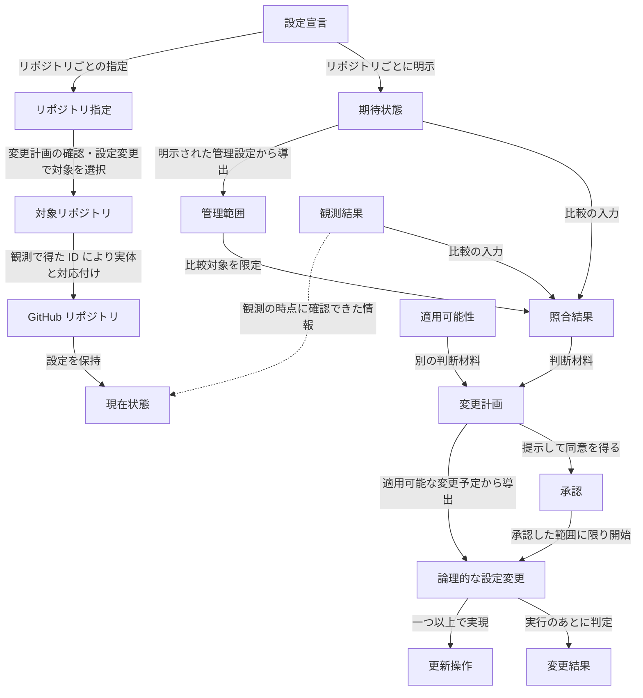

# ドメインモデル

## 1. 目的と適用範囲

本ドキュメントは、reco が GitHub リポジトリの設定を管理する際の中心概念と、その意味上の関係・区別を整理します。利用者が指定する対象と期待状態、GitHub 上の状態と観測結果、照合と変更の判断、承認と実行の結果を、実現方式に依存せず理解するためのモデルです。

システムに求める振る舞い、保証、不変条件は [要求定義](../spec/requirements.md) を正本とします。YAML・CLI の入力契約、GitHub REST API の外部契約、処理順序や更新方式は本ドキュメントで再定義しません。

## 2. ドメインの全体像

reco の管理では、「利用者が管理を意図した範囲」「GitHub 上に実際に存在する状態」「確認できた状態」「変更できるかという判断」「承認した変更がどう終わったか」を区別します。次の図は概念間の関係を簡略化したものです。処理順序、コンポーネントの依存関係、API 呼び出し順序を表すものではありません。

設定宣言と期待状態・管理範囲の関係は **リポジトリごと** に成立します。宣言に複数のリポジトリがあっても、期待状態や管理範囲をすべてのリポジトリで共有するわけではありません。利用者の操作のうち、変更計画の確認（`plan`）と設定変更（`apply`）は宣言から対象を選びますが、状態確認（`show`）は設定宣言を使わずに対象リポジトリを指定して観測します。このため、対象リポジトリが必ず設定宣言に結びつくわけではありません。

観測結果から現在状態への破線は、観測の時点に確認できた情報との関係を示し、状態全体の複製を意味しません。複数の取得操作にまたがる観測結果について、すべての値が同じ時点の原子的なスナップショットであることも保証しません。図では適用可能性の判断材料を省略しています。適用可能性は必要な観測情報、GitHub の制約、未管理設定への影響などに依存し、照合結果から自動的に導かれるものではありません。

## 3. 中心概念

### 3.1 GitHub が提供する対象と設定

| 日本語 | 英語 | 意味 |
|---|---|---|
| リポジトリ | Repository | GitHub 上に存在し、設定を保持するリポジトリ |
| リポジトリ ID | Repository ID | GitHub がリポジトリの実体に付与する識別子。所有者名とリポジトリ名による指定とは異なる |
| リポジトリ設定 | Repository Setting | GitHub がリポジトリについて提供する設定。Auto-merge の許可や Actions の実行許可範囲など |
| 設定の値 | Setting Value | 一つの設定が取る値。取り得る値と、二つの値が同じかどうかの判定は、設定ごとに決まっている。設定グループについては、項目ごとの値の組を一つの値として扱う |
| 設定の領域 | Setting Area | リポジトリ設定の区分。reco が扱うリポジトリ設定は、いずれか一つの設定の領域に属する。一回の観測で読み取る範囲を選ぶ単位になる |
| リポジトリ一般設定 | General | Pull Request の Auto-merge の許可やマージ後のブランチ自動削除など、リポジトリ全般の振る舞いに関する設定の領域 |
| Actions の実行許可 | Actions Permissions | Actions の有効状態、Actions 許可ポリシー、選択方式の Actions 許可条件など、Actions と再利用可能なワークフローを実行できる範囲に関する設定の領域 |
| Actions 許可ポリシー | Allowed Actions Policy | 許可する Actions と再利用可能なワークフローの範囲を定める上位設定 |
| 選択方式の Actions 許可条件 | Selected Actions Criteria | 上位の許可ポリシーが `selected` のときに適用される詳細な許可条件 |
| ワークフロー権限 | Workflow Permissions | ワークフローの `GITHUB_TOKEN` の既定権限と、GitHub Actions による Pull Request の作成と承認の許可からなる設定の領域 |

英語名は概念を説明するための呼称であり、すべてが GitHub 公式の用語・API フィールド名と一致するわけではありません。たとえば Selected Actions Criteria は、この文書で詳細な許可条件をまとめて指す呼称です。GitHub が提供する設定の意味と、reco が一体として管理する設定の単位は区別します。

### 3.2 操作と対象

| 日本語 | 英語 | 意味 |
|---|---|---|
| 利用者の操作 | Operation | 利用者が reco に要求する一回の実行。状態確認、変更計画の確認、設定変更の三つがある。観測操作や更新操作とは異なる |
| リポジトリ指定 | Repository Reference | 所有者名とリポジトリ名の組で、リポジトリを名前で指し示す情報。GitHub 上の実体を識別する Repository ID とは異なる |
| 対象リポジトリ | Target Repository | 一回の利用者の操作で選択されたリポジトリ。設定宣言に記載されているだけの指定とは区別する。観測のあとは、指定が指した実体の Repository ID を伴う |

### 3.3 宣言

| 日本語 | 英語 | 意味 |
|---|---|---|
| 設定宣言 | Configuration Declaration | 利用者が明示した、リポジトリごとの宣言の集まり |
| リポジトリごとの宣言 | Repository Declaration | 設定宣言の要素。一つのリポジトリ指定と、そのリポジトリの期待状態の組 |
| 管理の単位 | Management Unit | reco が期待値の宣言を受け付ける単位。単独の設定か、設定グループのいずれかである。どのリポジトリの宣言にも共通で、宣言されたかどうかによらない |
| 設定グループ | Setting Group | 意味を確定するために、複数の値を一体として期待値を宣言する管理の単位。Selected actions の3項目など |
| 管理設定 | Managed Setting | あるリポジトリについて、利用者が期待値を明示した管理の単位。期待状態の宣言、照合、変更予定の単位になる |
| 期待状態 | Desired State | リポジトリについて、管理設定に利用者が求める状態。管理設定ごとの期待値からなる |
| 期待値 | Desired Value | 一つの管理設定に明示された設定の値。`false` や空集合も期待値であり、省略とは異なる |
| 管理範囲 | Management Scope | リポジトリごとの、管理設定の集合。観測した設定や変更が必要な設定の集合とは異なる |
| 未管理設定 | Unmanaged Setting | 対象リポジトリの管理範囲に含まれない設定。宣言を省略した管理の単位と、管理の単位に含まれず宣言できない設定の両方を含む。観測や更新操作への併送の対象になっても、管理対象にはならない |

### 3.4 観測と GitHub への要求

| 日本語 | 英語 | 意味 |
|---|---|---|
| 現在状態 | Current State | GitHub 上に実際に存在する設定状態。reco が確認できた範囲と同一ではない |
| 観測 | Observation | 対象リポジトリの設定を、ある時点に GitHub から読み取って確かめること。読み取る設定の領域は観測ごとに決まる。一回の利用者の操作の中でも、時点が異なれば別の観測である |
| 観測結果 | Observation Result | 一回の観測で確認できた情報。指定が指した実体の Repository ID と、読み取った設定の領域の設定ごとの、設定の観測結果からなる。読み取らなかった設定の領域の情報は含まない |
| 観測値 | Observed Value | 一つの設定について、観測で確認できた設定の値。現在状態での値（現在値）を、その観測の時点に確認したものである |
| 観測不能 | Unavailable | 観測は成り立ったが、GitHub の取得条件により特定の設定の値を確認できないこと。理由を伴い、二つの観測不能が同じ理由によるかを判定できる。値が空であることや、観測操作の失敗とは異なる |
| 設定の観測結果 | Setting Observation | 観測結果の要素。一つの設定について、観測値か、理由を伴う観測不能のどちらか一方を持つ |
| 観測操作の失敗 | Observation Failure | 認証・権限・通信などにより観測そのものが成り立たなかったこと。観測結果に含めない |
| GitHub への要求の失敗 | Request Failure | 読み取り要求または更新要求に対して、成功の応答を契約どおりに受け取れなかったこと。原因の種類で区別する |
| 更新操作 | Update Operation | GitHub に対する個々の更新要求。一つの論理的な設定変更は複数の更新操作で実現される場合がある |
| 更新エンドポイント | Update Endpoint | GitHub が更新要求を受け付ける単位。更新操作は、いずれか一つの更新エンドポイントへ更新要求を送る。一つの更新エンドポイントが複数の設定の値を受け付ける場合がある |
| 更新操作の結果 | Update Outcome | 一つの更新操作について、GitHub の応答から判断した成功・失敗・成否不明の区別。論理的な設定変更の変更結果とは異なる |

### 3.5 計画

| 日本語 | 英語 | 意味 |
|---|---|---|
| 照合結果 | Reconciliation Result | 一つの管理設定について、期待値と観測結果を比較した、一致・不一致・比較不能の判断。比較不能は、その管理設定の設定の観測結果が観測不能のときに限って生じ、観測不能の理由を比較できない理由として伴う |
| 変更予定 | Planned Change | 照合結果が不一致または比較不能の管理設定。不一致によるものを確認済みの差分、比較不能によるものを比較不能な設定予定と呼び分ける。適用可能とは限らない |
| 適用可能性 | Applicability | 変更予定について、安全な変更に必要な条件を確認できるかという判断。適用可能か適用不能のいずれかで、適用不能は理由を伴う |
| 変更に伴う副作用 | Side Effect | 宣言された変更を実行すると、GitHub の仕様によって避けられずに生じる、未管理設定の値の消失や変化。影響を受ける設定と、その設定の計画時の設定の観測結果で表す。観測値があれば失われる値を、観測不能であれば失われる可能性だけを示す。副作用を生む変更予定に添えて提示し、承認の対象に含める |
| 管理設定の計画 | Setting Plan | リポジトリの計画の要素。一つの管理設定について、計画時の設定の観測結果、期待値、照合結果をまとめたもの。変更予定であれば、適用可能性と、変更に伴う副作用も含む |
| リポジトリの計画 | Repository Plan | 変更計画の要素。一つの対象リポジトリについて、Repository ID と、管理範囲内のすべての管理設定の計画をまとめたもの |
| 変更計画 | Change Plan | 一回の利用者の操作で選択されたすべての対象リポジトリについて、リポジトリの計画をまとめた情報。確認済みの差分、比較不能な設定予定、適用可否とその理由を表し、承認の対象になる |
| 論理的な設定変更 | Logical Change | 利用者が意図する変更内容と、完了を判断する期待状態とが対応する変更の単位。適用可能な変更予定から導く |

### 3.6 承認と実行

| 日本語 | 英語 | 意味 |
|---|---|---|
| 承認 | Approval | 提示した変更計画の対象と変更内容について、利用者が対話で与える明示的な同意。一回の設定変更の実行に限り有効で、承認した対象と変更内容だけに及ぶ |
| 変更前提 | Change Precondition | 承認した論理的な設定変更を構成する一つの更新操作を、開始してよい条件。更新操作ごとに、その直前に確かめる。対象が承認したリポジトリと同じ実体であること、関係する現在値が承認時に予定した値と同じであること、適用条件が成立すること |
| 期待状態の確認結果 | Desired State Confirmation | 更新操作のあとの観測で、論理的な設定変更の期待状態を確かめた結果。一致、不一致、確認失敗を区別し、更新操作の結果とは別に扱う。期待値と比べる設定が取得条件により観測不能で、観測できた値に期待値と異なるものがない場合は、確認失敗に当たる |
| 変更対象外の設定 | Outside Setting | ある論理的な設定変更の更新操作によって影響を受け得る設定のうち、その論理的な設定変更が変えないもの。管理設定か未管理設定かを問わない |
| 変更対象外の設定の予期しない変化 | Unexpected Outside Change | 変更対象外の設定について、更新直前の観測値と更新後の観測値が異なること。原因は断定しない |
| 変更結果 | Change Result | 論理的な設定変更ごとの完了（Completed）・失敗（Failed）・未実行（Not Attempted）の区別。変更前提の確認、更新操作の結果、期待状態の確認結果、変更対象外の設定の予期しない変化の有無から導く |

現在状態の情報源は GitHub ですが、現在状態と観測できた部分を区別する意味づけは reco のモデルに属します。これらの概念は、それぞれ独立した実装上の型を設けることを要求しません。

## 4. 重要な関係と区別

### 4.1 宣言・選択・実体の識別

対象リポジトリは操作時の選択によって決まり、設定宣言に記載されたリポジトリが常に一回の操作の対象となるわけではありません。また、リポジトリ指定は名前による参照であり、GitHub 上の実体の ID ではありません。

状態確認で利用者が操作時に与える所有者名とリポジトリ名の組も、設定宣言の要素と同じリポジトリ指定です。

宣言上の重複は名前で判定します。異なる名前が GitHub 上で同じ実体を指すかどうかは、この重複判定では扱いません。名前変更前の名前で同じ実体を参照すると、GitHub API はリダイレクト応答を返します。reco はこれに追従せず、読み取り要求なら観測操作の失敗、更新要求なら更新操作の成否不明として扱います。

名前が指す実体は、観測してはじめて分かります。対象リポジトリの Repository ID は観測結果から得られ、名前と実体の対応はその観測の時点のものです。実体の同一性は、承認後の各更新操作の直前に、承認したリポジトリと同じ ID かを確認する場面で扱います。この確認は、Repository ID が名前変更や移転で変わらず、別の実体に割り当てられないことを前提とします。

このように、「宣言されていること」「選択されていること」「同じ実体を指すこと」は別々に判断します。

| Relationship | Target | Target Type |
|---|---|---|
| `alignment` | `FR-001` | Functional Requirement |
| `alignment` | `FR-002` | Functional Requirement |
| `alignment` | `FR-010` | Functional Requirement |
| `alignment` | `INV-004` | Invariant |

### 4.2 管理の単位と管理設定

GitHub が意味を定める設定、reco が期待値の宣言を受け付ける管理の単位、更新操作の単位、GitHub が更新要求を受け付ける更新エンドポイントは、一致するとは限りません。

| 単位 | 意味 | 例 |
|---|---|---|
| GitHub の設定 | GitHub が提供する個々の設定と意味上の関係 | 上位の Actions 許可ポリシーと詳細な選択条件 |
| 管理の単位 | 独立して管理する単独の設定、または一体として期待値を定める設定グループ | Auto-merge は単独。Selected actions の3項目は一つの設定グループ |
| 更新操作 | GitHub に対する個々の更新要求 | 上位ポリシーと詳細条件は別の操作になり得る |
| 更新エンドポイント | GitHub が更新要求を受け付ける単位 | Actions 許可ポリシーと選択方式の Actions 許可条件は、同じ設定の領域に属するが、別々の更新エンドポイントで更新する |

Selected actions の `github_owned_allowed`・`verified_allowed`・`patterns_allowed` を一体として宣言するのは reco の入力契約です。このまとまりを、GitHub が原子的に更新できる単位とはみなしません。照合結果、変更予定、適用可能性は管理設定ごとに一つ定まり、設定グループの内訳ごとには定めません。

reco が扱う設定は、広い順に三つの集合をなします。reco が観測する設定、そのうち宣言を受け付ける管理の単位、そのうちあるリポジトリで期待値が明示された管理設定です。`sha_pinning_required` は、観測するものの管理の単位に含まれない設定の例で、どのリポジトリでも未管理設定です。

管理範囲は明示された期待値から導出されます。設定の省略と `false`・空集合の明示は異なり、期待値との一致が確認できた管理設定も管理範囲に残ります。管理設定か未管理設定かはリポジトリごとに決まるため、同じ管理の単位が、あるリポジトリでは管理設定、別のリポジトリでは未管理設定になります。未管理設定を観測したり、別の設定の更新に必要な既存値として送信したりしても、その設定が新たな管理対象になるわけではありません。

管理の単位の期待値が、単独では宣言できない設定の状態を含むことがあります。Actions の有効状態は単独では宣言できませんが、Actions 許可ポリシーの期待値は、そのポリシーで Actions を実行できること、つまり Actions が有効であることを含みます（[YAML 設定仕様](../spec/configuration.md) 4章）。そのため、Actions 許可ポリシーを宣言したリポジトリで Actions を有効にすることは、管理設定の変更であり、未管理設定の変更には当たりません。Actions 許可ポリシーを宣言していないリポジトリでは、Actions の有効状態は未管理設定です。

設定の領域は、更新操作の影響が及ぶ範囲を表す単位ではありません。同じ設定の領域の設定が、別々の更新エンドポイントで更新される場合があるためです。更新操作の影響が及び得る範囲は、その更新操作が更新要求を送る更新エンドポイントで決まります。観測で読み取る範囲は設定の領域で選ぶため、更新前後の観測で読み取った設定のすべてが、変更対象外の設定になるわけではありません。

二つの設定の値が同じかどうかは、設定の意味で決まります。要素の順序に意味のない設定では、順序だけが異なる二つの値は同じ値です。許可パターンがこれに当たります。この判定は、期待値と観測値を比べる照合に限らず、変更前提の確認と、変更対象外の設定の予期しない変化の検出にも使います。GitHub が応答で要素を並べ替えて返しても、設定の状態は変わっていないためです。要素の順序に意味のある設定では、順序の違いも値の違いです。

許可パターンが同じ文字列を重ねて含む場合の扱いは、[YAML 設定仕様](../spec/configuration.md) 4.2 に従います。設定グループの値は、すべての項目が同じ値のときに限り同じ値です。

同じ値と判定された二つの値でも、要素の並びまで同じとは限りません。期待値は宣言された並びを、観測値は GitHub が返した並びを保ちます。並びを揃えるのは同じ値かどうかの判定の中だけで、表示や GitHub へ送る値は保った並びを使います。

| Relationship | Target | Target Type |
|---|---|---|
| `alignment` | `FR-001` | Functional Requirement |
| `alignment` | `FR-005` | Functional Requirement |
| `alignment` | `FR-011` | Functional Requirement |
| `alignment` | `INV-001` | Invariant |

### 4.3 現在状態・観測結果・観測失敗

Current State は GitHub 上の実際の状態であり、Observation Result は一回の観測で確認できた部分を表します。管理範囲外の設定も、変更による影響を判断するために観測される場合があります。管理範囲と観測された範囲は、同じ集合ではありません。

一回の観測が読み取る設定の領域は、観測結果を使う側が決めます。状態確認は reco が観測できるすべての設定の領域を読み取り、変更計画の確認と設定変更は判断に必要な設定の領域を読み取ります。変更計画の確認で判断に必要な設定の領域は、対象リポジトリの管理範囲に含まれる管理設定が属する設定の領域です。設定変更の更新直前と更新後の観測で判断に必要な設定の領域は、変更前提で比べる関係する現在値、期待状態、比べる変更対象外の設定が属する設定の領域です。Repository ID は、名前が指す実体を確かめるために、どの観測でも読み取ります。読み取らなかった設定の領域の値は観測結果になく、これは観測不能とも観測操作の失敗とも異なります。値を確認しようとしていないためです。観測不能と同じく、`false` や空集合、既定値に補完する根拠にはなりません。

GitHub の取得条件により値を確認できないことと、認証・権限・通信などによって観測操作そのものが失敗することは異なります。前者は観測結果の中の観測不能として区別できますが、後者を正常な観測結果に含めません。いずれも、未確認値を `false` や空集合、既定値に補完する根拠にはなりません。

たとえば、Selected Actions Criteria の取得は上位ポリシーの条件に制約されます。取得できないことから、詳細の値が存在しない、または空であるとは判断できません。

観測不能は設定ごとに決まります。同じ設定の領域を読み取った一回の観測の中で、ある設定は観測値を持ち、別の設定は観測不能になります。Actions が無効のリポジトリでは、Actions の有効状態は「無効」という観測値を持ち、Actions 許可ポリシー、`sha_pinning_required`、選択方式の Actions 許可条件は観測不能です。一つの取得条件が複数の設定を観測不能にするとき、それらの設定は同じ理由を持ちます。GitHub が応答に値を含めていても、その値が設定の状態を示さないと分かっている場合は、観測値にしません。Actions が無効のときに返る `sha_pinning_required` がこれに当たります。

取得条件に当たらないと観測した直後に、GitHub がその設定の読み取りを拒否した場合は、観測不能ではなく観測操作の失敗です。Actions 許可ポリシーを `selected` と観測したあとで、選択方式の Actions 許可条件を取得できなかった場合がこれに当たります。二つの読み取りのあいだに現在状態が変わった可能性があり、どちらの時点の状態も一つの観測結果として確認できていないためです。

観測操作の失敗は、読み取り要求が GitHub への要求の失敗に終わったことを指します。失敗の種類は「GitHub への要求の失敗と更新操作の結果」で定めます。

設定変更では、同じ対象リポジトリを異なる時点に観測します。それぞれの時点の観測結果は別の情報であり、後の時点の観測結果で前の時点の観測結果を置き換えません。

| 観測の時点 | 観測結果の使い道 |
|---|---|
| 計画時の観測 | 照合と適用可能性の判断の入力になる。承認の際に提示する観測値と、承認したリポジトリの ID を与える |
| 更新直前の観測 | その更新操作の変更前提を確かめる。その更新操作が最初に影響を及ぼし得る変更対象外の設定の、更新前の値を与える |
| 更新後の観測 | 期待状態の確認結果と、変更対象外の設定の予期しない変化の有無を与える |

GitHub は、更新要求に正常応答を返したあと、すぐには取得の結果に更新を反映しないことがあります。更新後の観測は、更新が反映されたあとの状態を捉えるため、時間をおいて観測し直す場合があります。観測し直しは、更新後の観測という一つの時点の中で行います。期待状態の確認結果と変更対象外の設定の予期しない変化を与えるのは、観測し直しを打ち切った最後の観測です。それより前の観測は、更新がまだ反映されていないときの値を示している可能性があるため使いません。観測し直す条件、待つ時間と回数はアーキテクチャ設計が定めます。

更新直前の観測は更新操作ごとに、更新後の観測は論理的な設定変更ごとに行います。変更前提は更新操作ごとに確かめ、期待状態は論理的な設定変更の全体について確かめるためです。先行する論理的な設定変更の更新後の観測は、次の論理的な設定変更の更新直前の観測を兼ねません。

変更対象外の設定の更新前の値を与えるのは、その設定が影響を受け得る更新操作のうち、最初のものの直前の観測です。二つの更新操作からなる論理的な設定変更で、一つ目だけが影響を及ぼし得る設定は、一つ目の直前の観測値と更新後の観測値を比べます。二つ目の直前の観測値は、この比較に使いません。二つ目の直前を基準にすると、一つ目が起こした変化を見逃すためです。

状態確認と変更計画の確認が行うのは、計画時の観測に当たる一度の観測だけです。

| Relationship | Target | Target Type |
|---|---|---|
| `alignment` | `FR-004` | Functional Requirement |
| `alignment` | `FR-010` | Functional Requirement |
| `alignment` | `FR-012` | Functional Requirement |
| `alignment` | `QR-002` | Quality Requirement |
| `alignment` | `INV-004` | Invariant |

### 4.4 照合結果と適用可能性

| 照合結果 | 意味 |
|---|---|
| Match（一致） | 比較できた観測値が期待値と同じ値である |
| Mismatch（不一致） | 比較できた観測値と期待値が異なる |
| Not Comparable（比較不能） | GitHub の取得条件によって必要な値を確認できず、一致・不一致を判断できない |

照合は管理範囲内の管理設定について行います。管理対象外は照合結果の種類ではなく、観測操作の失敗も Not Comparable に含めません。

適用可能性は、変更予定（Mismatch または Not Comparable と判定された管理設定）について、安全な変更に必要な条件を確認できるかを表します。Mismatch でも適用不能な場合があり、Not Comparable でも必要な条件が成立すれば適用可能な場合があります。適用可能と判断したことは、将来の更新成功を保証しません。

適用可能性は変更予定にだけ定まり、変更計画に含まれる変更予定は、すべて適用可能か適用不能のいずれかに判断されています。Match と判定された管理設定には適用可能性の判断がありません。判断がないことは、適用不能を意味しません。

適用可能性の判断材料は、変更予定の計画時の設定の観測結果と期待値、および GitHub の取得と更新の制約です。Actions が無効のために Not Comparable になった Actions 許可ポリシーは、宣言したポリシーで Actions を有効にする変更として適用可能です。Actions 許可ポリシーが `selected` でないか Actions が無効であるために Not Comparable になった選択方式の Actions 許可条件も、適用可能です。この設定グループを宣言できるのは Actions 許可ポリシーを `selected` と宣言したときに限られ（[YAML 設定仕様](../spec/configuration.md) 4.1）、同じ変更計画がポリシーを `selected` にするためです。

変更に伴う副作用があることは、適用不能の理由になりません。副作用は、利用者が宣言した変更を GitHub が処理した結果として生じるもので、reco が未管理設定を変更対象に選んだ結果ではないためです。どの変更にどの副作用が伴うかは [アーキテクチャ設計](architecture.md) で定めます。

副作用が失わせる値を計画時に観測できないときも、副作用は可能性として変更予定に添えます。値を観測できないことは、副作用がないことを意味しないためです。Actions が無効のリポジトリで `selected` 以外のポリシーを宣言した場合がこれに当たります。一方、遷移先が `selected` の変更で選択方式の Actions 許可条件が宣言した値に置き換わることは、管理設定の変更であり、副作用ではありません。

| Relationship | Target | Target Type |
|---|---|---|
| `alignment` | `FR-005` | Functional Requirement |
| `alignment` | `FR-006` | Functional Requirement |
| `alignment` | `FR-007` | Functional Requirement |
| `alignment` | `INV-001` | Invariant |

### 4.5 変更計画・論理的な設定変更・変更結果

Change Plan は、実行前に把握した対象・変更予定・適用可能性を表し、実行済みの変更を意味しません。Change Plan は一回の操作で選択されたすべての対象リポジトリを含み、対象リポジトリごとの Repository Plan と、その中の管理設定ごとの Setting Plan からなります。Setting Plan は照合結果と適用可能性を別の値として保持します。期待値と一致した管理設定の Setting Plan は変更不要の確認に使い、変更予定には数えません。

変更予定が一つもない変更計画は変更不要であり、承認を求める対象がありません。適用不能な変更予定も説明のために表されますが、実行可能な変更ではありません。適用不能な変更予定を含む変更計画をどう扱うかは、要求定義の FR-008 と INV-002 が定めます。

Logical Change は、利用者が意図した変更内容と、その完了を判断する期待状態を結びつける単位です。適用可能な変更予定は、いずれか一つの論理的な設定変更に属します。管理設定と論理的な設定変更、更新操作は一対一とは限りません。たとえば、選択方式の Actions 許可条件と Actions 許可ポリシーを組み合わせて変更する場合、二つの管理設定の変更予定が一つの論理的な設定変更にまとまり、複数の更新操作がそれを構成し得ます。実際の更新順序や承認・停止条件は要求定義と CLI 仕様が規定します。

変更計画、更新操作の成否、変更後の観測結果、論理的な設定変更全体の結果も、互いに別の情報です。更新要求の応答を失った後で期待状態を観測できても、当該更新操作の成否が判明したことにはなりません。更新操作の成功だけで論理的な設定変更全体の完了を判断することもできません。

変更結果は、論理的な設定変更ごとに完了・失敗・未実行のいずれかとして扱います。完了は期待状態との一致を確認でき、変更対象外の設定の予期しない変化を検出しなかったこと、失敗は更新を開始したが完了を確認できなかったこと、未実行は更新操作を一つも開始しなかったことを表します。更新操作の成否不明は失敗に含めますが、その場合も更新操作の成否と期待状態の確認結果は区別したまま扱います。

未実行には、最初の更新操作の変更前提が成立しなかった場合と、先行する異常によって実行を止めた場合があります。後者では変更前提を確かめておらず、変更前提の不成立とは区別します。一方、先行する更新操作が成功したあとで、後続の更新操作の変更前提が成立せず開始できなかった場合は、更新をすでに開始しているため、未実行ではなく失敗です。

一つの対象リポジトリが複数の論理的な設定変更を持つときは、一つずつ順に実行し、変更結果が完了のときだけ次へ進みます。そのため、変更結果の並びは、完了が続いたあとに完了以外が高々一つあり、その後ろがすべて先行する異常による未実行、という形に限られます。

変更対象外の設定は論理的な設定変更ごとに決まり、管理範囲からは決まりません。論理的な設定変更を構成する更新操作ごとに、その更新エンドポイントで reco が観測する設定から、その論理的な設定変更が変える設定を除いたものが、変更対象外の設定です。ある論理的な設定変更の変更対象外の設定には、未管理設定のほかに、期待値と一致していた管理設定、先に完了した論理的な設定変更が変えた管理設定、後続の論理的な設定変更が変える予定の管理設定が含まれます。管理設定も比べるのは、同じ更新操作の影響を受け得る点で未管理設定と変わらないためです。更新エンドポイントごとにどの設定を観測して比べるかは [アーキテクチャ設計](architecture.md) で定めます。

承認した変更に伴う副作用として提示した変化は、変更対象外の設定の予期しない変化に数えません。利用者が承認した変化であり、予期しないものではないためです。

変更結果は論理的な設定変更にだけ定まります。管理範囲内のすべての管理設定が一致した対象リポジトリには論理的な設定変更がなく、変更結果ではなく変更不要として扱います。

| Relationship | Target | Target Type |
|---|---|---|
| `alignment` | `FR-007` | Functional Requirement |
| `alignment` | `FR-008` | Functional Requirement |
| `alignment` | `FR-011` | Functional Requirement |
| `alignment` | `FR-012` | Functional Requirement |
| `alignment` | `FR-013` | Functional Requirement |
| `alignment` | `INV-001` | Invariant |
| `alignment` | `INV-002` | Invariant |
| `alignment` | `INV-005` | Invariant |

### 4.6 GitHub への要求の失敗と更新操作の結果

読み取り要求と更新要求は、認証、権限、通信など同じ原因で失敗します。 **GitHub への要求の失敗** は、利用者が対処を選べるように原因の種類で区別します。種類は GitHub の応答から判断できる範囲にとどめ、応答だけでは決まらない原因を断定しません。

| 日本語 | 英語 | 意味 |
|---|---|---|
| 認証失敗 | Unauthorized | 認証情報が受け入れられなかった |
| 権限不足 | Forbidden | 操作が拒否された。レート制限と判断できる拒否は含めない |
| レート制限 | Rate Limited | GitHub の利用枠の超過により拒否された |
| 対象が見つからない | Not Found | GitHub が対象を見つけられないと応答した。不存在とも権限不足とも断定しない |
| 処理できない要求 | Unprocessable | GitHub が要求の内容を処理できないと応答した。値の検証の失敗とも、過剰な要求とみなされた結果とも断定しない |
| 競合 | Conflict | GitHub が、要求が対象の現在の状態と両立しないと応答した。外部主体が直前に状態を変えた結果とも、所有者による制限の結果とも断定しない |
| リダイレクト応答 | Redirect | 別の場所への転送を指示された。reco は追従しない |
| 契約外の応答 | Unexpected Response | 取得や更新の契約に適合しない応答を受けた。必要な値の欠落、解釈できない内容、想定外の応答を含む |
| 通信の失敗 | Communication Failure | 応答を最後まで受け取れなかった。接続の失敗、時間切れ、本文の受信途中の失敗、呼び出し元による中断を含む |

一方、更新要求では、失敗の種類だけでは更新操作の成否が決まりません。応答を受け取れなかった場合も、要求が GitHub に届いて処理された可能性が残るためです。そこで **更新操作の結果** を、GitHub の応答から確認できたことに応じて次の三つに分けます。

| 更新操作の結果 | 英語 | 意味 |
|---|---|---|
| 成功 | Succeeded | GitHub が更新要求を受け付けたと確認できた |
| 失敗 | Rejected | GitHub が更新要求を明示的に拒否した |
| 成否不明 | Unknown | 受け付けられたとも拒否されたとも確認できない |

成功を表すステータスの応答でも、成功を確認できなければ成功に数えません。その応答が、GitHub が更新要求を処理した結果だと確かめられないためです。失敗は GitHub が拒否を応答したことを表し、GitHub 上の状態が変わらなかったことまでは意味しません。更新操作の結果は開始した更新操作にだけ定まり、開始しなかった更新操作には結果がありません。応答のどの形をどの結果とみなすかは [アーキテクチャ設計](architecture.md) で定めます。

更新操作の結果の「失敗」は、変更結果の「失敗」と範囲が異なります。前者は GitHub による明示的な拒否だけを指し、後者は成否不明や更新後の不一致も含みます。英語名を Rejected と Failed に分けるのは、この二つを取り違えないためです。

| Relationship | Target | Target Type |
|---|---|---|
| `alignment` | `FR-004` | Functional Requirement |
| `alignment` | `FR-013` | Functional Requirement |
| `alignment` | `QR-002` | Quality Requirement |

### 4.7 承認と変更前提

承認は、提示した変更計画に対する同意であり、承認後の GitHub の状態に対する同意ではありません。承認から更新操作までのあいだに対象や現在値が変わり得るため、変更前提を各更新操作の直前に確かめます。

承認が得られない形は三つあります。拒否は、利用者が承認以外の入力を与えたか、入力が終わったか、入力を読めなかったことです。承認不能は、対話で尋ねる手段がないことです。中断は、承認を待つあいだに実行の中止を求められたことです。どの形でも更新操作を開始しません。

変更前提で関係する現在値と比べるのは、 **承認時に予定した値** です。これは、計画時に観測した内容に、承認した先行する更新操作による予定どおりの変化を反映したものです。先行する更新操作が関係する現在値を変えない場合は、計画時に観測した内容そのものになります。

変更前提が成立しない形は四つあります。同一性の不一致は、名前が指す実体が承認したリポジトリと異なることです。関係する現在値の変化は、更新直前の観測値が承認時に予定した値と異なることです。変化後の値が期待値と一致していても、承認した変更内容とは異なる状況のため、前提の不成立として扱います。適用条件の不成立は、未管理設定の既存値を維持できる条件など、その更新操作を安全に行う条件が更新直前に成り立たないことです。確認不能は、更新直前の観測操作が失敗したことです。

計画時に取得条件により観測不能だった設定では、理由を伴う観測不能が承認時に予定した値に当たります。更新直前の観測でも同じ理由で観測不能であれば、関係する現在値は変化していません。値を観測できた場合は、その値が期待値と同じでも、関係する現在値の変化です。利用者が承認したのは観測不能の状況での変更であり、値を観測できる状況は承認した変更内容と異なるためです。観測値だった設定が観測不能になった場合と、観測不能の理由が変わった場合も、関係する現在値の変化です。

何が関係する現在値に当たるかは、更新操作ごとに決まります。互いに独立して更新できる設定では、関係する現在値は、その論理的な設定変更が変える設定の現在値です。先行する論理的な設定変更が予定どおりに変えた別の設定の値は、関係する現在値に含めません。一つの論理的な設定変更が複数の更新操作からなるときは、先行する更新操作が変えた設定が、後続の更新操作の関係する現在値になる場合があります。承認した変更に伴う副作用として、失われる値や変わる値を観測して提示した設定も、その副作用を生む更新操作の関係する現在値に含めます。提示した値と更新直前の観測値が異なるまま更新すると、利用者に示していない値を失わせるためです。

| Relationship | Target | Target Type |
|---|---|---|
| `alignment` | `FR-009` | Functional Requirement |
| `alignment` | `FR-010` | Functional Requirement |
| `alignment` | `INV-001` | Invariant |
| `alignment` | `INV-003` | Invariant |
| `alignment` | `INV-004` | Invariant |

### 4.8 概念が属する文脈

中心概念は、答える問いの異なる四つの文脈に分かれます。文脈は語の意味が通用する範囲であり、処理の順序や Go の package の区切りを定めるものではありません。論理構成と package の分け方は [アーキテクチャ設計](architecture.md) で定めます。

| 文脈 | 答える問い | 属する概念 |
|---|---|---|
| 宣言 | 利用者はどのリポジトリの何を、どの状態にしたいか | 設定宣言、リポジトリごとの宣言、管理の単位、設定グループ、管理設定、期待状態、期待値、管理範囲、未管理設定 |
| 観測と GitHub への要求 | GitHub について何を確認でき、個々の要求はどう終わったか | 現在状態、観測、観測結果、設定の観測結果、観測値、観測不能、観測操作の失敗、GitHub への要求の失敗、更新操作、更新エンドポイント、更新操作の結果 |
| 計画 | どこが期待状態と異なり、安全に変更できるか | 対象リポジトリの選択、照合結果、変更予定、適用可能性、変更に伴う副作用、変更計画、論理的な設定変更 |
| 承認と実行 | 承認した変更を開始してよいか、どう終わったか | 承認、変更前提、期待状態の確認結果、変更対象外の設定、変更対象外の設定の予期しない変化、変更結果 |

リポジトリ指定、Repository ID、どの設定や設定の領域を指すかの識別、設定の値は、四つの文脈が同じ意味で共有します。どれも対象と設定を指し示し、値を表すための語であり、どの文脈の判断も含まないためです。期待値と観測値は別の文脈の概念ですが、どちらも設定の値であり、同じ設定については同じ取り得る値から選ばれます。計画はこれを前提に両者を照合し、承認と実行は観測値どうしや、観測値と期待値を比べます。

共有するのは、取り得る値、値の表現、値が同じかどうかの判定までです。YAML の表記をどう受け付けるかは宣言の文脈が、定義にない値を GitHub から受け取ったときの扱いは観測と GitHub への要求の文脈が決めます。宣言の文脈と、観測と GitHub への要求の文脈は、互いの概念を使いません。宣言は GitHub 上の実在や現在値を知らず、観測は管理範囲を知らないためです。計画はこの二つを突き合わせます。承認と実行は、計画の結果に加えて、観測と GitHub への要求の文脈の観測結果、更新操作、更新操作の結果を使い、設定宣言は読み直しません。状態確認は、観測と GitHub への要求の文脈だけで成り立ちます。

次の語は、文脈によって意味が変わります。文脈を示さずに使うと取り違えるため、どの文脈の語かが分かる形で書きます。

| 語 | 文脈ごとの意味 |
|---|---|
| 値がないこと | 宣言では、期待値の省略であり、その設定が未管理設定であることを表す。観測では、観測不能、観測操作の失敗、その設定の領域を読み取らなかったことのいずれかであり、どれも値が空であることを表さない |
| 設定の領域（General など） | どの領域を指すかは文脈によって変わらない。変わるのは領域に含める設定である。宣言では、期待値を明示した管理設定だけを含む。観測では、reco が観測する設定をすべて含み、未管理設定の観測値も含む |
| 一致 | 計画では、計画時の観測値と期待値の一致であり、変更予定にならないことを表す。承認と実行では、更新後の観測値と期待値の一致であり、完了の条件の一つにとどまる |
| 失敗 | 観測と GitHub への要求では、要求の失敗、観測操作の失敗、更新操作の結果の失敗（明示的な拒否）を指す。承認と実行では、変更結果の失敗を指す |

CLI の表示区分（`updated`、`unavailable` など）は、これらの概念を利用者へ示すための表現であり、文脈には数えません。表示区分と概念の対応は [CLI 仕様](../spec/cli.md) で定めます。

## 5. シナリオと反例

以下は概念の意味を確認する例です。独立した入力条件や実行規則を定義するものではありません。

| 状況 | 解釈 | 誤った解釈 |
|---|---|---|
| 状態確認で、設定宣言を使わずにリポジトリを観測 | 対象リポジトリと観測結果は存在する | 対象は必ず設定宣言から選ばれる |
| `allow_auto_merge: false` を宣言し、観測値も `false` | 管理範囲内で Match。更新は不要 | 更新不要なので管理対象外 |
| 未管理設定（例：`sha_pinning_required`）を観測 | 管理範囲外の値も観測対象になり得る | 観測した値は自動的に管理対象に入る |
| あるリポジトリでは `delete_branch_on_merge` を宣言し、別のリポジトリでは省略 | 同じ管理の単位が前者では管理設定、後者では未管理設定 | 一度宣言した設定はどのリポジトリでも管理対象 |
| Actions が無効のリポジトリで、Actions 許可ポリシーを宣言した | Actions 許可ポリシーの期待値は Actions が有効であることを含む。有効にすることは管理設定の変更である | Actions の有効状態は宣言できない未管理設定なので、有効にできず適用不能 |
| 宣言した許可パターンと観測した許可パターンが、要素の順序だけ異なる | 同じ値であり Match | 並びが違うので Mismatch |
| 許可パターンの更新直前と更新後の観測値が、要素の順序だけ異なる | 同じ値であり、変更対象外の設定の予期しない変化ではない | 並びが違うので予期しない変化 |
| Selected actions の詳細を上位ポリシーの条件により取得できない | 観測不能であり、照合時には Not Comparable になり得る | 値が空、または観測操作が失敗したと決めつける |
| Actions が無効のリポジトリを観測し、応答の `sha_pinning_required` が `false` だった | 観測不能。無効のあいだの応答は保存された値を示さない。Actions の有効状態は観測値を持つ | 応答にあるので `false` を観測値とする |
| Actions 許可ポリシーを `selected` と観測した直後に、選択方式の Actions 許可条件の取得を GitHub が競合として拒否した | 観測操作の失敗。二つの読み取りのあいだにポリシーが変わった可能性がある | 取得条件による観測不能として表示や照合へ進む |
| Actions の実行許可を読み取らない観測の結果に、Actions 許可ポリシーがない | 読み取らなかった設定の領域であり、観測不能ではない。理由も持たない | Actions が無効で観測不能だったとみなす |
| Mismatch だが安全な変更に必要な条件を確認できない | 不一致と適用不能は併存する | 不一致なら更新可能 |
| Match と判定された管理設定に、適用可能性の判断がない | 変更予定ではないため判断の対象外 | 判断がないので適用不能 |
| Actions 許可ポリシーを `selected` から `all` へ変えると宣言し、既存の選択方式の Actions 許可条件が失われる | 変更に伴う副作用。適用可能で、失われる値を変更予定に添えて承認の対象にする | 未管理設定が失われるので適用不能 |
| Actions 許可ポリシーを `all` から `local_only` へ変えると宣言した | 副作用はない。失われる選択方式の Actions 許可条件が現在状態にない | ポリシーを変えるので、常に許可条件の消失を副作用として示す |
| Actions が無効のリポジトリで、Actions 許可ポリシーを `all` と宣言した | Not Comparable で適用可能。無効にする前のポリシーが `selected` なら許可条件が失われ得るため、可能性を副作用として添える | 値を観測できないので副作用はない |
| Actions 許可ポリシーを `all` から `selected` へ変え、選択方式の Actions 許可条件を宣言した | ポリシーは Mismatch、許可条件は Not Comparable で、理由はポリシーが `selected` でないこと。どちらも適用可能。許可条件が宣言した値になることは管理設定の変更 | 許可条件を取得できないので適用不能。または、既存の値を上書きするので副作用 |
| 上の変更を承認して実行したあと、選択方式の Actions 許可条件を取得できなくなった | 承認した副作用であり、変更対象外の設定の予期しない変化に数えない。値は失われたものとして扱う | 更新直前と異なるので、予期しない変化で失敗 |
| 選択した2件の対象リポジトリのうち、1件に適用不能な変更予定がある | 変更計画の全体が承認の対象にならず、どちらも更新しない | 適用可能な対象リポジトリだけを承認して更新できる |
| 更新要求の応答を失った後、期待状態に一致する値を観測 | 更新後の観測と更新操作の成否は別の情報 | 更新操作の成功が確認できた |
| 更新要求に成功を表す応答が返り始めたが、本文を最後まで受け取れなかった | 更新操作の結果は成否不明 | 成功を表す応答が届いたので更新操作は成功した |
| 更新要求に `2xx` の応答が返ったが、その更新エンドポイントの正常応答とは異なるステータスだった | 更新操作の結果は成否不明。GitHub が更新要求を処理した応答だと確かめられない | `2xx` なので更新操作は成功した |
| 承認後、更新直前の観測で現在値がすでに期待値と一致していた | 関係する現在値が承認時に予定した値から変化しており、変更前提は不成立。変更結果は未実行 | 期待状態と一致しているので完了 |
| 更新操作に併送する未管理設定の既存値が、更新直前の観測では取得条件により観測不能だった | 適用条件の不成立で、変更前提は不成立。変更結果は未実行 | 計画時の観測値を併送すればよい |
| Actions が無効のリポジトリで Actions 許可ポリシーの変更を承認し、更新直前の観測では Actions が有効になっていた | 承認時に予定した値は観測不能であり、値を観測できたことは関係する現在値の変化。変更前提は不成立で、変更結果は未実行 | 計画時に観測値がなく比べるものがないので、変更前提は成立する |
| Actions 許可ポリシーを `selected` から `all` へ変える変更を承認し、更新直前の選択方式の Actions 許可条件が、承認の前に示した値と異なっていた | 副作用として失われる値も関係する現在値であり、変更前提は不成立。変更結果は未実行 | 変えるのは Actions 許可ポリシーだけなので、変更前提は成立する |
| 二つの更新操作からなる論理的な設定変更で、二つ目の直前の観測で、一つ目が変えた設定が予定どおりの値になっていた | 承認時に予定した値と同じであり、二つ目の変更前提は成立する | 計画時の観測値と異なるので、変更前提は不成立 |
| 二つの更新操作からなる論理的な設定変更で、一つ目が成功したあと、二つ目の変更前提が成立しなかった | 更新を開始しているため、変更結果は失敗。完了した更新操作と開始しなかった更新操作を区別する | 二つ目を開始しなかったので未実行 |
| ワークフロー権限の片方だけを管理し、もう一方を送らずに更新した | 送らなかったもう一方も、同じ更新操作の影響を受け得る未管理設定である。更新直前と更新後の観測値を比べる | 送っていない設定は更新操作の影響を受けないので、比べなくてよい |
| ワークフロー権限の更新の前後で、同じ観測で読み取ったリポジトリ一般設定の値が変わった | その論理的な設定変更の変更対象外の設定ではなく、比べない。更新要求を送った更新エンドポイントの設定ではないため | 更新前後の観測で読み取った設定は、すべて比べる |
| Actions が無効のリポジトリで、ワークフロー権限の値が返った | 観測値であり、照合に使う。取得条件は設定ごとに異なる | Selected Actions Criteria と同じく、Actions が無効なら観測不能とする |
| ワークフロー権限を読み取らない観測の結果に、ワークフロー権限の観測値がない | 読み取らなかった設定の領域であり、観測不能でも観測操作の失敗でもない。値について何も分からない | 観測値がないので `false` や `read` とみなす |
| パイプから承認文字列が与えられた | 対話で尋ねる手段がなく承認不能 | 承認文字列を読めたので承認 |
| 更新操作が成功し期待状態も一致したが、未管理設定の値が更新直前と異なる | 変更結果は失敗。原因は断定しない | 期待状態が一致したので完了 |
| 2設定とも宣言し、`delete_branch_on_merge` だけを更新した前後で、一致していた `allow_auto_merge` の値が変わった | 変更対象外の設定の予期しない変化。変更結果は失敗 | `allow_auto_merge` は未管理設定ではないので比べない |
| 一つ目の論理的な設定変更の更新の前後で、二つ目が変える予定の設定が期待値に変わった | 一つ目は変更対象外の設定の予期しない変化で失敗し、二つ目は未実行 | 期待値になったので、二つ目は完了 |
| 一つ目の論理的な設定変更が完了し、二つ目の更新直前の観測で、一つ目が変えた設定の値が計画時と異なる | 予定どおりの変化で、二つ目の関係する現在値ではない。変更前提は成立する | 計画時の観測値と異なるので、変更前提は不成立 |
| 一つ目の論理的な設定変更が失敗し、二つ目を開始しなかった | 二つ目は未実行。理由は先行する異常による停止で、変更前提は確かめていない | 二つ目は変更前提の不成立 |
| 更新要求に成功の応答が返ったが、観測し直しても更新後の観測値が更新前のままだった | 更新操作は成功、期待状態の確認結果は不一致で、変更結果は失敗。既知の原因の候補は可能性として示すが、断定しない | 成功の応答が返ったので期待状態に達した。または、候補の原因に当たると決めつける |
| 更新要求に成功の応答が返り、最初の更新後の観測値は更新前のままだったが、観測し直すと期待値だった | 期待状態の確認結果は一致。GitHub の反映が遅れただけで、最初の観測は確認結果を与えない | 最初の観測で不一致だったので失敗 |
| 更新要求に成功の応答が返ったが、観測し直しても Actions が無効で、Actions 許可ポリシーが観測不能だった | 期待状態の確認結果は確認失敗で、変更結果は失敗。値を確認できていないため、不一致ではない | 期待値を観測できなかったので不一致。または、成功の応答が返ったので完了 |
| GitHub が更新要求を明示的に拒否した | 更新操作の結果は失敗（Rejected）で、変更結果も失敗（Failed）。二つは別の区別 | 変更結果が失敗なら、更新操作は必ず拒否されている |
| 権限の不足により、GitHub が設定の値を応答に含めなかった | 観測操作の失敗。照合へ進まない | 取得条件による観測不能として Not Comparable にする |

## 6. References

- [要求定義](../spec/requirements.md)
- [CLI 仕様](../spec/cli.md)
- [YAML 設定仕様](../spec/configuration.md)
- [アーキテクチャ設計](architecture.md)
