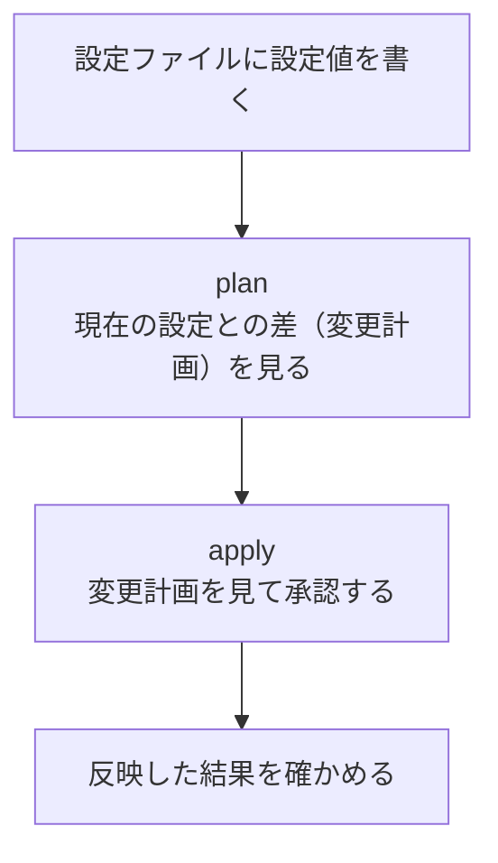

# Overview

reco（Repository Configurator）は、GitHub リポジトリの設定値を YAML の設定ファイルに書き、GitHub 上の現在の設定との差を示して、利用者の承認を得てから設定を変える CLI です。

## reco が解決する問題

GitHub の機能やセキュリティの設定は変わり続けます。多数のリポジトリを持つと、どのリポジトリでどの設定が有効になっているかを覚えておくことも、設定画面を一つずつ開いて確かめ続けることも難しくなり、直すべき設定を見落としやすくなります。

reco を使うと、個々のリポジトリの設定を覚えていなくても、設定ファイルを読めば各リポジトリで意図した設定値が分かり、`plan` を実行すれば今の設定がそこからずれていないかを確かめられます。

## 基本の流れ

設定ファイルには、管理したいリポジトリと、そのリポジトリで管理したい設定の値だけを書きます。次の例は、一つのリポジトリで、マージ後の head ブランチの自動削除を有効にしたいという設定です。

```yaml
repositories:
  - name: example/project-a
    general:
      delete_branch_on_merge: true
```

設定ファイルを書いてから適用するまでの流れは次のとおりです。



- **`plan`**：設定ファイルと GitHub 上の現在の設定を比べ、変更計画を表示する。GitHub の設定は変えない
- **`apply`**：変更計画を作り直して表示し、承認を求める。承認されたら、設定ファイルに書いた順にリポジトリを更新し、更新後の設定が設定ファイルのとおりになったことを確かめて結果を示す
- **`show`**：設定ファイルを使わずに、一つのリポジトリの現在の設定を表示する。設定ファイルを書く前に今の値を確かめるときに使う

## 始め方

1. [Installation](installation.md) に従って、reco をインストールする
2. [Getting Started](getting-started.md) に従って、reco を実行する
3. [Configuration](configuration.md) に従って、リポジトリ設定を記述する

## 管理できる設定

reco が管理可能な設定は、次のとおりです。具体的な設定方法は [Configuration](configuration.md) にあります。

| reco で設定できること | GitHub の設定画面の項目 |
|---|---|
| マージ後に head ブランチを自動で削除するか | 「General」ページの「Pull Requests」の欄の「Automatically delete head branches」 |
| 自動マージを許可するか | 「General」ページの「Pull Requests」の欄の「Allow auto-merge」 |
| Pull Request を squash merge でマージできるようにするか | 「General」ページの「Pull Requests」の欄の「Allow squash merging」 |
| Pull Request を merge commit でマージできるようにするか | 「General」ページの「Pull Requests」の欄の「Allow merge commits」 |
| Pull Request を rebase merge でマージできるようにするか | 「General」ページの「Pull Requests」の欄の「Allow rebase merging」 |
| base ブランチより遅れた Pull Request に、ブランチの更新を常に提案するか | 「General」ページの「Pull Requests」の欄の「Always suggest updating pull request branches」 |
| Actions を有効にするか、無効にするか | 「Actions」の「General」ページの「Actions permissions」の欄 |
| 実行を許可する Actions と再利用可能なワークフローの範囲（すべて、ローカルのものだけ、選んだものだけ） | 「Actions」の「General」ページの「Actions permissions」の欄。選んだものだけを許可する選択肢は「Allow *OWNER*, and select non-*OWNER*, actions and reusable workflows」 |
| 選んだものだけを許可するときに、GitHub が作った Actions を許可するか | 「Allow actions created by GitHub」 |
| 選んだものだけを許可するときに、Marketplace の認証済み作成者の Actions を許可するか | 「Allow actions by Marketplace verified creators」 |
| 選んだものだけを許可するときに、個別に許可する Actions と再利用可能なワークフロー | 「Allow or block specified actions and reusable workflows」 |
| Actions を完全な長さのコミット SHA に固定することを必須にするか | 「Actions」の「General」ページの「Actions permissions」の欄の「Require actions to be pinned to a full-length commit SHA」 |
| `GITHUB_TOKEN` のデフォルト権限を、読み書きにするか、読み取りに限るか | 「Actions」の「General」ページの「Workflow permissions」の欄 |
| GitHub Actions に Pull Request の作成と承認を許すか | 「Actions」の「General」ページの「Workflow permissions」の欄の「Allow GitHub Actions to create and approve pull requests」 |
| ほかのリポジトリのワークフローに、このリポジトリの Actions と再利用可能なワークフローを使わせるか（プライベートリポジトリだけ） | 「Actions」の「General」ページの「Access」の欄 |
| ワークフローから読む Repository Variables の名前と値 | 「Secrets and variables」の「Actions」ページの「Variables」タブ |
| デプロイ先の Environment があるか（なければ作成する） | 「Environments」ページの Environment の一覧 |
| Environment へデプロイできるブランチとタグを、制限しないか、保護ルールのあるブランチに限るか、選んだパターンに限るか | 「Environments」ページの Environment の「Deployment branches and tags」の欄の「No restriction」、「Protected branches only」、「Selected branches and tags」 |
| 選んだパターンに限るときに、デプロイを許可するブランチとタグのパターン | 「Selected branches and tags」で追加するパターンの一覧 |
| その Environment を使うジョブから読む Environment Variables の名前と値（Environment がなければ作成する） | 「Environments」ページの Environment の「Environment variables」の欄 |
| 依存関係の脆弱性を Dependabot alerts で知らせるか | 「Dependabot alerts」の項目 |
| 脆弱性を直す Pull Request を Dependabot security updates に作らせるか | 「Dependabot security updates」の項目 |
| リポジトリに push されたシークレットを Secret scanning で検出するか（公開リポジトリだけ） | 「Advanced Security」ページの「Secret Protection」の項目 |
| シークレットを含む push をリポジトリで拒否するか（公開リポジトリだけ） | 「Advanced Security」ページの「Secret Protection」の欄の「Push protection」の項目 |
| 見つけた脆弱性を、公開せずにメンテナーへ報告できるようにするか（公開リポジトリだけ） | 「Advanced Security」ページの「Private vulnerability reporting」の項目 |
