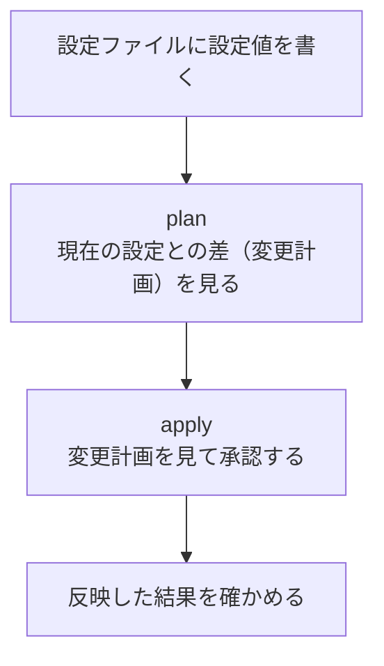

# reco の概要

reco（Repository Configurator）は、GitHub リポジトリの設定値を YAML の設定ファイルに書き、GitHub 上の現在の設定との差を示して、利用者の承認を得てから設定を変える CLI です。

## reco が解決する問題

GitHub の機能やセキュリティの設定は変わり続けます。多数のリポジトリを持つと、どのリポジトリでどの設定が有効になっているかを覚えておくことも、設定画面を一つずつ開いて確かめ続けることも難しくなり、直すべき設定を見落としやすくなります。

reco を使うと、個々のリポジトリの設定を覚えていなくても、設定ファイルを読めば各リポジトリで意図した設定値が分かり、`plan` を実行すれば今の設定がそこからずれていないかを確かめられます。

## 基本の流れ

設定ファイルには、管理したいリポジトリと、そのリポジトリで管理したい設定の値だけを書きます。次の例は、一つのリポジトリで、マージ後の head ブランチの自動削除を有効にしたいという設定です。

```yaml
repositories:
  - name: example/project-a
    general:
      delete_branch_on_merge: true
```

設定ファイルを書いてから適用するまでの流れは次のとおりです。



- **`plan`**：設定ファイルと GitHub 上の現在の設定を比べ、変更計画を表示する。GitHub の設定は変えない
- **`apply`**：変更計画を作り直して表示し、承認を求める。承認されたら、設定ファイルに書いた順にリポジトリを更新し、更新後の設定が設定ファイルのとおりになったことを確かめて結果を示す
- **`show`**：設定ファイルを使わずに、一つのリポジトリの現在の設定を表示する。設定ファイルを書く前に今の値を確かめるときに使う

## 管理できる設定

reco が管理できるのは、次の表の設定です。表にない設定（マージコミット、squash マージ、rebase マージの許可や、ブランチの保護など）は扱えません。

| reco で設定できること | GitHub の設定画面の項目 |
|---|---|
| マージ後に head ブランチを自動で削除するか | 「General」ページの「Pull Requests」の欄の「Automatically delete head branches」 |
| 自動マージを許可するか | 「General」ページの「Pull Requests」の欄の「Allow auto-merge」 |
| Actions を有効にするか、無効にするか | 「Actions」の「General」ページの「Actions permissions」の欄 |
| 実行を許可する Actions と再利用可能なワークフローの範囲（すべて、ローカルのものだけ、選んだものだけ） | 「Actions」の「General」ページの「Actions permissions」の欄。選んだものだけを許可する選択肢は「Allow *OWNER*, and select non-*OWNER*, actions and reusable workflows」 |
| 選んだものだけを許可するときに、GitHub が作った Actions を許可するか | 「Allow actions created by GitHub」 |
| 選んだものだけを許可するときに、Marketplace の認証済み作成者の Actions を許可するか | 「Allow actions by Marketplace verified creators」 |
| 選んだものだけを許可するときに、個別に許可する Actions と再利用可能なワークフロー | 「Allow or block specified actions and reusable workflows」 |
| `GITHUB_TOKEN` の既定の権限を、読み書きにするか、読み取りに限るか | 「Actions」の「General」ページの「Workflow permissions」の欄 |
| GitHub Actions に Pull Request の作成と承認を許すか | 「Actions」の「General」ページの「Workflow permissions」の欄の「Allow GitHub Actions to create and approve pull requests」 |

Actions の有効と無効を切り替える設定（設定ファイルの `enabled`）は、現在は `plan` で差を確かめられるだけで、`apply` では変えられません。設定ファイルでの書き方は [設定ファイルの書き方](configuration.md) にあります。

## 設定を変えるときの安全性

reco は、設定を変えるときに次のように動きます。

- **書いていない設定を変えない**：変更の対象は、設定ファイルに書いた設定だけである。GitHub の仕様により書いていない値が消えると分かっている変更では、そのことを変更計画に示してから承認を求める
- **承認するまで変えない**：`apply` は変更計画を示して承認を待ち、承認した内容だけを実行する
- **トークンを表に出さない**：トークンを保存せず、出力やエラーに表示しない

一方、`apply` が途中で止まっても、すでに反映した変更は自動では元に戻りません。reco は、更新の失敗などを見つけると残りの更新を始めずに止まります。止まったときは、出力を見てどこまで反映されたかを確かめます。reco が安全を保つ仕組みは [reco の安全性](safety.md) にあります。

## 始め方

reco を入れる手順は [インストール](installation.md) に、トークンの用意は [トークンの用意](authentication.md) に、一つのリポジトリの一つの設定で `show`、`plan`、`apply` を試す手順は [はじめての適用](getting-started.md) にあります。

## References

- [Constitution](../CONSTITUTION.md)：reco が解決する問題と提供する価値、目的としないこと
- [要求定義](../spec/requirements.md)：安全性に関わる動作の全条件（5章の不変条件、FR-003、FR-012、FR-013、QR-001）
- [CLI 仕様](../spec/cli.md)：コマンドの役割（2.1節）、承認（5.1節）
- [YAML 設定仕様](../spec/configuration.md)：管理できる設定と許容値
- [GitHub リポジトリ API 仕様](../research/repositories.md)：一般設定に当たる設定画面の項目名（4章）
- [GitHub Actions 権限 API 仕様](../research/actions-permissions.md)：Actions の設定に当たる設定画面の項目名（3.2節、4章、5.2節）
